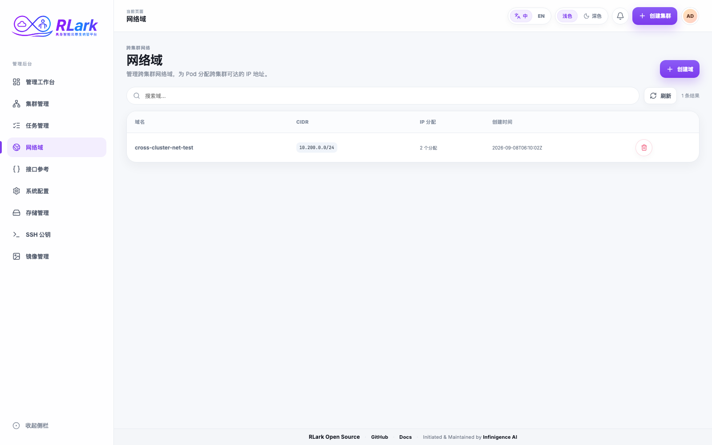

# Networking and Security

## Managing Network Domains

A Domain groups virtual addresses and scopes cross-cluster forwarding. Each Domain has a CIDR range for IP allocation. It is not an isolation boundary for the underlying infrastructure or ordinary Kubernetes networking.

### Creating a Domain

> **Screenshot note:** Screenshots are from an example environment. Resource names and data are illustrative; your environment will differ.



- Administrator Console → Domain Management → Create Domain
- Enter a unique name and CIDR range (e.g., `10.200.0.0/24`)
- The Domain CRD is created in kcp
- DomainPeer resources are automatically created for cross-cluster connectivity

### Inspecting IP Allocations
- Domain details show allocated IPs and their associated Pods
- Verify IP ranges don't overlap between Domains
- Cross-cluster Pods communicate via Domain IPs through SSH tunnels

### Deleting a Domain
- Verify no active Jobs reference the Domain
- Delete the Domain CRD
- DomainPeer resources are garbage collected

### Using the API
```bash
# Create Domain
kubectl apply -f domain.yaml

# List Domains
kubectl get domains -A

# Delete Domain
kubectl delete domain <name>
```

## Cross-Cluster Network Architecture

```
Client Pod (cluster-B)                    Server Pod (cluster-A)
  ├── wget → Domain IP (10.200.0.x)        ├── nc -l -p 8000
  ├── gVisor netstack intercepts           │
  ├── TUN device → NodeServer socket       │
  └── NodeServer → SSH tunnel → ──────────→ Proxy → localhost:8000
```

Routing is decided per connection by the node agent:

- **Same cluster** — when the target Pod reports the same `globalNamespace` and `--enable-same-cluster-direct` is on (default), the node agent dials the target Pod's real address directly on port `5700`.
- **Cross cluster** — otherwise the connection is relayed through the control-plane server's SSH endpoint (port `2222`) as a `direct-tcpip` channel. The server verifies the Domain certificate and confirms that the requested address actually belongs to that Domain's `DomainPeer` before opening the channel.

!!! warning "`--enable-cross-cluster-direct` is not implemented"
    The agent flag `--enable-cross-cluster-direct` is accepted and defaults to `true`, but the direct cross-cluster path is not implemented. Cross-cluster traffic always uses the SSH relay regardless of this flag. Do not rely on it for capacity or latency planning.

### Relay connection admission and cleanup

The SSH relay defaults to 64 pending `direct-tcpip` upstream opens per SSH connection (`--ssh-max-pending-targets`). Established channels do not consume this budget. When all slots are occupied, an open waits up to five seconds (`--ssh-admission-wait-timeout`) for a slot before rejection. Waiting, route authorization and the upstream dial share a 30-second context budget. The same pending-open limit bounds additional waiting callers; when that wait queue is also full, excess opens are rejected immediately. Both configuration values must be positive and are startup-only. Raising the limit increases per-connection resource use; queued opens do not start route lookup or target dialing until admitted. No FIFO ordering is guaranteed.

Budget/wait-queue exhaustion returns SSH `ResourceShortage`; upstream failures and recognized context/API timeouts return `ConnectionFailed`. Permission denials and invalid requests retain `Prohibited`; other unclassified route errors retain that existing code. These codes distinguish capacity/connection failure from policy rejection, but do not add automatic retries or prove that no final target connection was attempted. A failed channel does not by itself close the shared SSH connection.

SSH rejection diagnostics are logged at info level with a bounded reason, rejection code, session ID and pending/waiting counts. Logs are rate-limited per SSH connection to one entry per second with a burst of five (also shared with rejection-send error logs); rejection still occurs when a log is suppressed. The diagnostic does not include the certificate, connection header or client payload.

Acceptance follows a successful upstream `Dial`, but the existing RemoteDialer protocol returns after opening a logical stream and sending its connection header. It does **not** acknowledge the final Agent-side TCP connection. A target failure beyond that hop can still appear as EOF after channel acceptance; do not treat EOF as proof that no target connection was attempted or replay non-repeatable requests automatically.

The 30-second budget is a context deadline, not a hard wall-clock guarantee: the pinned smux `OpenStream` API does not accept a context and can wait for its own transport-write timeout before cancellation is observed. Cancellation interrupts subsequent connection-header writes without retiring the shared transport.

RemoteDialer admits at most 128 pending incoming connection headers/target dials per session, excluding its control stream and established relays. Excess streams close without starting a target dial; at most eight rejection workers may read a header for up to one second before closing. Header reads and target dials each have a one-minute limit; these are separate budgets, not one end-to-end deadline. The wire format is unchanged, and a closed stream is not a typed target-refusal acknowledgment.

RemoteDialer capacity rejections also emit info-level diagnostics (`pending_admission_full` or `rejection_workers_full`) with the session key and capacity counts, rate-limited per serving session to one entry per second with a burst of five. These logs do not include connection headers or target addresses. This does not change RemoteDialer's existing refusal mechanism or resolve the immediate-FIN registration race when its rejection workers are full.

Session cancellation closes the multiplexed transport, closes each stream's target connection to interrupt idle reads, and joins its stream/control workers. An individual copy ending retains the existing 60-second opposite-direction drain budget; the current smux supports write-side half-close, so cleanup must not discard a pending response merely because the peer finished writing. Active sibling streams remain usable when an individual stream ends. This cleanup does not introduce graceful Agent transport retention or a rollout continuity guarantee. The SSH `RelayStreams` path retains its existing half-close behavior and has no forced-close fallback for streams without deadlines.

## Protocol Support

The sidecar intercepts traffic with a TUN device and a gVisor netstack that registers IPv4 only. Supported protocols are therefore narrower than a normal Pod network.

| Protocol | Status | Notes |
| ---------- | -------- | ------- |
| TCP | Supported | The connection is terminated locally by netstack and the payload is relayed to the peer sidecar's proxy on port `5700`. |
| UDP | Supported | Datagrams are framed as `[2-byte big-endian length][payload]` and multiplexed over the same relay stream. The receiving proxy re-emits them with a real UDP socket. |
| ICMP (IPv4) | Echo only | The proxy uses a raw `ip4:icmp` socket, which requires `CAP_NET_RAW`. Only Echo Reply (type `0`) is relayed back. `ping` works; `traceroute` and ICMP error reporting (Destination Unreachable, TTL Exceeded, Fragmentation Needed) do **not**. |
| IPv6 | Not supported | The netstack registers `ipv4.NewProtocol` only. Use IPv4 Domain CIDRs. |
| SCTP, raw IP, other L4 | Not supported | Packets are dropped silently. |

Additional constraints:

- The virtual address is installed inside the netstack with a fixed `/24` prefix, independent of the Domain CIDR you configured. Plan Domain CIDRs as `/24` or smaller to avoid surprising on-link/off-link behavior.
- There is no virtual DNS server. Pod names resolve only through the synchronized `/etc/hosts` file (see `--sidecar-hosts-sync-enabled`). Any resolver that bypasses `/etc/hosts`, such as a Go program built with the pure-Go resolver forced to DNS, will not see peer Pod names.
- Because ICMP errors are not relayed, a failed cross-cluster connection surfaces as a timeout or a plain connection error rather than an ICMP diagnostic.

## MTU Tuning

The TUN device MTU is set with `--sidecar-tun-mtu` (default `1500`). The same value is applied to the Linux TUN link and to the gVisor channel endpoint, and it sizes the per-packet read buffer.

Guidance:

- **Underlay MTU does not need to match.** Netstack terminates the application's TCP connection inside the sidecar and relays the payload over a separate TCP/SSH stream. The underlay path therefore performs its own segmentation, and a smaller underlay MTU does not fragment the application flow.
- **The TUN MTU bounds the MSS offered to the application.** Lowering it reduces per-segment efficiency inside the Pod but does not change relay behavior. There is rarely a reason to lower it.
- **Keep UDP datagrams below the MTU.** Larger datagrams depend on IPv4 fragmentation and reassembly inside netstack; staying under the MTU gives predictable behavior.
- **ICMP Echo payloads are capped by a fixed 1500-byte proxy read buffer.** Replies to `ping -s` with a payload larger than roughly 1472 bytes are not relayed, regardless of the configured MTU.
- **Changing the MTU requires recreating the Pod.** The sidecar is injected as an init container; the flag cannot be changed in place.
- Set the same value across all clusters that share a Domain. Mismatched values are tolerated by TCP but can silently drop large UDP datagrams in one direction.

## Troubleshooting Cross-Cluster Connectivity

### Metrics

The sidecar exposes Prometheus metrics and pprof on `--sidecar-metrics-listen` (default `:5790`); set it to an empty value to disable. The node agent exposes NodeServer metrics on its own metrics endpoint.

| Metric | Labels | Meaning |
| -------- | -------- | --------- |
| `rlark_sidecar_tun_packets_total` | `direction=tx\|rx` | Packets crossing the TUN device. No `tx` growth means traffic never reached `gnet0`. |
| `rlark_sidecar_proxy_connections_total` | `protocol=tcp\|udp\|icmp` | Inbound connections accepted by the peer-facing proxy. |
| `rlark_sidecar_proxy_connections_active` | — | Currently open inbound proxy connections. |
| `rlark_sidecar_hosts_sync_total` | `status=success\|error` | Hosts file synchronization attempts. |
| `rlark_nodeserver_connections_total` / `_active` | — | Connections accepted on the NodeServer Unix socket. |
| `rlark_nodeserver_dial_total` | `type=direct\|ssh`, `status=success\|error` | Upstream dials, split by same-cluster direct and cross-cluster relay. |
| `rlark_nodeserver_ssh_reconnect_total` | `domain` | SSH transport reconnections. Sustained growth means the relay is flapping. |

### Common failures

| Symptom | Likely cause | Where to check |
| --------- | -------------- | ---------------- |
| Peer Pod name does not resolve | Hosts sync disabled or NodeServer socket unreachable; there is no DNS fallback | `cat /etc/hosts` inside the Pod; `rlark_sidecar_hosts_sync_total{status="error"}`; sidecar logs |
| `gnet0` is missing in the Pod | TUN creation needs privileged / `CAP_NET_ADMIN`; the data plane node must be Linux | Sidecar container logs and the Pod security context |
| NodeServer returns `server not found` | The target Pod is not published in the Domain's `DomainPeer` yet | `kubectl get domainpeer -n agent-<agent-id> <domain> -o yaml` and inspect `spec.pods` |
| Connection refused at the destination | The target Pod has no network sidecar, so nothing listens on `5700` | Target Pod spec; `rlark_sidecar_proxy_connections_total` on the target |
| `rlark_nodeserver_dial_total{type="ssh",status="error"}` growing | The control-plane SSH endpoint is unreachable or the Domain certificate is invalid | Agent `--rlark-server-ssh-address`; reachability of the server on port `2222`; server logs |
| `rlark_nodeserver_ssh_reconnect_total` growing steadily | Transport flapping from keepalive timeouts or repeated certificate rotation | Control-plane server logs; network stability between data plane and control plane |
| Channel rejected with `Prohibited` | Permission/request validation failed, or an unclassified route error occurred | Control-plane server logs; `DomainPeer.spec.pods` and `localIP` |
| Channel rejected with `ResourceShortage` | No open slot became available within the wait budget, or the bounded wait queue is full | Server rejection reason and pending/waiting counts; `--ssh-max-pending-targets` and `--ssh-admission-wait-timeout` |
| Channel rejected with `ConnectionFailed` | Upstream connection failure or recognized cancellation/timeout | Server rejection reason and Agent tunnel availability; use bounded retry only when the operation semantics allow it |
| Small requests work, large transfers stall | Usually not MTU (see above); inspect the relay instead | `rlark_nodeserver_dial_total`, server logs, and per-Domain SSH connection limits |
| `ping` works but `traceroute` does not | Expected: only ICMP Echo Reply is relayed | — |

### Diagnostic commands

```bash
# Confirm the virtual interface and address inside a Pod
kubectl exec <pod> -c <app> -- ip addr show gnet0

# Confirm peer name resolution
kubectl exec <pod> -c <app> -- cat /etc/hosts

# Inspect the routing table published to the data plane
kubectl get domainpeer -n agent-<agent-id> <domain> -o yaml

# Check Domain IP allocations
kubectl get domain <domain> -o jsonpath='{.status.ipAllocations}'

# Scrape sidecar metrics from inside the Pod network
kubectl exec <pod> -c <app> -- wget -qO- http://127.0.0.1:5790/metrics
```

## Security Best Practices

- Enforce security-zone isolation with infrastructure controls such as Kubernetes NetworkPolicy; do not rely on Domains alone
- Rotate TLS certificates periodically via `rlarkadm`
- Review DomainPeer resources for unexpected cross-cluster connections
- SSH keys for Worker access should be managed through the platform, not directly on nodes
- Control-plane certificates are auto-generated but should be monitored for expiration
