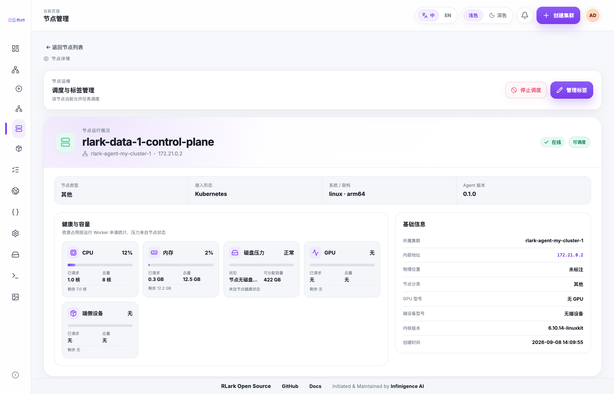

# Node and Resource Management

## Managing Node Scheduling

Administrators can control whether a node accepts new workload by toggling its scheduling status.

### Cordon a Node (Stop Scheduling)

- PATCH the Node resource: set `spec.unschedulable: true`
- Existing running Workers on the node are NOT affected
- New jobs will not be scheduled to this node
- Use this before maintenance, upgrades, or when the node is misbehaving

### Uncordon a Node (Resume Scheduling)

- PATCH the Node resource: set `spec.unschedulable: false`
- The node resumes accepting new workload
- Verify the node is healthy before uncordoning

## Node Labels

- Administrators can add custom labels to nodes for organization
- Labels are used by users for nodeSelector in job configuration
- Common labels: `rlark.io/node-category` (cloud/edge/robot), GPU model, location

| Label | Values | Description |
|-------|--------|-------------|
| `rlark.io/node-category` | `cloud`, `edge`, `robot`, `other` | Node type category |
| `rlark.io/gpu-model` | `A100`, `V100`, `T4`, etc. | GPU model (cloud nodes) |
| `rlark.io/device-model` | `franka`, `ur5`, `realsense`, etc. | Embodied device model |
| `rlark.io/city` | Any | Physical location (annotation) |

## Inspecting Node Resources

Open the administrator console → Nodes to view and manage nodes:

> **Screenshot note:** Screenshots are from an example environment. Resource names and data are illustrative; your environment will differ.



Node details include:
- Scheduling status (schedulable / cordoned)
- Node type, access mode, OS, architecture
- Agent version
- Resource usage: CPU, memory, disk, GPU, and embodied-device resources
- Disk warnings when usage reaches 90% or kubelet reports `DiskPressure=True`
- Associated jobs running on the node

## Site Nodes

The administrator console's **Site Nodes** page uses the full content width. **Add node** is in the toolbar, and the status tabs show the All, Bound, Offline, Conflict, and Retired counts. The toolbar searches node names and UIDs, filters by member cluster, refreshes data, and opens recent node operations for the selected cluster. Each cluster with robots has its own section headed by the cluster name: its control-plane node is a compact row and its robots are camera-led cards in the same section. A robot card shows desired and current power, self-check, maintenance, one large and three small camera views with their state, and a slow preview refreshed every five seconds. Its quick actions offer the driver action that fits the current state (start or stop the driver) and power on or off, plus the home pose; the full detail has all four power and driver actions. A power or driver command shows that it is being sent and then whether the Gateway accepted it; the desired state changes at once and the robot catches up on its next report, with a wait explained in its Node's `rlark.io/power` annotation. The card's current power also shows a hardware fault or an unreadable vendor monitor instead of leaving the value blank, and the open detail shows the Node's `rlark.io/power` annotation when the power service reports one, so a blocked pose can be traced. The home-pose control is hold-to-move: its label says so, a short click explains that it must be held, an unavailable pose says whether the robot needs power, the driver, an emergency-stop reset, or reports a hardware fault, and releasing it reports the stop or the refusal. Selecting robots exposes the existing bulk power and pose controls. Other clusters are grouped below with compact inventory cards. Every detail starts collapsed, and only one detail is open at a time; the open detail spans the row below its cards, so it never stretches the cards. The card grid becomes one column on phones.

**Expand details** opens a full-row panel below the card row instead of a drawer or in-card tabs. It places identity, network and admission, and conditions side by side; a robot's panel adds its power and driver actions and a live four-camera strip. A conflict record shows both the UID recorded for it and the UID currently reported under the name. Copyable identity and connection values include the node UID, WireGuard public key, tunnel address, and SSH host fingerprint. Reissue, revoke, and eligible **Delete record** actions are in the panel header, with the reason shown when an action is unavailable. Clicking a camera opens an enlarged preview and returns focus to that camera button when it closes; Escape closes the panel and returns focus to the expand button. Deleting the record does not remove a node that still reports under the name, which registers again with its next report. The **Admission records** section lists code and SSH admissions and their state, issuer, issue/expiry times, WireGuard key, and tunnel address. It supports reissuing records, revoking a code that has not been used, clearing a redeemed unfinished join to start over, and opening an SSH join record. The code itself is not stored or shown again after issuance.

## Removing a Node

Removing a node takes it out of its cluster and returns the machine to a state where it can join again. It is not the same as cordoning the node, and it is not the same as deleting a site-node record.

RLark records the removal as a `NodeOperation` with action `Remove`. The operation runs through these stages: check, power off a robot, drain, leave the tunnel, reset the machine, delete the Node, and verify. The control plane owns the operation, not the browser:

- Closing the confirmation drawer or navigating to another admin page does not stop the removal. A task card shows the current stage while it runs.
- The node list marks the node as removing, and the row and detail view show the stage. Reloading the page restores progress from the `NodeOperation` list.
- If a stage fails, the operation stops in `Blocked` with the reason from its `Progressing` condition. A `Blocked` operation is terminal: the controller does not retry it automatically. Retry starts a new attempt with a new request ID. After an uncertain request, the console reuses the same request ID, so retrying cannot create a duplicate operation.
- A member cluster API that cannot be reached is recorded as `Blocked` with reason `MemberClusterUnreachable` after the member API timeout; the operation does not stay `Running` forever.
- A node whose kubelet stopped reporting is treated as reset even when an earlier reset Pod is still `Pending` on it. The machine clears what it kept when it joins again, so the removal proceeds instead of waiting on a Pod that cannot run.
- Only one removal per node may be Pending or Running. A second request for the same node is rejected with `409 NODE_OPERATION_IN_PROGRESS` and the name of the operation already running. Once the operation reaches `Blocked` or `Failed`, or succeeds, a new removal or retry may be started.
- A control-plane node cannot be removed: its cluster would end with it. A removal may stop RLark tasks on the node; the owning Jobs restart them elsewhere.
- If the machine cannot be reached, its old installation is cleared when it joins again. After removal RLark may no longer reach it, so it may need to join from the machine itself.

The centered confirmation dialog summarizes the node and cluster, shows the node status, type, and IP when available, and lists the removal steps and up to six workloads that will stop. It separately warns when the site Hub has not recently observed the machine or when RLark cannot verify the node UID and will remove by name. Preflight errors can be retried from the dialog. After confirmation, the control-plane-owned operation continues independently of the browser and remains visible in the task center. Deleting a site-node record is a separate action, available only when its node was removed, is in `Conflict`, or has no Node.

## Joining a Node

In Administrator Console → Site Nodes → Add node, choose a target cluster and one of three methods. The page opens with a compact header and a target-cluster selector; the machine workspace filters its rows by **All**, **Discovered**, or **Manual**.

- Discovered machines are the entries the site's hubs found. They can be searched and batch-selected. **Join selected machines** opens a password dialog that groups the selection by NodeClass, shows whether the Orin entry-device password is configured, and accepts an x86 login password and an optional sudo password. An empty x86 field keeps the stored class credential; a typed value replaces and saves it. The dialog writes the class credentials first, then admits the machines. The passwords are class credentials, not one-time secrets, and RLark never shows their values.
- Manual rows are SSH joins that are running or stopped; **Open SSH record** selects that record in the SSH method. **Add computer/GPU** opens the SSH form. A submitted SSH join appears under Manual. Ordinary x86/GPU servers are not discovered by the site scanner; use SSH or a join code.
- The operations rail follows batch, SSH, and code joins independently of the browser. At wide widths it is the right-hand column; at narrower widths it follows the workspace. SSH retry and cleanup stay on the SSH record, and a waiting code can be revoked. Server-side joins continue when the page is left.

## Site Discovery Settings

Open **Administrator Console → Site Nodes → Discovery Settings** (`/admin/stations/network`), or select **Discovery Settings** from **Add node**. The page is administrator-only: the Gateway rejects reading and saving with `403`, and the console shows a read-only notice. A `404` means the site network has yet to be initialized.

The header carries the network health strip (Ready, FullyConnected, DiscoveryStale, observed/current generation) and **Back to joining** / **Refresh**. The workbench has three parts:

- The left rail selects a site. The editor shows its status, clusters, and scanning Hubs; **Cancel** and **Save settings** are in the editor header and remain disabled until the draft changes. The form enables or disables scanning, sets the interval to 10–3600 seconds, accepts 1–8 unique extra IPv4 prefixes of `/22` to `/32`, and chooses the management-plane dial-out Hub (`from`) separately from the scanning Hubs.
- The right-hand details show the clusters and Hubs, the discoverable NodeClasses with entry port and access/discovery flags, and all factory host-key fingerprints. On narrower screens the details move below the editor.
- The shared **Scanning scope and limits** panel lists the five rules: discovery covers only entry devices matching `NodeClass.spec.discovery.hostKeyFingerprints`; hubs also scan connected private networks; overlapping ranges may duplicate Machines; changes take about 30 seconds; a site without an enrolled Hub does not scan.

Below the workbench, three cards summarize the site network: **Recent scan activity**, **Site discovery load** (per-site machine counts, selectable to switch the editor), and **Astribot robots** (online robots, power, cameras, joining machines, and per-site online counts from site-node data). These cards only add status to Discovery Settings; the management dashboard is unchanged.

Ordinary x86/GPU servers have no discovery declaration and never appear in the scan list. They join over SSH or with a join code; scanning them directly requires a separate direct/entry-only admission mode.

## Using the UI

Administrator Console → Nodes → Select a node → Toggle scheduling or edit labels.

## Using the API

```bash
# Cordon
kubectl patch node <name> --type merge -p '{"spec":{"unschedulable":true}}'

# Uncordon
kubectl patch node <name> --type merge -p '{"spec":{"unschedulable":false}}'

# List nodes by category
kubectl get nodes -l rlark.io/node-category=cloud
```
