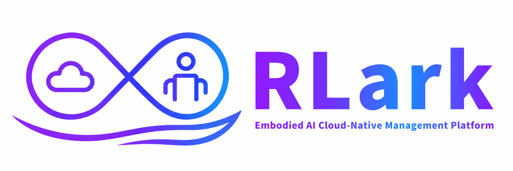
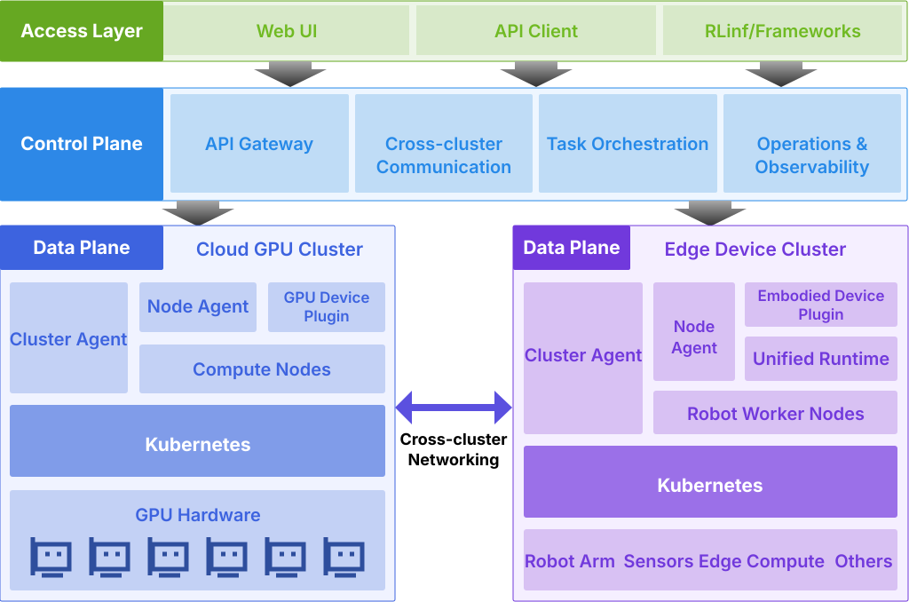

---
hide:
  - toc
---

<div align="center">
  
</div>

<div align="center" markdown>
  
  
  
</div>


<h1 align="center">
  <sub>RLark — Cross-Cluster Embodied Intelligence Cloud-Native Platform</sub>
</h1>

Manage cross-cluster embodied intelligence workloads through a unified cloud-native platform spanning cloud GPU training, cross-cluster collaboration, and edge device deployment across heterogeneous resources such as GPU clusters, robot arms, sensors, and cameras.

## What's NEW!

- [2026/09] RLark is now open-source.

## Key Capabilities

- **Embodied AI Workload Orchestration**: From cloud GPU training (RL/LLM) to edge deployment (robot arm, sensor, camera), unified declarative Job/Task abstraction across the full pipeline
- **Multi-Runtime Data Plane**: Kubernetes provides unified management for cloud GPU clusters and edge devices across the complete training-to-deployment lifecycle; Docker and Raw runtime support will extend coverage to lightweight edge scenarios where Kubernetes is not suitable
- **Cross-Cluster Resource Abstraction**: Unify multi-site GPU clusters and edge devices via Domain (virtual network domain) and Node (compute node) CRDs, with the control plane running on kcp
- **Declarative Training Jobs**: Job/Task abstraction with declarative distributed training and Ray cluster definition
- **Cross-Cluster Pod Networking**: Virtual network based on TUN devices + gVisor netstack + SSH tunnels, enabling Pod-to-Pod communication without NAT traversal — cloud GPUs and edge robots communicate directly
- **Certificate System**: Dual-layer X.509 + SSH certificates for Agent access, Domain-scoped cross-cluster forwarding authentication, and user SSH authentication
- **Observability**: Prometheus metrics, real-time Pod log streaming, and web management UI

## Roadmap

### Available Today

- Kubernetes-based management of cloud GPU clusters and edge devices
- Declarative Job/Task orchestration for distributed training and Ray workloads
- Cross-cluster resource management through Domain and Node CRDs
- Cross-cluster Pod networking over TUN devices, gVisor netstack, and SSH tunnels
- X.509 and SSH certificate-based authentication
- Prometheus metrics, real-time Pod logs, and a web management UI

### Planned

- Docker runtime support for lightweight data planes
- Raw runtime support for hosts and edge devices without a container orchestrator
- More complete account, role, and permission management
- Continued web UI usability and workflow improvements
- Cross-cluster network throughput, latency, and resource-efficiency optimizations

## Architecture Overview

This is a simplified view of the main control-plane and data-plane components.

<div style="max-width: 85%; margin: 0 auto;">
  
</div>

## Quick Start

Choose one of the two verified flows:

- **One-click CLI**: deploy the control plane and two kind data-plane clusters, then verify cross-cluster Pod networking.
- **UI-based flow**: create clusters and a Domain in the web console, deploy two kind data planes, schedule a Job across them, and verify connectivity.

For the one-click CLI flow:

```bash
# Clone the repository and enter the project directory
git clone https://github.com/RLinf/RLark.git
cd RLark

# One-click deploy: control plane (Docker Compose) + 2 kind clusters + cross-cluster network test
bash apps/rlark/docs/examples/quickstart.sh
```

!!! tip "System Requirements"
    - OS: Linux (recommended) or macOS
    - CPU Architecture: amd64 / arm64
    - Memory: ≥ 16 GB recommended
    - Disk: ≥ 20 GB free space recommended
    - Dependencies: Docker ≥ 24.0, kind ≥ 0.20, kubectl ≥ 1.28, jq, python3
    - Users in China: the script automatically falls back to domestic mirror if Docker Hub is unreachable

See the [Quick Start Guide](quickstart.md) for full prerequisites and step-by-step instructions.

## Tech Stack

- **Language**: Go (control plane/agent) + TypeScript (frontend)
- **Orchestration**: Kubernetes (kcp + kind)
- **Networking**: TUN device + gVisor netstack + SSH tunnel
- **Certificates**: X.509 mTLS + SSH certificates
- **Database**: PostgreSQL (Bun ORM)
- **Monitoring**: Prometheus
- **Frontend**: React + Vite + TypeScript
