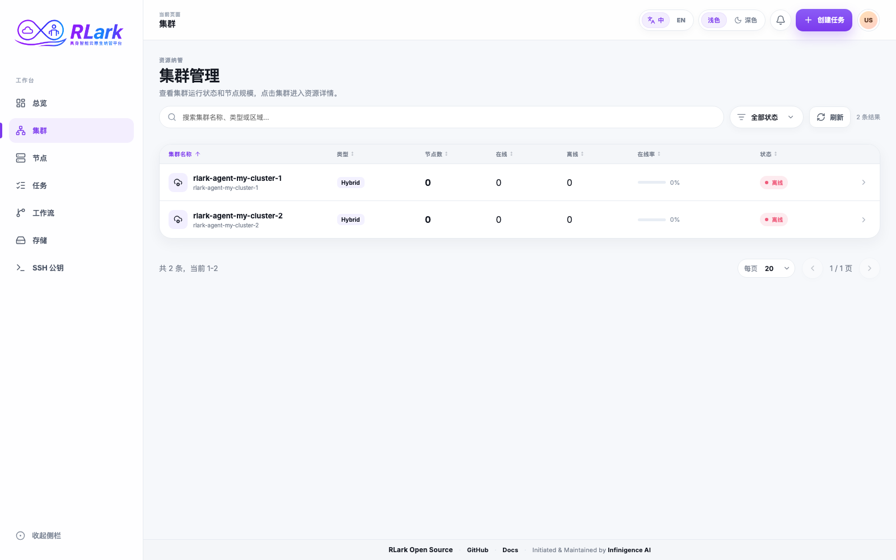
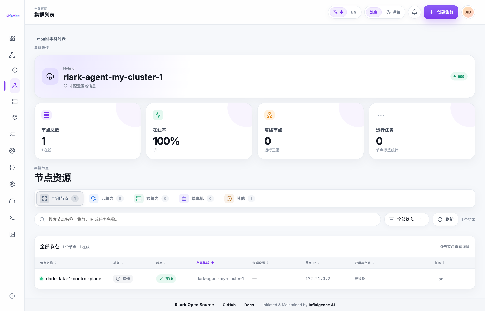
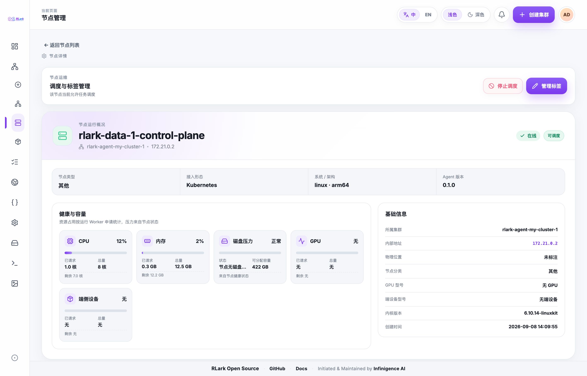

# Clusters and Nodes

Use this guide to find a data-plane cluster and confirm that it has suitable Worker capacity before creating a Job.

## Task 1: Find an Available Cluster

1. Open **Clusters** in the platform console.
2. Search by cluster name or ID, or filter by the metadata shown in the list.
3. Check the cluster status, online rate, and Worker count.
4. Open the cluster that you plan to use.

A Cluster is a cluster-scoped RLark resource. `spec.agentNamespace` is the authoritative membership boundary: the cluster details and node count include only Node CRs in that namespace. `rlark.io/cluster-id` is a compatibility lookup label and does not establish membership. Its cluster Agent renews the control-plane `heartbeat` Lease every 15 seconds, and the Lease expires after 45 seconds. Every registered Worker also requires its own `node-heartbeat-<node-name>` Lease from `rlark-agent-node`; a missing or expired node Lease makes only that Worker offline.

The **Status** column and status filter use the following cluster phases:

- **Online**: the cluster heartbeat is current and all registered Workers are online.
- **Offline**: the heartbeat Lease is missing or expired.
- **Downgraded**: the cluster heartbeat is current, but one or more registered Workers are offline.
- **Cordoned**: scheduling is disabled by durable Cluster intent. Existing Tasks are not stopped by this action.
- **Draining**: administrators have requested an orderly drain. RLark treats already Succeeded or Failed Tasks as drained, records a drain stop request for each remaining Task, and waits until each reports the stopped state for its current generation. The owning Job controller applies the suspension for Job-owned Tasks; the Cluster controller directly suspends standalone Tasks. Drain checks use exponential backoff from 1 second to 1 minute. A drain that remains incomplete for 30 minutes retains the requested state and reports a `Progressing=True`, `Reason=DrainTimedOut` condition listing the blocked Tasks for recovery. Completing a drain does not by itself change the durable drain or cordon intent. After the current-generation `Progressing=False`, `Reason=DrainComplete` condition appears, use Delist to hide the cluster, Undrain to restore the cordon state saved when the drain began, or Uncordon to cancel the drain intent and resume scheduling. Cancelling a drain clears the stop requests and resumes only the standalone Tasks the drain suspended; a Task that was already suspended before the drain keeps its own desired state.
- **Delisted**: administrators have hidden the cluster and its Nodes from the user console. The Nodes page and Node list API omit those Nodes for non-administrators; restoring the cluster makes them visible again. Administrators can still inspect the cluster and its Nodes to operate or restore it.

The list also displays total, online, and offline Worker counts and calculates the online rate as `online Workers / total Workers`. The count and rate describe Worker heartbeat observation; they do not change the cluster phase or scheduling eligibility on their own.

Administrators can use **Cordon** to pause new scheduling, **Uncordon** to resume new scheduling after a cluster is cordoned or after its drain has completed, **Drain** to stop only RLark Tasks in the selected cluster, **Delist** to stop showing it to users after a drain has completed, and **Restore** to make a delisted cluster visible again without changing its prior scheduling intent. Delisting is distinct from the **Offline** heartbeat phase. A draining cluster can be Delisted or Uncordoned only after its current-generation `Progressing=False`, `Reason=DrainComplete` condition confirms completion; while the drain is incomplete, these actions are rejected. Uncordoning a fully drained cluster also clears `spec.draining` and the saved cordon state, so the cluster becomes schedulable again instead of staying blocked by the drain intent. Uncordon does not repair agent connectivity or node health; after it clears the scheduling intent, the cluster phase reflects its observed heartbeat and node state. A delisted cluster must be restored before it can be uncordoned. Job outcomes continue to be aggregated from the observed Task states.

When creating a Job, the console offers **Online** and **Downgraded** clusters. The Job controller also enforces this server-side when it resolves a Task's node selector: it accepts only online, schedulable Nodes in exactly one Cluster whose `spec.cordoned`, `spec.draining`, and `spec.delisted` are all false and whose phase is **Online** or **Downgraded**. Cordoned, Draining, Offline, and Delisted clusters are not candidates, including for Jobs created through the API. A Downgraded cluster can schedule only onto its online, schedulable Workers; its offline Workers remain ineligible. The Gateway rejects new standalone Task requests targeting a Cluster agent namespace while that Cluster is Cordoned, Draining, or Delisted, but it permits updates and patches to existing Tasks for operational recovery. Existing Tasks are not stopped by Cordon; Drain remains responsible for stopping existing RLark Tasks.

> **Screenshot note:** Screenshots are from an example environment. Resource names and data are illustrative; your environment will differ.

## Task 2: Check Cluster Capacity

1. In cluster details, review total and offline Workers and running Jobs.
2. Compare the cloud compute, edge compute, and robot resource groups.
3. Filter or search the Worker list to find the required hardware.

## Task 3: Inspect a Worker

1. Select a Worker from the cluster details or open **Nodes** and search for it.
2. Confirm that it is online and schedulable.
3. Review its access mode, operating system, architecture, and Agent version.
4. Review CPU, memory, and GPU capacity and requested resources. The usage values are aggregated Kubernetes requests, not real-time hardware utilization.
5. Check the Jobs and Workers already placed on the node.

Use **Refresh** on the Nodes page to update the full filtered node list in place. During the request, the current rows remain visible under a dimmed loading mask with a centered spinner, while the surrounding page keeps its position.

!!! note "Node categories"
The platform groups Workers using RLark category labels for cloud, edge, and robot resources. Legacy category values and nodes that explicitly advertise supported resources remain visible. Kubernetes control-plane nodes are excluded from the platform Worker view.

## Result

You should now have a cluster and, when needed, a node selector that matches online, schedulable Workers with sufficient capacity. Use them in [Submit and Manage a Job](jobs.md).

## API Equivalent

Query Cluster summaries and Node CRs. See [API Reference](../api/reference.md) for fields and filters.
