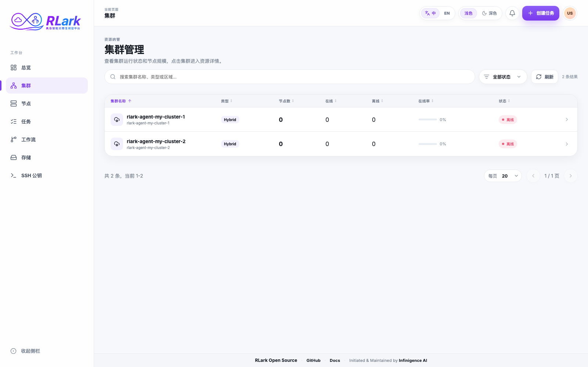
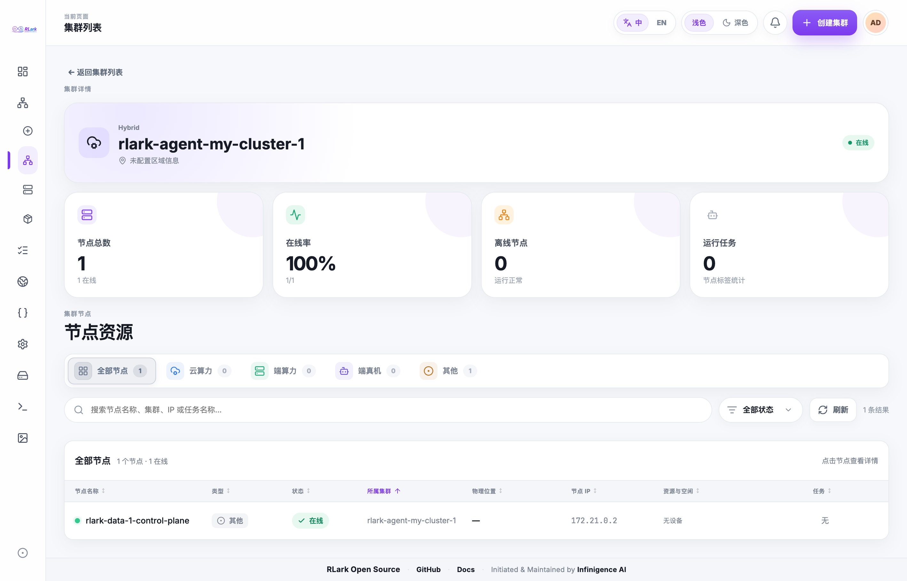
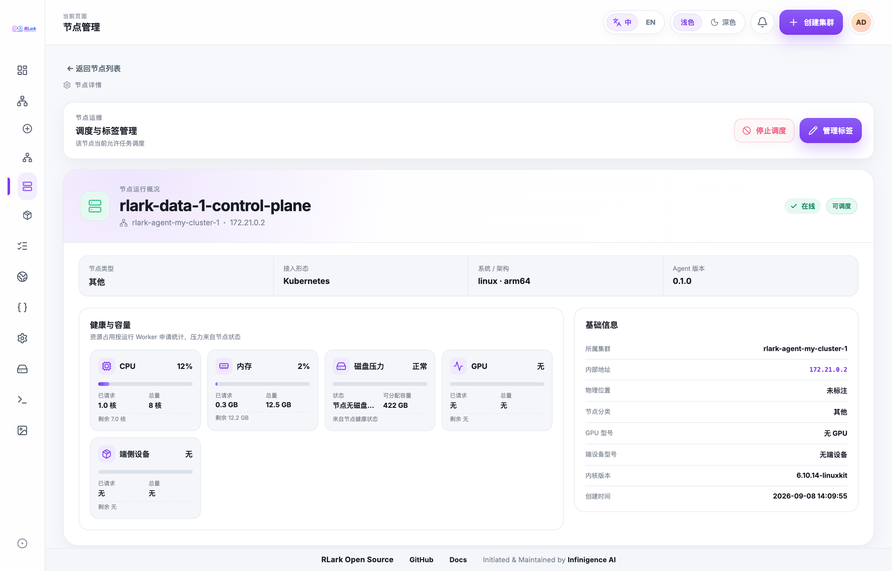

# Clusters and Nodes

Use this guide to find a data-plane cluster and confirm that it has suitable Worker capacity before creating a Job.

## Task 1: Find an Available Cluster

1. Open **Clusters** in the platform console.
2. Search by cluster name or ID, or filter by the metadata shown in the list.
3. Check the cluster status, online rate, and Worker count.
4. Open the cluster that you plan to use.

A Cluster is a cluster-scoped RLark resource. `spec.agentNamespace` is the authoritative membership boundary: the cluster details and node count include only Node CRs in that namespace. `rlark.io/cluster-id` is a compatibility lookup label and does not establish membership. Every registered Worker has a control-plane `node-heartbeat-<node-name>` Lease. The Server renews it for the active node-Agent connection and records a connection instance ID in `holderIdentity`. Renewal is an idempotent Lease write rather than a leader election, so a reconnecting Agent is reported online as soon as its first renewal succeeds instead of waiting for a previous holder's lease duration. The Node Controller evaluates its renewal time using control-plane time. Heartbeats update only the Lease, not the full Node status. By default, the Lease lasts 45 seconds, renews every 15 seconds, and allows a 15-second controller grace window. Configure the Server with `--node-heartbeat-lease-duration`, `--node-heartbeat-renew-deadline`, and `--node-heartbeat-retry-period`; configure the controller manager with `--node-heartbeat-timeout` and `--node-heartbeat-grace-period`. During the grace window, `AgentConnected=True` remains in effect; after it, an expired Lease makes only that Worker offline.

The **Status** column and status filter use the following cluster phases:

- **Online**: every registered Worker is connected, ready, and not cordoned.
- **Offline**: no registered Worker is connected and ready. The console displays **Disconnected** when the most frequent failure reason is `LeaseExpired` or `HeartbeatNeverReceived`; otherwise it displays **Unavailable**.
- **Downgraded**: at least one Worker is connected and ready, but one or more Workers are degraded, disconnected, or cordoned.
- **Cordoned**: scheduling is disabled by durable Cluster intent. Existing Tasks are not stopped by this action.
- **Draining**: administrators have requested an orderly drain. RLark treats already Succeeded or Failed Tasks as drained, records a drain stop request for each remaining Task, and waits until each reports the stopped state for its current generation. A Task that declares no Runtime has never held and cannot hold a workload, so it is treated as drained as well and never blocks the drain. The owning Job controller applies the suspension for Job-owned Tasks, and keeps applying it even while the draining, cordoned Cluster blocks new placement; the Cluster controller directly suspends standalone Tasks. Drain checks use exponential backoff from 1 second to 1 minute. A drain that remains incomplete for 30 minutes retains the requested state and reports a `Progressing=True`, `Reason=DrainTimedOut` condition listing the blocked Tasks for recovery. Completing a drain does not by itself change the durable drain or cordon intent, but the **Draining** phase marks only an in-flight drain: once every eligible Task reports stopped, the phase reverts to the durable scheduling intent (**Cordoned**), so the console shows the cluster as stopped-scheduling and offers **Drain** again instead of **Cancel Drain**, while the drain request and the stopped Tasks remain untouched. Use **Cancel Drain** while the drain is still in flight to clear the stop requests and resume only the standalone Tasks the drain suspended; a Task that was already suspended before the drain keeps its own desired state. After the current-generation `Progressing=False`, `Reason=DrainComplete` condition appears, use **Resume Scheduling** to cancel the drain intent and resume scheduling. Tasks stopped by the drain are not resumed by Resume Scheduling; they stay Stopped until the user starts their Job or unsuspends the Task.
- **Delisted**: administrators have hidden the cluster and its Nodes from the user console. The Nodes page and Node list API omit those Nodes for non-administrators; restoring the cluster makes them visible again. Administrators can still inspect the cluster and its Nodes to operate or restore it.

The list displays total Workers and the count of connected ready, degraded, disconnected, and cordoned Workers. Availability is `connected ready Workers / total Workers`. A ready Worker under resource pressure is counted in both the ready and degraded counts but remains ineligible for new placement. The controller selects the most frequent stable Node Condition reason among unavailable candidate Workers as `status.dominantFailureReason`; ties use lexical order. These counts and the reason explain the observed phase; scheduling still evaluates each Node's conditions and capabilities.

The Cluster Controller records connectivity of the Cluster Agent separately as the `AgentConnected` condition, derived from the cluster heartbeat Lease. This condition does not change the cluster phase; it keeps an expired or missing cluster heartbeat visible even while registered Workers still report ready.

Administrators can use **Pause Scheduling** to pause new scheduling, **Resume Scheduling** to resume new scheduling after a cluster is cordoned or after its drain has completed, **Drain** to stop only RLark Tasks in the selected cluster, **Delist** to stop showing it to users, **Delete** to permanently remove it and its data-plane resources, and **Restore** to make a delisted cluster visible again without changing its prior scheduling intent. In the admin action menu, **Drain** is enabled only for **Cordoned** clusters with running Jobs (when a Cordoned cluster has zero running Jobs it is disabled and labelled **No running tasks**); **Delist** and **Delete** are enabled only for **Cordoned** clusters with zero running Jobs. Before the initial pause, Drain, Delist, and Delete are disabled. For a **Delisted** cluster, the action menu offers only **Restore** and **Delete**. Delisting is distinct from the **Offline** heartbeat phase. A draining cluster can have scheduling resumed only after its current-generation `Progressing=False`, `Reason=DrainComplete` condition confirms completion; while the drain is incomplete, this action is rejected. Resuming scheduling on a fully drained cluster also clears `spec.draining` and the saved cordon state, so the cluster becomes schedulable again instead of staying blocked by the drain intent. Resume Scheduling does not release the Tasks the drain stopped; they stay Stopped until the user starts their Job or unsuspends the Task. Resume Scheduling does not repair agent connectivity or node health; after it clears the scheduling intent, the cluster phase reflects its observed heartbeat and node state. A delisted cluster must be restored before scheduling can be resumed. Job outcomes continue to be aggregated from the observed Task states.

When creating a Job, the console offers **Online** and **Downgraded** clusters. The Job controller also enforces this server-side when it resolves a Task's node selector: it accepts only online, schedulable Nodes in exactly one Cluster whose `spec.cordoned`, `spec.draining`, and `spec.delisted` are all false and whose phase is **Online** or **Downgraded**. Cordoned, Draining, Offline, and Delisted clusters are not candidates, including for Jobs created through the API. A Downgraded cluster can schedule only onto its online, schedulable Workers; its offline Workers remain ineligible. The Gateway rejects new standalone Task requests targeting a Cluster agent namespace while that Cluster is Cordoned, Draining, or Delisted. It also rejects updates and patches that unsuspend an existing Task (`spec.suspended` changes from `true` to `false`) on such a Cluster, because unsuspending would let the data plane resume the workload and bypass the scheduling-intent boundary. Other updates and patches to existing Tasks remain permitted for operational recovery, including suspending a Task (`spec.suspended` set to `true`) or leaving `spec.suspended` unchanged. Existing Tasks are not stopped by Pause Scheduling; Drain remains responsible for stopping existing RLark Tasks. The Gateway applies the same scheduling-intent boundary when a Job is created running and when it is started: creating a Job with `spec.suspended: false`, `POST /jobs/:name/start`, and updates or patches that unsuspend a Job are rejected with `409 Conflict` when every Node selected by the Job's task templates is excluded by that rule, that is, every such Node belongs to an Offline, Cordoned, Draining, or Delisted Cluster or to no Cluster at all. A Job created with `spec.suspended: true` is only a template and is accepted.

> **Screenshot note:** Screenshots are from an example environment. Resource names and data are illustrative; your environment will differ.

## Task 2: Check Cluster Capacity

1. In cluster details, review total and offline Workers and running Jobs.
2. Compare the cloud compute, edge compute, and robot resource groups.
3. Filter or search the Worker list to find the required hardware.

## Task 3: Inspect a Worker

1. Select a Worker from the cluster details or open **Nodes** and search for it.
2. Confirm that it is online and schedulable.
3. Review its access mode, operating system, architecture, and Agent version.
4. Review CPU, memory, and GPU resource declarations. `capacity` is physical inventory; `allocatable` is the scheduler-declared amount after reservations; `used` is the sum of scheduled non-terminal Pod requests. The console labels these separately as **Allocatable**, **Scheduled allocation**, and **Scheduling available**; only `allocatable - used` is scheduling availability. These fields are not real-time hardware utilization.
5. The console shows filesystem **monitored usage** as a separate observational value, never as scheduling capacity. Resource pressure is reported by the `ResourcePressure` Condition; the console does not infer pressure by thresholding monitoring samples.
6. Check the Jobs and Workers already placed on the node. The node list task summary and the node detail Worker list both count Pods scheduled to the node that have not reached a terminal phase (`Succeeded` or `Failed`), so a Worker that is briefly `Pending` during startup or a restart still appears in both places.

Use **Refresh** on the Nodes page to update the full filtered node list in place. During the request, the current rows remain visible under a dimmed loading mask with a centered spinner, while the surrounding page keeps its position.

!!! note "Node categories"
The platform groups Workers using RLark category labels for cloud, edge, and robot resources. A node enters the Worker view once it is managed by RLark (`rlark.io/enabled=true`); its Kubernetes role does not affect visibility, so an operator can manage a control-plane node and see it alongside the other Workers.

## Node State and Field Ownership

A Node separates durable scheduling intent from observed facts. **Online** is not a single source of truth for connection, health, and schedulability.

- `spec.unschedulable` is management-owned durable intent that prevents new placement; it does not stop existing workloads. The Agent mirrors it to the local Kubernetes Node: cordoning sets `rlark.io/unschedulable=true`, and uncordoning removes that label.
- `spec.operations` holds one-shot `Drain` or `EnterMaintenance` requests. Each request needs a unique `id`; a genuinely new action needs a new ID. The drain endpoint reuses the ID of an unfinished Drain instead of appending another operation for a repeated request. For a Node `Drain`, the cluster Agent reads the local Kubernetes Node UID reported in `status.kubernetesNodeUID`, lists Pods actually scheduled to that Node, proves each Task root workload by its Task UID, and records a `spec.drainRequests` entry containing the operation ID and Kubernetes Node UID on the owning Task. The Task Host then deletes the proven-owned root workload. The Task reports `status.drainRequests` as `WaitingForReschedule` only after cleanup completes. The Task stays stopped while the Drain operation remains in `spec.operations`. Once every Task reports `WaitingForReschedule`, the Node Controller retires the completed operation from `spec.operations` and, while doing so, marks each drained Task with `rlark.io/node-drain-stopped=<node>` and suspends it, so retiring the operation cannot restart the workload on the still-cordoned Node. Cancelling the drain — through `uncordon`, `undrain`, or `recover` — releases the corresponding `spec.drainRequests` entries but deliberately leaves that marker and the suspension in place, so the Task stays stopped until its Job is started explicitly (or that Task is unsuspended); deleting the Node clears the marker as well. No dedicated rescheduler moves the Task, so normal Kubernetes scheduling places the restarted workload. A Task the user suspended itself keeps its own desired state.
- `spec.runtime` is a control-plane-owned runtime reference and `spec.identity` carries durable business registration fields; Agents never write Node `spec`. The Agent reports the local Kubernetes Node UID in `status.kubernetesNodeUID`.
- Agent-owned observations in `status` include `kubernetesReady`, `kubernetesCordoned`, heartbeat and status-change timestamps, scheduler resource snapshots, Agent/runtime versions, capabilities, and the bounded `activeWorkloads` summary. `capacity` is declared inventory, `allocatable` is scheduler-declared capacity, and `used` is scheduled Pod requests; none is real-time utilization.
- Bounded monitoring snapshots such as `status.storage` are observational only and are not scheduling inputs. High-frequency monitoring must use the monitoring pipeline rather than repeatedly rewriting Node status.
- The Node Controller alone derives `status.phase` and `status.conditions` from intent and observations. It expresses resource pressure through `ResourcePressure` and publishes the single placement decision through `Schedulable`; schedulers, Jobs, and the console consume Node status read-only.

To schedule new work, require the controller-written `Schedulable=True` condition and compatible observed capabilities. The Node Controller derives `Schedulable` from `spec.unschedulable`, `AgentConnected`, `Ready`, and `ResourcePressure`; the Job scheduler and the console both consume that condition instead of re-deriving placement rules. Manual placement can still pin a Task explicitly to a degraded Node when an operator accepts the risk. A connected Agent or a `Ready` lifecycle phase alone does not override administrative scheduling intent. During a rolling upgrade, a Node whose Agent has not reported a capability snapshot yet is treated as a legacy Node: the controller falls back to the declared Node runtime and lets capability and device checks be enforced when the snapshot arrives.

The console reports a Node as **Available** when the controller-written `Schedulable` condition is `True`; it does not independently derive availability from connection, readiness, or pressure conditions. A schedulable Node that also has a non-fatal `Degraded=True` condition is reported as **Service degraded** for diagnosis, but it remains eligible for placement because `Degraded` is not a placement blocker. Any `Schedulable` condition other than `True` is reported as **Unavailable**. The node list shows the controller-written `Schedulable` reason (for example `LeaseExpired`, `KubernetesNodeNotReady`, or `ResourcePressureDetected`) in its **Notes** column without a tooltip on the availability badge; for a degraded but schedulable Node the note includes the `Degraded` condition reason. While the Node is `Draining`, the **Notes** column reads **Not schedulable / draining jobs**, because a drain request also cordons the Node and the generic scheduling reason alone would only report it as cordoned. The scheduling badge in the node detail header follows the same `Schedulable` decision: it reads **Schedulable** when the condition is `True`, **Draining** while a drain is in progress, and **Not schedulable** otherwise. It uses the same note as its tooltip, so an offline Node reads **Not schedulable** with a tooltip such as **Not schedulable: Heartbeat lease expired**, and a draining Node's tooltip reads **Not schedulable / draining jobs**. The availability filter offers only **Available** and **Unavailable**.

### Node Phases and Conditions

`status.phase` is only a concise UI and lifecycle summary. The Node Controller calculates it with the following precedence: `Draining`, `Cordoned` for maintenance, `Offline`, `Registering`, `Cordoned` for `spec.unschedulable`, `Degraded`, then `Online`. `Draining` applies only while a Drain operation is still in progress; once every Task drain observation is complete, the Node falls through to `Cordoned` because drain keeps `spec.unschedulable=true`. The completed Drain operation is retired from `spec.operations` once the Tasks it stopped are durably suspended, and the `Draining` condition reports `False` with reason `DrainComplete`; the Node stays cordoned until an operator runs `uncordon`. `Cordoned` never changes Agent connectivity or health conditions. `Degraded` reports resource pressure or a failed capability while keeping readiness separate: resource pressure leaves `Ready=True`, whereas Kubernetes Node NotReady also fails `Ready`. The Node Controller reports `Schedulable=False` when `ResourcePressure` is `True`, so automatic placement excludes the Node while existing workloads keep running; an operator can still pin a Task explicitly to that Node. Neither phase alone is a scheduling decision.

### Node Conditions

The Node Controller writes Kubernetes-style `status.conditions`: `AgentConnected`, `Ready`, `RuntimeReady`, `NetworkReady`, `StorageReady`, `DeviceReady`, `ResourcePressure`, `Draining`, `Degraded`, `Schedulable`, and `KubernetesCordoned`. Every entry has `status` (`True`, `False`, or `Unknown`), a stable machine-readable `reason`, a human-readable `message`, and `lastTransitionTime`. `Ready` and `Degraded` are two-state summaries and are only ever `True` or `False`: an unobserved Kubernetes Node readiness is reported as `Ready=False` with reason `KubernetesNodeReadyUnobserved`, and unknown capability observations are surfaced by the contributing conditions. `Schedulable` is the single placement decision consumed by the Job scheduler and the console; it is `True` only when `spec.unschedulable` is false, `AgentConnected` is `True`, `Ready` is `True`, `KubernetesCordoned` is not `True`, and `ResourcePressure` is not `True`. `KubernetesCordoned` reports the Agent-observed `spec.unschedulable` of the local Kubernetes Node, a field RLark never writes; `KubernetesCordoned=True` means the node was cordoned outside RLark, and because the Kubernetes scheduler then excludes every Pod on it, the Node Controller also reports `Schedulable=False` with reason `KubernetesCordoned`. `observedGeneration` records the generation observed when the controller wrote the conclusion.

`AgentConnected` is computed only from the heartbeat Lease. `Ready` requires a current Agent connection, Kubernetes Node readiness, no active drain request, and no explicitly failed critical runtime, network, or device condition. Missing optional capability observations remain `Unknown` and do not by themselves turn a ready node offline; an unobserved Kubernetes Node readiness, by contrast, fails `Ready`. Storage pressure is reported through `StorageReady=False`, `ResourcePressure=True`, and `Degraded=True` without failing `Ready`: the Node Controller reports `Schedulable=False`, so a Node degraded only by resource pressure keeps running existing workloads but receives no new work. `Degraded` does not change `Schedulable` by itself and is not a substitute for `Ready`. The Node Controller publishes bounded per-operation progress in `status.drainOperations`; it sets `completed=true` only after every registered Task request for that operation reports current-generation `WaitingForReschedule`. A missing or stale Task observation remains blocked. A Drain operation keeps `Ready=False`, so the Node Controller reports `Schedulable=False` and the scheduler excludes the Node, but a Drain does not write `spec.unschedulable`; cordon the Node explicitly if it must remain unschedulable after the operation is removed.

Use condition type, status, and reason for automation; do not parse `message`. Key reasons include `LeaseValid`, `LeaseExpired`, `HeartbeatNeverReceived`, `KubernetesNodeReady`, `KubernetesNodeNotReady`, `KubernetesNodeReadyUnobserved`, `RuntimeUnavailable`, `NetworkUnavailable`, `StorageUnavailable`, `DeviceUnavailable`, `ResourcePressureDetected`, `DrainRequested`, `DrainBlocked`, `Schedulable`, `Unschedulable`, `NotSchedulable`, `KubernetesCordoned`, `KubernetesNotCordoned`, and `KubernetesCordonUnobserved`. The console uses these values to distinguish a disconnected Agent, an unready node, unavailable runtime or dependencies, resource pressure, and draining work instead of inferring a cause from the `Offline` phase.

The console localizes the condition type, status, reason, and the fixed explanation the controller writes for each condition type. It shows `lastTransitionTime` as a relative duration with the absolute timestamp on hover, and keeps the machine-readable condition type in the tooltip.

## Result

You should now have a cluster and, when needed, a node selector that matches ready, schedulable Workers with sufficient capacity. Use them in [Submit and Manage a Job](jobs.md).

## API Equivalent

Query Cluster summaries and Node CRs. See [API Reference](../api/reference.md) for fields and filters.
