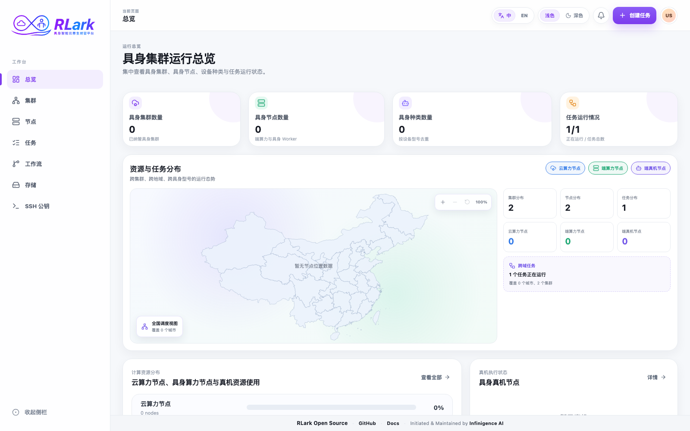

# Console Access and Navigation

## Signing In

RLark has two login entry points:

| Entry            | URL                        | Purpose                                                       |
| ---------------- | -------------------------- | ------------------------------------------------------------- |
| Platform Console | `http://<host>:5173`       | Job management, Workers, storage, SSH keys                    |
| Admin Console    | `http://<host>:5173/admin` | Cluster onboarding, nodes, certificates, system configuration |

### Login Steps

1. Open the console URL in your browser
2. Enter your username and password
3. Click Login
4. The Gateway issues a JWT access token (8 hours by default), and the browser sends it as a Bearer token on subsequent API requests

!!! warning "Role authorization is coarse-grained"
    Gateway enforces `admin` access for control-plane configuration and credential management. The `user` role can manage platform workloads, but per-user resource ownership is not yet implemented, so authenticated users are not isolated from each other's Jobs or storage objects. Continue to use TLS and network controls.

## Console Navigation

In the Astribot edition, the sidebar shows the Astribot logo, and the RLark logo appears by **RLark Open Source** in the footer.

### Platform Console Pages

| Page     | Purpose                                                        |
| -------- | -------------------------------------------------------------- |
| Overview | Dashboard summary of clusters, schedulable workload nodes, robots, and running jobs |
| Clusters | Browse and inspect onboarded data-plane clusters               |
| Nodes    | Filter and inspect node resources, scheduling, and health      |
| Jobs     | Create, monitor, and manage training jobs                      |
| Storage  | Browse storage classes and object storage                      |
| SSH Keys | Manage public SSH keys for Worker access                       |

### Admin Console Pages

The **Image Registries** page stores private-registry credentials and selects their distribution scope: store only, selected clusters, or all current and future clusters. Display names may be duplicated and edited; RLark uses an internal ID to identify each credential. Distribution and deletion are asynchronous. Delivered credentials are placed in `rlark-system` on each selected Kubernetes data plane.

> **Screenshot note:** Screenshots are from an example environment. Resource names and data are illustrative; your environment will differ.

### Node Removal Progress

On **Nodes**, an administrator starts removal with the row's **Remove** action. A centered confirmation dialog summarizes the node, cluster, IP address, status, and category. It lists the removal steps and up to six affected workloads, and calls out an unreachable site machine or an unverified node identity when applicable. Confirming creates a node operation on the control plane. Closing the dialog or leaving the page does not cancel it: the row shows **Removing** with the current stage, and a task card in the lower-right corner follows the operation. The card collapses and opens a detail drawer with every stage and its condition. Reloading the page restores progress from the operation list. If a stage fails, or the member cluster API cannot be reached, the detail drawer shows the reason and offers **Retry**. While a removal is pending or running, the console does not submit a second one for the same node; the Gateway also rejects a duplicate with `409 NODE_OPERATION_IN_PROGRESS`. A control-plane node cannot be removed.

### Site Node Details

The **Site Nodes** page is a bounded content column (1480px) centered on wide screens. **Add node** is in the toolbar, and the status tabs are quiet underline tabs showing the All, Bound, Offline, Conflict, and Retired counts. The toolbar searches node names and UIDs, filters by member cluster, refreshes the list, and opens recent node operations for the selected cluster. Each cluster with robots has its own section headed by the cluster name and a mono stat line (drivers ready, camera issues, online): its control-plane node is a compact row and its robots are camera-wall tiles in the same section. A robot tile puts the picture first: the identity, status, verification tags, desired and current power, and the fixed controls grouped by function (power on and off, start and stop the driver, hold-to-move home pose) sit directly on the large camera view, the smaller views sit in a strip under it and refresh a still frame every five seconds, and the main view streams at the card's own preview rate. A card's preview-rate selector sits just left of its status label. A tile whose power faults, e-stops, fails its self-check, or is under maintenance gets an amber ring so trouble reads from across the room. The full detail has all four power and driver actions. Both halves of each control pair stay visible: one the current state cannot act on is disabled, its tooltip and the card's state line say why, and whole groups wrap below the picture on narrow tiles. A power or driver command reports on its own card that it is being sent, then that the Gateway accepted it, and finally that it was applied only when the robot itself reports the target state; driver and power actions differ in how long the device takes, powering on again waits about ten seconds after a power-off, and a bounded series of reads of that robot's Node by name follows the request instead of repeated full refreshes. The desired state changes at once and the robot's power service reconciles every five seconds; when the state has not been observed within the window the card says so and shows the Node's `rlark.io/power` waiting reason when the power service reports one. The tile's current power also shows a hardware fault or an unreadable vendor monitor instead of leaving the value blank, and the open detail shows the Node's `rlark.io/power` annotation when the power service reports one, so a blocked pose or a lagging command can be traced. The home-pose control is hold-to-move: its label says so, a short click explains that it must be held, an unavailable pose says whether the robot needs power, the driver, an emergency-stop reset, or reports a hardware fault, and releasing it reports the stop or the refusal. Before the first hold is acknowledged the button reads as a pending request, not as moving, and a hold receipt that arrives after release never turns it back to moving. Selecting robots reveals the existing bulk power and pose controls. Other clusters are quiet row lists below — icon, name, admission state, a dot status word, and mono facts per row, separated by hairlines instead of card boxes. Every detail starts collapsed, and only one detail is open at a time; the detail opens as a dialog over the page, so it never stretches or moves the tiles and rows. The tile grid drops to one column on phones.

**Recovery and whole-machine restart.** A robot tile the plane does not see as **Bound** keeps its last-report and tunnel facts and adds a recovery line with **Re-check**. Re-check runs the page's normal load again (the station list, the Node, the site network and the admissions) and needs no separate endpoint. It cannot reach a machine whose host and site link are both down: if a re-check still shows no report and no verified tunnel, someone must go to the machine or use an out-of-band path. **Rejoin** sits beside **Re-check** and opens **Site Nodes → Add node** for that node: the target cluster is prefilled only when one cluster claims the station's namespace, an existing SSH join record for that node is opened when one exists, and otherwise the SSH form starts with the node's name and the login and address reliably mapped from its admission and Node. It only opens the flow; the operator still submits the join, and the card never deletes records, clears joins, or joins the machine by itself. The open detail repeats the same recovery note and offers **Re-check** in its header. A **Bound** S1U robot also offers **Restart** in a **Machine** group on the tile. The administrator confirms that someone is on site and the emergency stop is reachable; the console then writes only the one-shot Node label `rlark.io/restart-request` with a new request id through the existing administrator Node PATCH, never the claim holder's `rlark.io/robot-restart` annotation and never a Wake-on-LAN or shell command. The robot's node tuner keeps its own guards: the node profile has to hold, the robot must not be held by a Run or a device session, and a pressed emergency stop or its rollout wave still stops it, so the request may wait, queue or be refused. The write carries the `resourceVersion` of the read that passed the outstanding-request check, so a second administrator gets `409` and is asked to re-check instead of overwriting a request. The tile shows **Submitted**, **Waiting** with the tuner's reason from `rlark.io/maintenance`, **Restarting**, **Restarted** only when `rlark.io/restart-request-state` records the boot that followed, or **Failed**/**not observed**; an unfinished request already on the Node is shown and blocks a second one. A restart takes the robot Offline for a while, and its progress stays on the tile. The label's value is done once and kept, so each click uses a new id; the console also checks the management Node's UID against the station record before writing and during observation, so a same-named replacement machine is never restarted under the old identity.

**Open details** opens the station in a dialog over the page instead of a drawer or an in-card tab; the tiles and rows stay where they are. The robot's power controls and live cameras appear first, followed by the body state. Identity, network and admission, and conditions are grouped under **Identity, network and conditions**, which starts collapsed. Escape or the close button closes it, and clicking the dimmed area outside does not. A conflict record shows both the UID recorded for it and the UID currently reported under the name. Values such as node UID, WireGuard key, tunnel address, and SSH host fingerprint can be copied. Reissue, revoke, and **Delete record** are in the panel header, with the reason shown when an action is unavailable; **Delete record** is enabled only when the record is eligible. Clicking a camera opens an enlarged preview and returns focus to that camera button when it closes. Escape closes the details and returns focus to the tile's expand button. Deleting a site-node record does not remove a node that still reports under the name; it registers again with its next report.

Inside the expanded section, wide dialogs show **Identity**, **Network and admission**, and **Conditions** in equal-width columns. Narrow dialogs show fewer columns so long values stay readable.

A robot tile shows the main camera's name, **Frame age**, and **Fetch** time on its first line, beside the robot's name and above the model and UID line; on a narrow tile that line wraps under the name instead of squeezing the status label. Frame age is the age the camera service reports for the frame, or the time since its capture timestamp when the service reports none. Fetch time runs from the browser request to the first complete JPEG, not merely to the response headers. Every card starts at the lowest rate, 5 FPS, and its selector just left of the status label offers 5, 10, 15, or 30 FPS. Immediately beside the selector the card shows **Measured** N.N FPS: different JPEG frames the browser actually received over roughly the last second, counted after identical consecutive frames are skipped. It reads — until the first measurement, while the stream is broken or retrying, while the tab is hidden, and whenever a still frame stands in for the stream. The measured rate can be lower than the target, and it is written straight to the page without re-rendering the card on each frame. Changing the rate aborts the old stream and opens exactly one new stream at that rate, so a card never keeps a second subscription. A frame the browser has held for ten seconds reads **Stale frame** even if the service reported a smaller age, and a reported age of at least five seconds also reads stale. Missing timing data appears as a dash.

The card's stream and the strip's still requests stop while the tile is off screen, the robot is offline, the tab is hidden, or the detail or enlarged preview is open, which then owns the single stream. They resume when the tab is visible again or the dialog closes. Hiding the tab pauses the picture without keeping any request in flight; unmounting the card, closing a dialog, and changing the rate release the requests, timers, animation frames, and image object URLs.

Open a camera preview to stream that view and choose a **Target FPS** of 5, 10, 15, or 30. Opened from a robot card, the preview starts at that card's current rate; opened from elsewhere it starts at 10 FPS. **Measured** counts different JPEG frames received in the browser over roughly one second, skipping identical frames sent in succession. It can be lower than the target. The setting controls the preview stream's maximum rate. The preview disconnects when closed or hidden and reconnects when visible or after a stream failure.

**End-to-end latency** estimates the time from the camera's ROS capture timestamp to the browser's next paint opportunity after the JPEG loads. The browser calibrates against the camera service and displays network clock uncertainty as **±**. Camera timestamp accuracy and physical display timing are outside that uncertainty. Unavailable timing or clock uncertainty above 100 ms appears as a dash.

**Site network links** summarizes connectivity inside the same section. Expand it to see the state and timestamps reported by each Hub.

Expand **Running container images** in a node's details to see the namespace, Pod, container, reported image, explicit tag when present, and runtime image ID when reported. This is an administrator-only snapshot of containers Kubernetes reports as running on that node. It excludes images that are only cached on disk and containers started outside Kubernetes, such as standalone Docker containers. Use **Refresh** for a new snapshot. If the member cluster cannot be reached or the node identity no longer matches the site record, the console shows that images are unavailable.

Each card in the **Robot model catalog** combines the model identity with its capabilities. It shows each model's supported camera slots by hardware variant, and the body state fields, units, and dimensions. S1U specifies color JPEG for head, torso, and both wrist slots. The `s1u_observer` variant specifies head and torso only. These are model capabilities. Open the live cameras section for each camera's current status.

**Body state** is visible when the robot's dialog opens and shows the detected hardware variant, configured cameras, left and right arm end-effector poses, torso endpoint pose, and joint positions and velocities. The pose table shows one row per endpoint, grouping the labeled XYZ axes in the position column and XYZW in the quaternion column. The joint table aligns position and velocity by joint number across all body groups, with each group’s telemetry status in its header. On narrow screens, scroll each table sideways. The component name or joint number stays visible. The panel shows a missing source reference frame explicitly. S1U joint groups have 7, 7, 4, 1, and 1 values per field for the left arm, right arm, torso, and left and right grippers. The grippers use raw driver units. The panel uses ordinal labels for the driver vectors and refreshes approximately once per second while the dialog is open and the page is visible. Each group can independently be waiting, live, or stale. S1U Addon v1.7.3 and later provide the read-only body observer. Nodes on older versions display that body state is unavailable. Arm and torso groups report radians and radians per second. Camera previews and power controls continue to use their usual interfaces.

The **Admission records** section lists code and SSH admissions with their cluster, state, issuer, issue and expiry times, WireGuard key, and tunnel address. A pending code can be revoked, an admission can be reissued, a redeemed but unfinished join can be cleared to start over, and an SSH join can be opened from its record. The code itself is not stored or shown again after issuance.

### Joining Nodes

Open **Site Nodes → Add node**. The page has a compact header, a target-cluster context bar, and a three-way method tab switch: discovered machines, SSH, or a one-time join code. The machine workspace has **All / Discovered / Manual** source filters, plus machine-type filters when viewing scanned candidates.

- Select **Start scan** in the top-right of the **Discovered** panel. The list shows unjoined machines reported by the selected site’s latest scan within the last ten minutes; in-progress joins stay visible. Click **Join** on a row to open the confirmation dialog for that machine, or tick rows (including via the column-header select-all checkbox) and select **Join selected machines** for a batch join. The dialog groups Robot selections by NodeClass, shows whether the Orin entry-device password is configured, and accepts an x86 login password plus an optional sudo password. Leaving the x86 field empty keeps the stored class credential; typing a value replaces and saves it. The dialog writes the class credentials before it admits the machines. These passwords are class credentials, not one-time secrets; RLark shows only whether one is stored, never its value.
- **Manual** lists SSH joins that are still running or stopped; **Open SSH record** switches to the SSH method with that record selected. **Add computer/GPU** opens the SSH form directly; after submission the machine appears under Manual. Use SSH or a join code to add ordinary x86/GPU servers. **Rejoin** on an offline station's recovery line also opens this page with that node's cluster and name: its existing SSH join record is selected, otherwise the SSH form is prefilled, and nothing is submitted until the operator submits it. Expand **Advanced settings** in the SSH form to set the node name, SSH port, and public tunnel endpoint. The node name defaults to the machine hostname and SSH defaults to port 22. Leaving the tunnel endpoint blank uses the machine IP and UDP port 51820.
- In the **Join code** form, selecting Robot shows the required robot model and profile (NodeClass) fields directly in the main form. Expand **Advanced settings** for the optional robot ID (derived from the node name when left blank), **Network** (pinned tunnel address and uplink gateway), and **Scheduling** (labels and taints), with format errors shown below the affected field. For an ordinary Linux server, choose **Server** and enter a node name to issue a code using the default site settings. The machine needs access to the Station API and permission to run sudo. Check node readiness and GPU allocatable resources separately after joining.
- The operations rail follows batch, SSH, and code joins and continues on the server when the page is left. On a wide screen it is the sticky right-hand column; below that width it follows the workspace. The SSH and join-code methods keep their own forms, a short flow and notes column, and their recent records.

### Discovery Settings

Open **Administrator Console → Site Nodes → Discovery Settings** (`/admin/stations/network`), or select **Discovery Settings** from the **Add node** header. The page is administrator-only: the Gateway rejects reading, saving, and starting scans with `403`, and the console shows a read-only notice. A `404` means the site network has yet to be initialized.

Choose a site from the cards above the form. A site linked to one cluster uses that cluster’s display name and shows the site identifier, and marks sites with unsaved changes. Select **Start scan** in the editor header to scan with the saved settings and see the Hub reporting progress. Scans continue after leaving the page and can be retried after completion or the five-minute timeout.

**Scan scope** accepts 1–8 unique extra IPv4 prefixes from `/22` to `/32` and also covers the Hubs’ directly connected private networks; **Unclassified SSH candidates** below indicates **On / Off** and expands to configure options. **Management connection** selects the dial-out Hub used to reach the relays. Save the settings and wait for them to apply before starting a scan. If another update causes a conflict, the page reloads the latest settings for review.

The **Network status and diagnostics** bar below the editor surfaces network readiness, connectivity, and configuration generation at a glance; expand it to see site and model details, scope limits, recent activity, discovery records, and Astribot robot status. With **Unclassified SSH candidates** enabled, unmatched SSH endpoints may appear as **Unclassified**. Use SSH or a join code to add ordinary x86/GPU servers.

### Creating a Cluster

The **New Cluster** page collects the site and its first machine in two sections and keeps a **What will be created** summary beside the form. Required fields are marked, and invalid input is explained under the field instead of only disabling the button. Enter submits the form. After submission, the progress card shows the provisioning stage and earlier attempts; leaving the page does not cancel provisioning.

### Finding the Right Page

| Question                                       | Go to                              |
| ---------------------------------------------- | ---------------------------------- |
| Is a cluster or node available for scheduling? | Clusters or Nodes page             |
| How to create a training job?                  | Jobs → Create Job                  |
| Which stage is a job stuck at?                 | Job Details → Workers tab          |
| How to find application errors?                | Job Details → Logs tab             |
| How to check resource usage?                   | Nodes page → Node detail           |
| How to open a terminal in a container?         | Job Details → Worker → WebTerminal |
| How to configure private image credentials?    | Admin Console → Image Registries   |

### Refreshing Console Data

Use **Refresh** to request the latest data without leaving the current page. While the request is in progress, the affected table or dashboard is dimmed, its controls are temporarily disabled, and a centered progress indicator is shown. Existing rows remain visible until the refreshed response arrives. This behavior is used consistently across overview dashboards, clusters and nodes, domains, jobs and Workers, storage and files, SSH keys, image registries, and system configuration.

### Interface Language

The language switch in the header applies to both Chinese and English. Besides static labels, it also localizes values that the console derives from control-plane state: node status reasons, Addon phases, the CPU core unit, derived node kinds in Worker filters, and list separators. The login page and the WebTerminal page follow the same switch. Values passed through verbatim from the data plane — node labels, operating system and architecture identifiers, and other server-provided strings — are shown as reported and are not translated.

### Long Values in Node Tables

In the node detail Worker table, long instance names are truncated with an ellipsis, and in the expanded Pod sub-table the network domain is truncated the same way. Hover over a truncated value to see the full text in a tooltip. This keeps the status column visible without horizontal scrolling.

### Filtering Jobs by Tag

The tag filter in the job list combines the selection the same way the Gateway does: different tag keys are ANDed, and several values of the same key are ORed. A job is listed only when it carries every selected key, and for each of those keys at least one of the selected values. Selecting keys that no single job carries together therefore returns an empty list; this is the filter semantics, not a failed request. The popover states the rule above the columns, and the **All / None** shortcut applies to the values of the key currently in focus, never to the key list.

A key comes into focus when you click its row, and the value column keeps showing that key until you click another one. Hovering does not change the focus, so moving the pointer towards the values never replaces the list. The checkbox in front of a key is a separate control: it selects or clears all values of that key at once.

### Role Count in the Job List

The **Roles** column counts the distinct role names of the Job, the same names the job detail page and the job editor show. It is not derived from `Task.spec.role`, which is only a coarse grouping hint (`Actor`, `Rollout`, `Env`) and collapses several business roles into one value.

### Copy Buttons

Copy buttons report success inline instead of silently succeeding: the icon switches to a check mark for about 1.6 seconds and then returns to the copy icon. The image copy button in the job detail role runtime panel also turns green with a short pulse and changes its tooltip to **Copied**. A button that stays unchanged means the copy did not happen, usually because the browser blocked clipboard access.

Every copy button in the console shares one clipboard path. Browsers expose the async clipboard API only in a secure context (HTTPS or `localhost`), so when the console is served over plain HTTP the copy automatically falls back to a compatible path instead of failing. This covers the SSH key, SSH connect command, Worker SSH command, API example, deployment YAML, workflow YAML, and job log copy buttons. Success feedback appears only after the copy actually succeeds.

### Closing Form Dialogs

Dialogs that collect input — creating, cloning, editing, or restart-editing a job, creating or editing a storage class, adding or editing image registry credentials, adding an SSH key, creating a domain, and editing job tags — do not close when you click the dimmed area outside the dialog. Because the console cannot restore discarded input, these dialogs close only through their close button in the upper-right corner or their **Cancel** button; the job, storage class, and image registry dialogs also close with `Esc`.

Confirmation dialogs that collect no input, such as job lifecycle actions, job deletion, the restart mode choice, and cluster lifecycle actions, still close when you click outside them.

## API Equivalent

Supported resource operations are available through the [Gateway API](../api/reference.md). The standalone Gateway defaults to `http://<host>:8080`; an `rlarkadm` deployment uses its configured Service and UI proxy. The API reference is authoritative because not every UI interaction has a one-to-one public endpoint.
