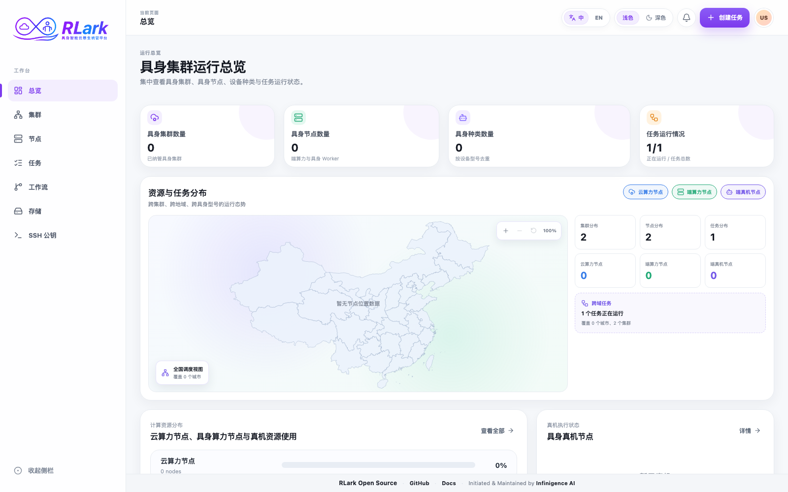

# Console Access and Navigation

## Signing In

RLark has two login entry points:

| Entry            | URL                        | Purpose                                                       |
| ---------------- | -------------------------- | ------------------------------------------------------------- |
| Platform Console | `http://<host>:5173`       | Job management, Workers, storage, SSH keys                    |
| Admin Console    | `http://<host>:5173/admin` | Cluster onboarding, nodes, certificates, system configuration |

### Login Steps

1. Open the console URL in your browser
2. Enter your username and password
3. Click Login
4. The Gateway issues a JWT access token (8 hours by default), and the browser sends it as a Bearer token on subsequent API requests

!!! warning "Role authorization is coarse-grained"
    Gateway enforces `admin` access for control-plane configuration and credential management. The `user` role can manage platform workloads, but per-user resource ownership is not yet implemented, so authenticated users are not isolated from each other's Jobs or storage objects. Continue to use TLS and network controls.

## Console Navigation

### Platform Console Pages

| Page     | Purpose                                                        |
| -------- | -------------------------------------------------------------- |
| Overview | Dashboard summary of clusters, schedulable workload nodes, robots, and running jobs |
| Clusters | Browse and inspect onboarded data-plane clusters               |
| Nodes    | Filter and inspect node resources, scheduling, and health      |
| Jobs     | Create, monitor, and manage training jobs                      |
| Storage  | Browse storage classes and object storage                      |
| SSH Keys | Manage public SSH keys for Worker access                       |

### Admin Console Pages

The **Image Registries** page stores private-registry credentials and selects their distribution scope: store only, selected clusters, or all current and future clusters. Display names may be duplicated and edited; RLark uses an internal ID to identify each credential. Distribution and deletion are asynchronous. Delivered credentials are placed in `rlark-system` on each selected Kubernetes data plane.

> **Screenshot note:** Screenshots are from an example environment. Resource names and data are illustrative; your environment will differ.

### Finding the Right Page

| Question                                       | Go to                              |
| ---------------------------------------------- | ---------------------------------- |
| Is a cluster or node available for scheduling? | Clusters or Nodes page             |
| How to create a training job?                  | Jobs → Create Job                  |
| Which stage is a job stuck at?                 | Job Details → Workers tab          |
| How to find application errors?                | Job Details → Logs tab             |
| How to check resource usage?                   | Nodes page → Node detail           |
| How to open a terminal in a container?         | Job Details → Worker → WebTerminal |
| How to configure private image credentials?    | Admin Console → Image Registries   |

### Refreshing Console Data

Use **Refresh** to request the latest data without leaving the current page. While the request is in progress, the affected table or dashboard is dimmed, its controls are temporarily disabled, and a centered progress indicator is shown. Existing rows remain visible until the refreshed response arrives. This behavior is used consistently across overview dashboards, clusters and nodes, domains, jobs and Workers, storage and files, SSH keys, image registries, and system configuration.

### Interface Language

The language switch in the header applies to both Chinese and English. Besides static labels, it also localizes values that the console derives from control-plane state: node status reasons, Addon phases, the CPU core unit, derived node kinds in Worker filters, and list separators. The login page and the WebTerminal page follow the same switch. Values passed through verbatim from the data plane — node labels, operating system and architecture identifiers, and other server-provided strings — are shown as reported and are not translated.

### Long Values in Node Tables

In the node detail Worker table, long instance names are truncated with an ellipsis, and in the expanded Pod sub-table the network domain is truncated the same way. Hover over a truncated value to see the full text in a tooltip. This keeps the status column visible without horizontal scrolling.

### Filtering Jobs by Tag

The tag filter in the job list combines the selection the same way the Gateway does: different tag keys are ANDed, and several values of the same key are ORed. A job is listed only when it carries every selected key, and for each of those keys at least one of the selected values. Selecting keys that no single job carries together therefore returns an empty list; this is the filter semantics, not a failed request. The popover states the rule above the columns, and the **All / None** shortcut applies to the values of the key currently in focus, never to the key list.

A key comes into focus when you click its row, and the value column keeps showing that key until you click another one. Hovering does not change the focus, so moving the pointer towards the values never replaces the list. The checkbox in front of a key is a separate control: it selects or clears all values of that key at once.

### Role Count in the Job List

The **Roles** column counts the distinct role names of the Job, the same names the job detail page and the job editor show. It is not derived from `Task.spec.role`, which is only a coarse grouping hint (`Actor`, `Rollout`, `Env`) and collapses several business roles into one value.

### Copy Buttons

Copy buttons report success inline instead of silently succeeding: the icon switches to a check mark for about 1.6 seconds and then returns to the copy icon. The image copy button in the job detail role runtime panel also turns green with a short pulse and changes its tooltip to **Copied**. A button that stays unchanged means the copy did not happen, usually because the browser blocked clipboard access.

Every copy button in the console shares one clipboard path. Browsers expose the async clipboard API only in a secure context (HTTPS or `localhost`), so when the console is served over plain HTTP the copy automatically falls back to a compatible path instead of failing. This covers the SSH key, SSH connect command, Worker SSH command, API example, deployment YAML, workflow YAML, and job log copy buttons. Success feedback appears only after the copy actually succeeds.

### Closing Form Dialogs

Dialogs that collect input — creating, cloning, editing, or restart-editing a job, creating a workflow, creating or editing a storage class, adding or editing image registry credentials, adding an SSH key, creating a domain, and editing job tags — do not close when you click the dimmed area outside the dialog. Because the console cannot restore discarded input, these dialogs close only through their close button in the upper-right corner or their **Cancel** button; the job, workflow, storage class, and image registry dialogs also close with `Esc`.

Confirmation dialogs that collect no input, such as job lifecycle actions, job deletion, the restart mode choice, and cluster lifecycle actions, still close when you click outside them.

## API Equivalent

Supported resource operations are available through the [Gateway API](../api/reference.md). The standalone Gateway defaults to `http://<host>:8080`; an `rlarkadm` deployment uses its configured Service and UI proxy. The API reference is authoritative because not every UI interaction has a one-to-one public endpoint.
