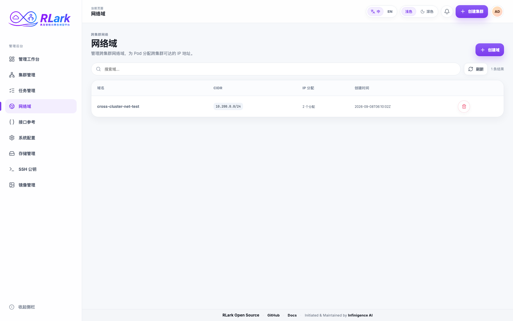

# 网络与安全

## 管理网络域

Domain 用于虚拟地址分组并限定跨集群转发范围。每个 Domain 有一个 CIDR 范围用于 IP 分配，但它不是底层基础设施或普通 Kubernetes 网络的隔离边界。

### 创建 Domain

> **截图说明：** 截图来自示例环境，资源名称和数据仅供说明，实际环境会有所不同。



- 管理后台 → Domain 管理 → 创建 Domain
- 输入唯一名称和 CIDR 范围（如 `10.200.0.0/24`）
- Domain CRD 在 kcp 中创建
- DomainPeer 资源自动创建用于跨集群连接

### 查看 IP 分配
- Domain 详情显示已分配的 IP 及关联的 Pod
- 确认 IP 范围在 Domain 之间不重叠
- 跨集群 Pod 通过 Domain IP 经 SSH 隧道通信

### 删除 Domain
- 确认没有活跃的 Job 引用该 Domain
- 删除 Domain CRD
- DomainPeer 资源被垃圾回收

### 通过 API 操作
```bash
# 创建 Domain
kubectl apply -f domain.yaml

# 列出 Domain
kubectl get domains -A

# 删除 Domain
kubectl delete domain <name>
```

## 跨集群网络架构

```
客户端 Pod (cluster-B)                    服务端 Pod (cluster-A)
  ├── wget → Domain IP (10.200.0.x)        ├── nc -l -p 8000
  ├── gVisor netstack 拦截                  │
  ├── TUN 设备 → NodeServer socket         │
  └── NodeServer → SSH 隧道 → ────────────→ Proxy → localhost:8000
```

路由由 Node Agent 按连接决定：

- **同集群** —— 当目标 Pod 的 `globalNamespace` 与本地相同且 `--enable-same-cluster-direct` 开启（默认）时，Node Agent 直接拨号目标 Pod 的真实地址的 `5700` 端口。
- **跨集群** —— 否则连接通过控制面 Server 的 SSH 端点（端口 `2222`）以 `direct-tcpip` channel 中继。Server 会校验 Domain 证书，并确认请求的地址确实属于该 Domain 的 `DomainPeer`，然后才打开 channel。

!!! warning "`--enable-cross-cluster-direct` 尚未实现"
    Agent 参数 `--enable-cross-cluster-direct` 可以接受且默认为 `true`，但跨集群直连路径尚未实现。无论该参数取值如何，跨集群流量始终走 SSH 中继。请勿基于它做容量或时延规划。

### 中继连接接入与清理

SSH 中继默认对每个 SSH 连接允许 64 个待完成的 `direct-tcpip` 上游 open（`--ssh-max-pending-targets`），已建立的 channel 不占用该预算。额度耗尽后，请求先等待额度释放，最长五秒（`--ssh-admission-wait-timeout`），之后才拒绝。等待、路由授权与上游 dial 共用 30 秒 context 预算。额外等待人数也以上述待接入限额为上限；等待队列也满时，超出的 open 立即拒绝。两个配置值都必须为正，且仅在启动时生效。增大限额会增加每个连接的资源占用；等待中的 open 不启动路由查询或目标 dial。不保证 FIFO 顺序。

预算/等待队列耗尽返回 SSH `ResourceShortage`；上游失败及已识别的 context/API 超时返回 `ConnectionFailed`。权限拒绝和非法请求保留 `Prohibited`；其他未分类的路由错误也保留原有拒绝码。这些拒绝码用于区分容量/连接失败与策略拒绝，但不增加自动重试，也不能证明最终目标连接未被尝试。单个 channel 失败本身不会关闭共享 SSH 连接。

SSH 拒绝诊断在 info 级别记录有界的原因、拒绝码、session ID 和待接入/等待人数。日志按每个 SSH 连接限流为每秒一条、突发五条（与拒绝消息发送失败日志共享）；日志被抑制时仍执行拒绝。诊断不包含证书、连接头或客户端 payload。

channel 接受发生在上游 `Dial` 成功之后，但现有 RemoteDialer 协议在打开逻辑流并发送连接头后即返回，**不确认**最终 Agent 侧 TCP 连接已建立。因此更下游的目标失败仍可能在接受 channel 后表现为 EOF；不能把 EOF 当作“未尝试连接目标”的证据，也不能据此自动重放不可重复请求。

30 秒预算是 context deadline，并非严格的实际耗时保证：锁定版本的 smux `OpenStream` API 不接受 context，可能等待自身传输写入超时后才能观察取消。后续连接头写入支持取消，且不会因此关闭共享传输。

RemoteDialer 每个 session 最多允许 128 个待完成的入站连接头读取/目标 dial，控制流和已建立的转发不占用该预算。超出预算的流关闭，不启动目标 dial；最多八个拒绝 worker 可以等待连接头读取，最长一秒后关闭。连接头读取和目标 dial 各有一分钟上限；这是两个独立预算，不是端到端统一时限。线协议保持不变，流关闭不构成有类型的目标拒绝确认。

RemoteDialer 容量拒绝也输出 info 级别诊断（`pending_admission_full` 或 `rejection_workers_full`），包含 session key 和容量计数，按每个正在服务的 session 限流为每秒一条、突发五条。日志不包含连接头或目标地址。这不改变 RemoteDialer 原有拒绝机制，也未解决拒绝 worker 全满时立即发送 FIN 的注册竞态。

session 取消时关闭多路复用传输，并关闭各流的目标连接以解除空闲读取阻塞，等待流及控制 worker 退出。单个复制方向结束时保留已有的 60 秒反向排空预算；当前 smux 支持写方向半关闭，因此不能仅因对端结束写入就丢弃待返回的响应。单个流结束时，其他活跃流仍可使用。该清理不引入 Agent 传输优雅保留或滚动升级连续性保证。SSH 的 `RelayStreams` 路径仍保留原有半关闭行为，对不支持 deadline 的流没有强制关闭兜底。

## 协议支持

Sidecar 通过 TUN 设备和 gVisor netstack 拦截流量，而该 netstack 仅注册 IPv4，因此支持的协议比普通 Pod 网络更窄。

| 协议 | 状态 | 说明 |
| ------ | ------ | ------ |
| TCP | 支持 | 连接在 netstack 内本地终结，载荷中继到对端 Sidecar 的 `5700` 端口 Proxy。 |
| UDP | 支持 | 数据报以 `[2 字节大端长度][载荷]` 封帧，复用同一条中继流；接收端 Proxy 用真实 UDP socket 重新发出。 |
| ICMP（IPv4） | 仅 Echo | Proxy 使用 `ip4:icmp` 原始 socket，需要 `CAP_NET_RAW`。只有 Echo Reply（类型 `0`）会被回传。`ping` 可用；`traceroute` 和 ICMP 差错报告（Destination Unreachable、TTL Exceeded、Fragmentation Needed）**不可用**。 |
| IPv6 | 不支持 | netstack 只注册了 `ipv4.NewProtocol`，请使用 IPv4 Domain CIDR。 |
| SCTP、原始 IP、其他 L4 | 不支持 | 报文被静默丢弃。 |

其他约束：

- 虚拟地址在 netstack 内以固定的 `/24` 前缀安装，与你配置的 Domain CIDR 无关。请将 Domain CIDR 规划为 `/24` 或更小，避免出现非预期的同网段/跨网段判断。
- 没有虚拟 DNS 服务器。Pod 名称只能通过同步的 `/etc/hosts` 文件解析（参见 `--sidecar-hosts-sync-enabled`）。任何绕过 `/etc/hosts` 的解析器（例如强制走 DNS 的 Go 纯 Go 解析器）都看不到对端 Pod 名称。
- 由于 ICMP 差错不被中继，跨集群连接失败时表现为超时或普通连接错误，而不是 ICMP 诊断信息。

## MTU 调优

TUN 设备 MTU 通过 `--sidecar-tun-mtu` 设置（默认 `1500`）。该值同时应用于 Linux TUN 链路和 gVisor channel endpoint，并决定单包读缓冲区大小。

建议：

- **底层 MTU 无需匹配。** netstack 在 Sidecar 内终结应用的 TCP 连接，载荷通过独立的 TCP/SSH 流中继，底层链路自行分段，因此底层 MTU 较小不会导致应用流被分片。
- **TUN MTU 决定向应用通告的 MSS。** 调小会降低 Pod 内的单段传输效率，但不改变中继行为，通常没有调小的必要。
- **保持 UDP 数据报小于 MTU。** 更大的数据报依赖 netstack 内的 IPv4 分片与重组；控制在 MTU 以内行为更可预期。
- **ICMP Echo 载荷受固定 1500 字节 Proxy 读缓冲限制。** 无论 MTU 如何配置，`ping -s` 载荷超过约 1472 字节时回包不会被中继。
- **修改 MTU 需要重建 Pod。** Sidecar 以 init container 注入，该参数无法原地变更。
- 同一 Domain 下的所有集群应配置相同的值。不一致时 TCP 可以容忍（MSS 会协商），但可能在单方向上静默丢弃大 UDP 数据报。

## 跨集群连通性故障排查

### 指标

Sidecar 在 `--sidecar-metrics-listen`（默认 `:5790`）暴露 Prometheus 指标和 pprof，置空可禁用。Node Agent 在其自身的 metrics 端点暴露 NodeServer 指标。

| 指标 | 标签 | 含义 |
| ------ | ------ | ------ |
| `rlark_sidecar_tun_packets_total` | `direction=tx\|rx` | 经过 TUN 设备的报文数。`tx` 不增长说明流量根本没到达 `gnet0`。 |
| `rlark_sidecar_proxy_connections_total` | `protocol=tcp\|udp\|icmp` | 面向对端的 Proxy 接受的入向连接数。 |
| `rlark_sidecar_proxy_connections_active` | — | 当前打开的入向 Proxy 连接数。 |
| `rlark_sidecar_hosts_sync_total` | `status=success\|error` | hosts 文件同步尝试次数。 |
| `rlark_nodeserver_connections_total` / `_active` | — | NodeServer Unix socket 上接受的连接数。 |
| `rlark_nodeserver_dial_total` | `type=direct\|ssh`、`status=success\|error` | 上游拨号次数，区分同集群直连与跨集群中继。 |
| `rlark_nodeserver_ssh_reconnect_total` | `domain` | SSH 传输重连次数。持续增长说明中继在抖动。 |

### 常见故障

| 现象 | 可能原因 | 排查位置 |
| ------ | ---------- | ---------- |
| 对端 Pod 名称无法解析 | hosts 同步被关闭或 NodeServer socket 不可达；没有 DNS 兜底 | Pod 内 `cat /etc/hosts`；`rlark_sidecar_hosts_sync_total{status="error"}`；Sidecar 日志 |
| Pod 内没有 `gnet0` | 创建 TUN 需要 privileged / `CAP_NET_ADMIN`；数据面节点必须是 Linux | Sidecar 容器日志与 Pod 安全上下文 |
| NodeServer 返回 `server not found` | 目标 Pod 尚未发布到该 Domain 的 `DomainPeer` | `kubectl get domainpeer -n agent-<agent-id> <domain> -o yaml`，检查 `spec.pods` |
| 目标端连接被拒绝 | 目标 Pod 没有网络 Sidecar，`5700` 端口无人监听 | 目标 Pod spec；目标侧 `rlark_sidecar_proxy_connections_total` |
| `rlark_nodeserver_dial_total{type="ssh",status="error"}` 持续增长 | 控制面 SSH 端点不可达，或 Domain 证书无效 | Agent 的 `--rlark-server-ssh-address`；Server `2222` 端口连通性；Server 日志 |
| `rlark_nodeserver_ssh_reconnect_total` 稳定增长 | keepalive 超时或证书反复轮换导致传输抖动 | 控制面 Server 日志；数据面与控制面之间的网络稳定性 |
| channel 被以 `Prohibited` 拒绝 | 权限/请求校验失败，或发生未分类的路由错误 | 控制面 Server 日志；`DomainPeer.spec.pods` 和 `localIP` |
| channel 被以 `ResourceShortage` 拒绝 | 等待预算内未获得 open 额度，或有界等待队列已满 | Server 拒绝原因和待接入/等待人数；`--ssh-max-pending-targets` 与 `--ssh-admission-wait-timeout` |
| channel 被以 `ConnectionFailed` 拒绝 | 上游连接失败，或已识别的取消/超时 | Server 拒绝原因与 Agent 隧道可用性；仅在操作语义允许时采用有界重试 |
| 小请求正常、大传输卡住 | 通常不是 MTU 问题（见上文），应检查中继 | `rlark_nodeserver_dial_total`、Server 日志、每 Domain 的 SSH 连接数上限 |
| `ping` 正常但 `traceroute` 不通 | 预期行为：只有 ICMP Echo Reply 会被中继 | — |

### 诊断命令

```bash
# 确认 Pod 内的虚拟网卡和地址
kubectl exec <pod> -c <app> -- ip addr show gnet0

# 确认对端名称解析
kubectl exec <pod> -c <app> -- cat /etc/hosts

# 查看下发到数据面的路由表
kubectl get domainpeer -n agent-<agent-id> <domain> -o yaml

# 查看 Domain IP 分配
kubectl get domain <domain> -o jsonpath='{.status.ipAllocations}'

# 从 Pod 网络内抓取 Sidecar 指标
kubectl exec <pod> -c <app> -- wget -qO- http://127.0.0.1:5790/metrics
```

## 安全最佳实践

- 使用 Kubernetes NetworkPolicy 等基础设施控制实施安全区域隔离；不要仅依赖 Domain
- 通过 `rlarkadm` 定期轮换 TLS 证书
- 检查 DomainPeer 资源是否有意外的跨集群连接
- Worker 访问的 SSH 密钥应通过平台管理，不直接在节点上操作
- 控制面证书自动生成，但应监控过期时间
