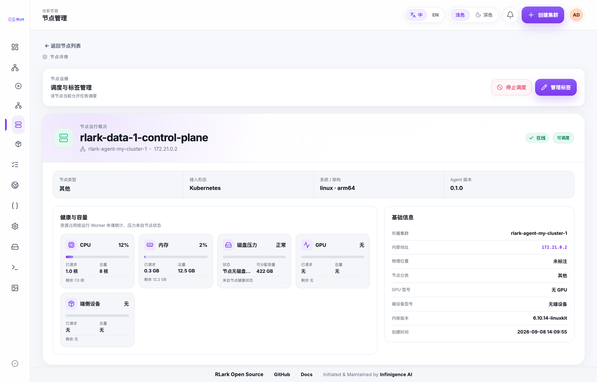

# 节点与资源管理

## 管理节点调度

管理员可通过切换节点的调度状态来控制节点是否接受新工作负载。

### 暂停调度（Pause Schedule）

- PATCH Node 资源：设置 `spec.unschedulable: true`
- 节点上已有的运行中 Worker 不受影响，也不会被自动标记为失败
- 新任务不会被调度到此节点
- 暂停调度只作用于 RLark：Agent 仅在本地 Kubernetes Node 上设置 `rlark.io/unschedulable=true` 标签，所有 RLark 工作负载模板都带有排除该标签的强制 nodeAffinity。RLark 不会写入 Kubernetes Node 的 `spec.unschedulable`，因此非 RLark 纳管工作负载的 Pod 仍会被调度到该节点
- 此操作不会改变 `AgentConnected` 或 `Ready`：处于暂停调度状态的 Node 仍可保持连接和就绪
- 节点列表会将该 Node 显示为**不可用**，调度原因为**已暂停调度**，生命周期 Phase 仍为 `Cordoned`；因为处于暂停调度状态的节点无法接收新任务，已有工作负载继续运行
- 在维护、升级或节点异常时使用
- 在 RLark 之外被 cordon 的节点会在 Node 状态的 `KubernetesCordoned=True` 中体现，并在节点列表中标记。RLark 不管理该字段，但被 cordon 的节点无法接收任何 Pod，因此 Node Controller 会同时写入 `Schedulable=False`（原因为 `KubernetesCordoned`），Job 调度器不再向该节点放置新 Task
- 迁移说明：由更早版本 RLark 执行暂停调度、同时被写过 Kubernetes Node `spec.unschedulable` 的节点会继续保持 cordon，因为 RLark 不再管理该字段。确认节点健康后，请用 `kubectl uncordon <node>` 显式恢复

## 排空（Drain）节点

排空是一次性的节点运维操作。当节点需要停机维修、重启、升级或退出服务，而节点上仍有 Task 在运行时，使用排空有序停止这些 Task。排空同时会阻止新任务放置；如果只想阻止新放置、保留已有工作负载，请使用上一节的**暂停调度（Pause Schedule）**。

### 何时使用

- 节点需要硬件维修、操作系统升级、重启或下线，继续运行工作负载不可接受
- 需要在维护前停止节点上的 RLark 工作负载，而不是直接删除节点或逐个手动停止任务
- 不要用排空做临时调度控制：仅需阻止新任务放置时应使用暂停调度（Pause Schedule），排空还会停止节点上已有的 Task

### 与暂停调度（Pause Schedule）的区别

| 操作 | 阻止新任务放置 | 停止节点上的已有 Task | 写入的期望状态 | 恢复方式 |
|------|----------------|----------------------|----------------|----------|
| 暂停调度（Pause Schedule） | 是 | 否 | `spec.unschedulable=true` | 恢复调度（Resume Schedule） |
| 排空（Drain） | 是 | 是 | `spec.unschedulable=true`，并追加一条 Drain 操作；Node Agent 随后在 Task 上写入 `spec.drainRequests` | undrain 结束排空，再用恢复调度（Resume Schedule）或 recover 恢复节点调度；被排空停止的 Task 需显式启动其 Job 才会恢复运行 |

排空不调用 Kubernetes 驱逐接口直接删除 Pod。Node Agent 识别实际调度到该节点、且归属可证明的 Task，写入一次性 `spec.drainRequests`；Task Agent 停止该 Task 的根工作负载并上报观测状态。

### 请求排空

- REST 端点：`POST /api/v1/rlinf.io/v1alpha1/nodes/{name}/drain?namespace=<ns>`（管理员权限）
- 请求一个 `Drain` 操作，并将 `spec.unschedulable` 置为 true。若已存在未完成的 Drain，端点会复用其 operation ID，通过 `operationId` 返回，且不再追加操作；因此 UI 重试和并发重复请求会收敛到同一个操作。只有现有 Drain 全部完成后，才会创建新操作
- Gateway 将 `spec.operations` 限制为最多 32 条。达到上限后，需要创建新操作的请求返回 `409 Conflict`；复用未完成 Drain 的幂等重试仍然成功。请求新的 Drain 前，请通过 **undrain** 或 **recover** 清理已完成操作
- `spec.operations` 中的每一条都必须带非空的 `id`，且 `type` 只能是 `Drain` 或 `EnterMaintenance`。其他取值由 API Server 直接拒绝，因此格式不合法的操作根本不会进入控制器、被静默忽略
- 对于节点上仍有 Pod 的每个 Task，Agent 会在其 `spec.drainRequests` 中记录一条请求；Task Agent 停止该 Task 的根工作负载并上报 `WaitingForReschedule`。Agent 为每个 Task 最多写入 32 条 DrainRequest；达到上限后，重复记录已存在的请求仍是成功的空操作
- `spec.drainRequests` 是 Node 当前 Drain 操作的投影，而非永久的用户期望状态。当 Drain 操作通过 **undrain** 或 **recover** 从 `spec.operations` 移除后，Agent 会删除对应请求；但被排空停止的 Task 不会自动恢复运行：Node Controller 写入的停止标记会让 Task 保持 suspended，直到运维显式启动其 Job（或取消该 Task 的 suspend）。删除 Node 时会同时释放请求并清除停止标记，因此 Agent 离线或 Node 对象已删除都不会让 Task 永久停摆
- 删除 Node（`DELETE /api/v1/rlinf.io/v1alpha1/nodes/{name}`）时，会先从受影响的 Task 中释放指向该节点的 `spec.drainRequests`，再删除 Node 对象；因此即使 Node Agent 离线，直接删除 Node 也不会让 Task 永久停摆
- `spec.drainRequests` 仅由 Node Agent 写入。Job/Workflow 的 Task 模板中携带的该字段在 Job controller 创建 Task 时会被忽略，因此复制或恢复 Job 不会把历史 Drain 请求带入新的 Task
- 已完成的 Drain 会保留在 `spec.operations` 中直到运维显式清除，因此节点仍处于排空状态期间，受影响的 Task 会保持停止；该操作在保留期间保持完成，恢复调度不会把它重算为未完成并重新触发驱逐

### 观察排空进度

Node Controller 将每个 Drain 操作的有界进度写入 `status.drainOperations`：

| 字段 | 含义 |
|------|------|
| `operationID` | Drain 操作的 ID，与 `spec.operations[].id` 对应 |
| `waiting` | 已针对当前 generation 上报 `WaitingForReschedule` 的 Task 数量 |
| `blocked` | 尚未上报当前 generation 观测，或上报 `Blocked` 的 Task 数量 |
| `completed` | 该操作是否可视为完成 |

- 至少有一个 Task 收到该操作的 DrainRequest 时，仅当 `blocked=0` 才将 `completed` 置为 true；`waiting` 不计入阻塞，因为对应根工作负载已经停止运行
- 还没有 Task 收到 DrainRequest 时，Node Controller 参考 Agent 上报的 `status.activeWorkloads`：Agent 尚未上报工作负载快照时不完成；`RLarkManaged=0` 视为节点上确实没有 RLark 工作负载；`RLarkManaged>0` 说明 Agent 尚未发出请求
- `Draining` Condition 的 reason 表达整体状态：`DrainRequested`（True，等待 Task 观测）、`DrainBlocked`（True，仍有阻塞的 Task）、`DrainComplete`（False，全部完成）、`NoDrainRequest`（False，没有 Drain 操作）
- `status.phase` 在存在未完成 Drain 操作时为 `Draining`；完成后回落到 `Cordoned`，因为排空同时把 `spec.unschedulable` 置为 true
- Task 侧：`spec.drainRequests` 是 Node Agent 写入的一次性请求（含 `operationID`、`nodeUID`、`nodeName`）；`status.drainRequests` 是 Task Host 的观测。`WaitingForReschedule` 表示根工作负载已经停止、正在等待重新放置，并不表示任务已经迁移到其他节点

```bash
# Node 侧的排空进度
kubectl -n <agent-namespace> get nodes.rlinf.io <name> \
  -o jsonpath='{.status.drainOperations}'

# Draining Condition
kubectl -n <agent-namespace> get nodes.rlinf.io <name> \
  -o jsonpath='{.status.conditions[?(@.type=="Draining")]}'

# Task 侧的排空请求与观测
kubectl -n <agent-namespace> get tasks.rlinf.io <task> \
  -o jsonpath='{.spec.drainRequests}{"\n"}{.status.drainRequests}'
```

### 结束排空（undrain）

- REST 端点：`POST /api/v1/rlinf.io/v1alpha1/nodes/{name}/undrain?namespace=<ns>`（管理员权限）
- 移除 `spec.operations` 中所有 Drain 操作，保留 `EnterMaintenance`；不会把 `spec.unschedulable` 置为 false
- 幂等：节点没有 Drain 操作时直接返回当前对象，不做修改
- 实际效果：undrain 只移除管理面的 Drain 期望状态并释放 `spec.drainRequests`，不会让被排空的 Task 自动恢复运行，也不会触发自动重调度。Node Controller 写入的 `NodeDrainStoppedAnnotation` / `NodeDrainSuspendedAnnotation` 会保留，Task 保持 suspended，直到运维显式启动其 Job（或取消该 Task 的 suspend）
- 释放请求后，节点仍保持 `spec.unschedulable=true`。需要任务回到该节点时，请继续执行 **uncordon** 或直接 **recover**，然后显式启动对应的 Job；需要任务迁移到其他节点时，先确认集群容量、nodeSelector 和污点约束，再启动 Job

### 排空后的节点恢复

#### 恢复调度（Resume Schedule）

- REST 端点：`POST /api/v1/rlinf.io/v1alpha1/nodes/{name}/uncordon?namespace=<ns>`（管理员权限）
- 等价 kubectl：`kubectl -n <agent-namespace> patch nodes.rlinf.io <name> --type merge -p '{"spec":{"unschedulable":false}}'`
- 将 `spec.unschedulable` 置为 false，节点恢复接受新工作负载
- 会移除 `spec.operations` 中所有 Drain 操作（保留 `EnterMaintenance`），并释放对应的 `spec.drainRequests`；但被排空停止的 Task 不会自动恢复运行，其 `NodeDrainStoppedAnnotation` / `NodeDrainSuspendedAnnotation` 会保留，需显式启动其 Job 才会恢复
- 需要同时清除 cordon 标记和 EnterMaintenance 等运维操作时，请使用下方的 **一键恢复** 端点
- 恢复调度前请确认节点健康

#### 暂停调度后的一键恢复（Recover）

- REST 端点：`POST /api/v1/rlinf.io/v1alpha1/nodes/{name}/recover?namespace=<ns>`（管理员权限）
- 组合恢复操作：移除 `spec.operations` 中所有 Drain 和 EnterMaintenance 操作，同时将 `spec.unschedulable` 置为 false
- 被排空停止的 Task 不会随 recover 自动恢复运行：停止标记会保留，需显式启动其 Job 才会恢复
- 幂等：如果节点已处于调度状态且没有待处理的排空操作，端点会直接返回成功而不修改对象
- 典型运维流程：暂停调度（Pause Schedule）→ 排空任务（Drain）→ 硬件/软件修复 → **一键恢复**

## 取消纳管节点

只要任一 Task 的 `status.observedNodes` 仍包含该节点，取消纳管会被拒绝并返回 `409 Conflict`，两个入口行为一致：

- `DELETE /api/v1/rlinf.io/v1alpha1/nodes/{name}?namespace=<ns>`（管理员权限）——删除管理面 Node CR
- `POST /api/v1/data-plane-nodes/{agent_id}/nodes/{node_name}/unmanage`（管理员权限）——移除数据面 Kubernetes Node 的 `rlark.io/enabled` 标签，Agent 停止上报该节点

请先排空节点，等待任务全部迁移或停止（`Draining` Condition 的 reason 达到 `DrainComplete`）后再取消纳管；没有观测到任务的节点可直接取消纳管。拒绝响应中会列出仍在该节点上的 Task 名称。此外，节点必须已无法接收新任务：Agent 仍连接的节点需先暂停调度（`spec.unschedulable=true`）；Agent 未连接的节点则无需先暂停调度，因为控制器会将其判定为 `Offline` 且 `Schedulable=False`，新任务不会被放置到该节点，从而保证失联节点仍可取消纳管。

管理后台在启用「取消纳管」操作前应用同样的两个前置条件，并以 Agent 上报的 `status.activeWorkloads.rlarkManaged` 判断节点上是否还有 RLark 工作负载。该计数不包含非 RLark 的系统 Pod，因此仅运行平台负载的节点在暂停调度后即可取消纳管。服务端基于 Task 的校验仍是最终权威：若控制台放行了操作但该节点仍被某个 Task 引用，请求依旧会返回 `409 Conflict`。

删除入口会在删除 CR 前释放受影响的 Task 中指向该节点的 `spec.drainRequests`，因此即使 Node Agent 离线、无法再 reconcile 该节点，这些 Task 也能恢复运行。作为最后兜底，控制面会为每个 Node 添加 `rlark.io/node-drain-request-cleanup` finalizer：若通过其他路径（例如 `kubectl delete`）删除节点，该 finalizer 会在删除完成前执行同样的释放逻辑，不依赖 Gateway 或 Node Agent 在线。

通过移除标签入口取消纳管时，Agent 会停止上报该节点，并在一个确认周期（约 30–36 秒；扫描间隔带最多 20% 抖动，避免同时重启的 Agent 同步发起管理面 List 请求）后删除管理面 Node CR。如果本地 Kubernetes Node 完全消失，Agent 会等待约两分钟再删除 CR，避免把同名重建的 Node 误判为已移除。只有 Agent 至少成功上报过一次的 CR 才会被删除，且 Agent 不会清除其他控制器添加的 finalizer；如果对应控制器未运行，CR 会停留在 `Terminating`，直到该控制器完成清理。

## 节点标签与管理元数据

- 管理员可为节点添加自定义标签以进行分类管理；标签以数据面为准，并供用户在任务配置中通过 nodeSelector 使用
- 管理元数据存储在 RLark Node CR 的 Annotation 上，不会被数据面覆盖；同名键同时存在时 Annotation 优先于旧版 Label
- 常用元数据：`rlark.io/node-category-{cloud,edge,robot}`（Annotation）、GPU 型号、设备型号、位置

| 键 | 可选值 | 说明 |
|----|--------|------|
| `rlark.io/node-category-{cloud,edge,robot}` | `true` | 节点类型（Node CR 注解，可同时属于多个分类） |
| `rlark.io/node-category` | `cloud`, `edge`, `robot`, `other` | 旧版逗号分隔分类值，从 Label 或 Annotation 兼容读取 |
| `rlark.io/gpu-model` | `A100`, `V100`, `T4` 等 | GPU 型号（云端节点，Node CR 注解） |
| `rlark.io/device-model` | `franka`, `ur5`, `realsense` 等 | 具身设备型号（Node CR 注解） |
| `rlark.io/city` | 任意 | 物理位置（Node CR 注解） |

## 查看节点资源

打开管理后台 → 节点，查看和管理节点：

> **截图说明：** 截图来自示例环境，资源名称和数据仅供说明，实际环境会有所不同。



节点详情包括：
- 调度状态（可调度 / 已暂停调度），与连接和就绪状态独立
- 连接与就绪 Condition，以及 Agent 上报的活动工作负载摘要
- 管理 API 或审计集成已记录时的暂停调度操作时间和操作人
- 节点类型、接入形态、操作系统、架构
- Agent 版本
- 资源使用情况：CPU、内存、磁盘、GPU 和具身设备资源
- 磁盘使用率达到 90% 或 kubelet 上报 `DiskPressure=True` 时显示告警
- 节点上运行中的关联任务

## 通过 UI 操作

管理后台 → 节点 → 选择节点 → 切换调度状态或编辑标签。

## 通过 API 操作

```bash
# 暂停调度：暂停向该 RLark Node CR 调度新任务。必须明确 namespace，避免误操作 Kubernetes 内置 Node。
kubectl -n <agent-namespace> patch nodes.rlinf.io <name> --type merge \
  -p '{"spec":{"unschedulable":true}}'

# 恢复调度：恢复向该 RLark Node CR 调度新任务
kubectl -n <agent-namespace> patch nodes.rlinf.io <name> --type merge \
  -p '{"spec":{"unschedulable":false}}'

# 设置节点类别（写入 RLark Node CR 的 Annotation）
kubectl -n <agent-namespace> annotate nodes.rlinf.io <name> \
  rlark.io/node-category-cloud=true

# 按类别列出 RLark Node CR（Annotation 不能用于 label selector）
kubectl -n <agent-namespace> get nodes.rlinf.io -o json \
  | jq -r '.items[] | select(.metadata.annotations["rlark.io/node-category-cloud"]=="true") | .metadata.name'
```

`status.phase` 仅为运维概览。放置工作负载前，必须要求控制器写入的 `Schedulable=True` Condition 和兼容的 `status.capabilities`；Node Controller 依据 `spec.unschedulable`、`AgentConnected`、`Ready` 和 `ResourcePressure` 计算 `Schedulable`，Job Scheduler 与控制台都消费该 Condition。不得仅根据 Phase 或单个 Condition 调度。处于暂停调度状态的 Node 仍可保持连接和就绪。`Degraded=True` 用于提示资源压力或能力异常，供管理员定位；资源压力不会使 Node 失去 `Ready`，但 `ResourcePressure=True` 会使 `Schedulable=False`，该 Node 不参与新任务放置，已有工作负载继续运行。`KubernetesCordoned` 是观测而非决策：它反映 Agent 观测到的本地 Kubernetes Node `spec.unschedulable`，RLark 从不写入该字段。`KubernetesCordoned=True` 表示节点在 RLark 之外被 cordon，Kubernetes 调度器已排除该节点上的所有 Pod；此时 `Schedulable` 仍为 `True`，因为本平台自身的调度意图未变。