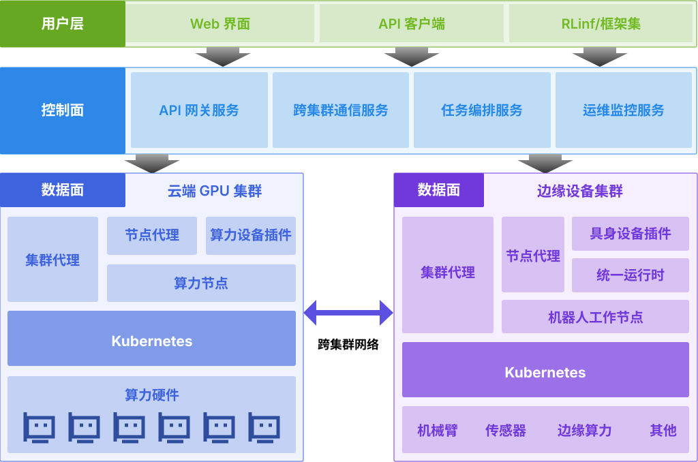
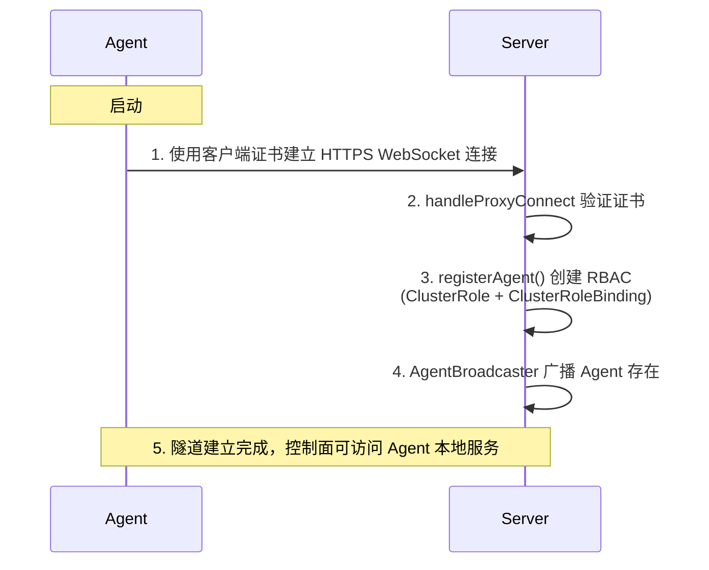
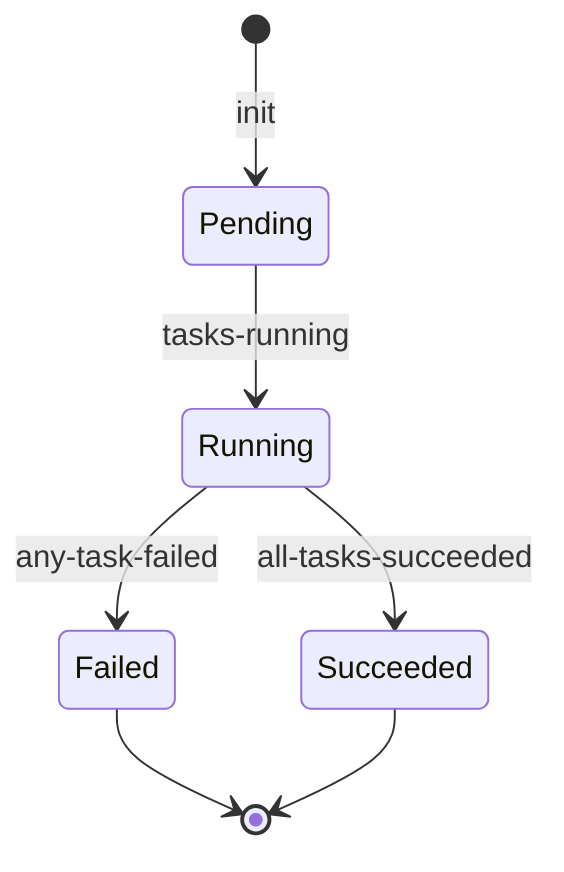
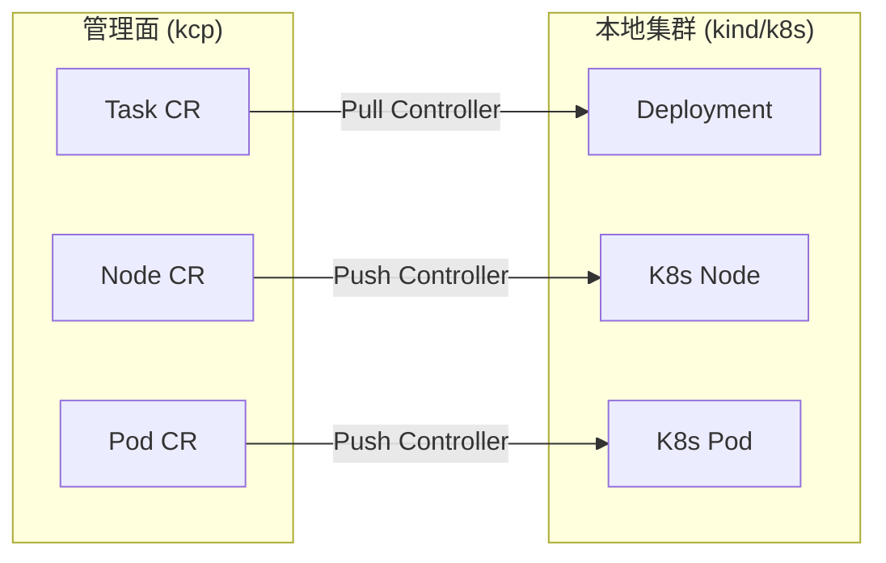
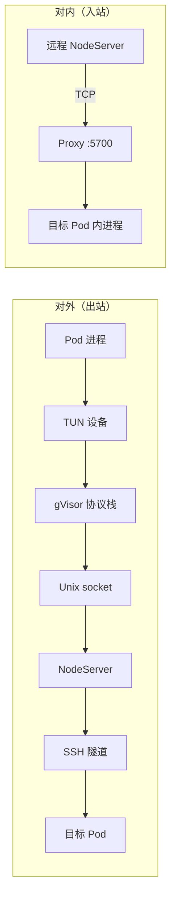
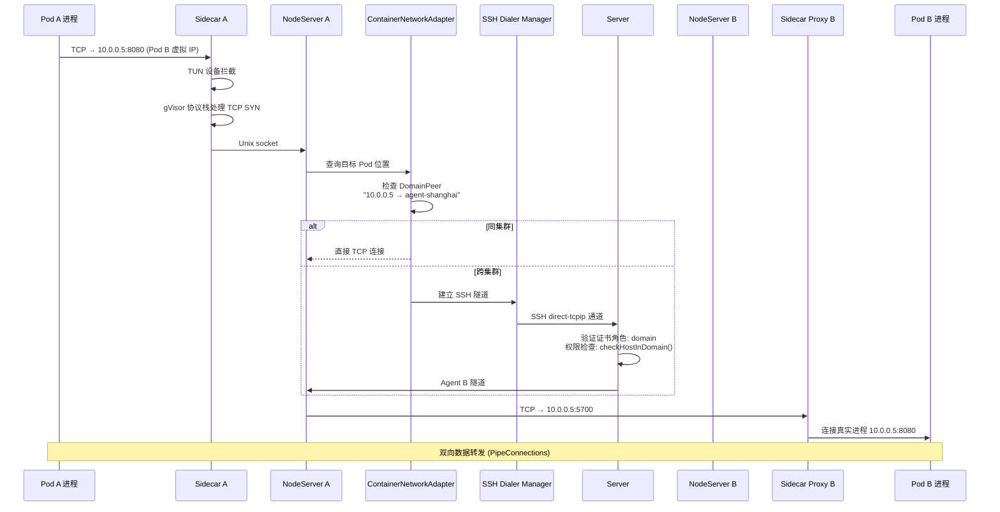
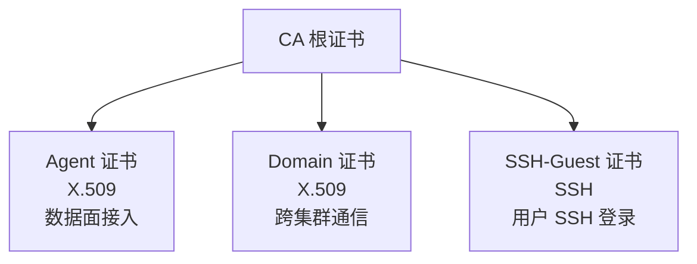
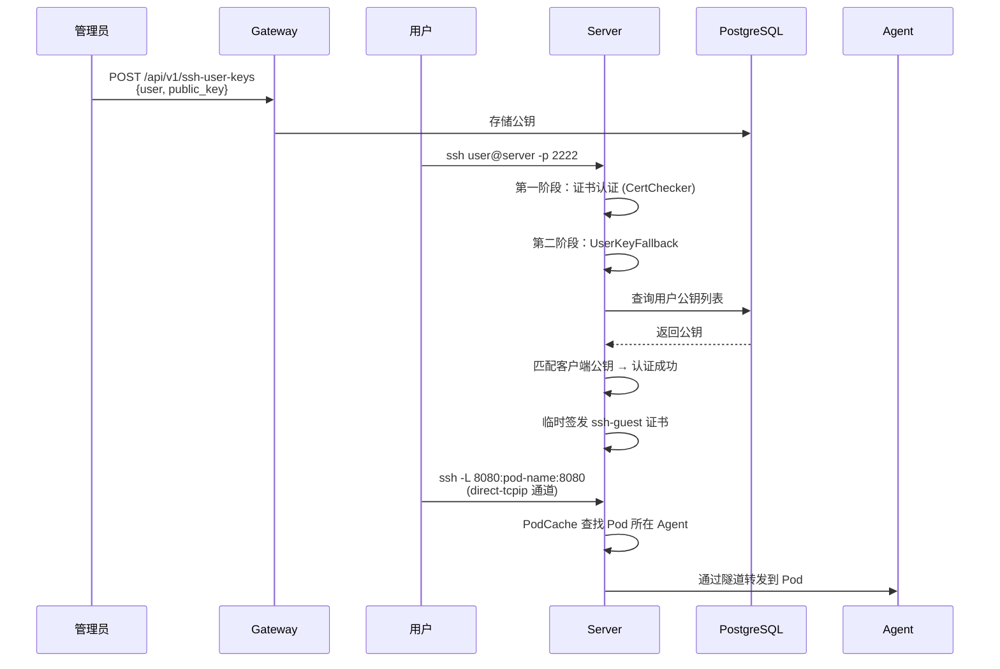
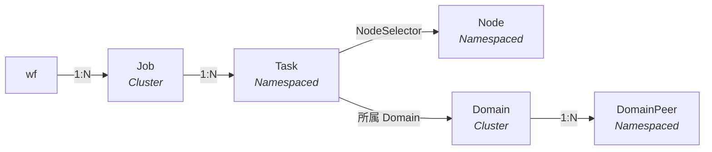

# 技术架构

## 1. 设计目标

RLark 是一个面向跨集群具身智能场景的云原生纳管平台，核心设计目标：

1. **云端到端侧的工作负载编排**：从云端 GPU 训练（RL/LLM）到端侧部署（机械臂、传感器、摄像头），统一的声明式抽象覆盖具身智能全链路
2. **多运行时数据面**：以 Kubernetes 运行时统一纳管云端 GPU 集群与端侧设备，形成云端训练、跨集群协同和具身设备部署的完整链路；后续将通过 Docker 和 Raw 运行时扩展更多轻量端侧场景
3. **跨集群资源池化**：将分布在不同地域的 GPU 集群和端侧设备统一管理，形成逻辑上的单一资源池
4. **Pod 间直接网络通信**：具身智能场景中训练进程与端侧机器人之间需要实时通信，要求跨集群 Pod 能够直接建立 TCP 连接
5. **安全隔离**：多租户下的具身智能任务需要网络隔离，不同团队/项目的设备和数据不能互相访问

## 2. 总体架构

RLark 采用**控制面—数据面**分离架构，控制面使用 kcp 作为兼容 Kubernetes 的 API Server，Agent 将云端 GPU 集群与端侧 Kubernetes 节点统一接入控制面。可选的 **embodied-runtime** Device Plugin 部署到配有机械臂（ROS 1/2）或摄像头硬件的 Kubernetes 节点，将这些设备作为 Kubernetes 资源暴露；后续将通过 Docker 和 Raw 数据面运行时适配更多轻量端侧环境。



## 3. 控制面组件

### 3.1 Server

Server 是控制面核心，负责所有 Agent 和外部客户端的连接管理。

**关键职责**：

| 功能         | 实现                                                      | 关键文件                                                         |
| ---------- | ------------------------------------------------------- | ------------------------------------------------------------ |
| Agent 隧道管理 | 基于 remotedialer 的反向代理，Agent 主动连接 Server 建立 WebSocket 隧道 | [handle\_proxy.go](https://github.com/RLinf/RLark/tree/main/apps/rlark/pkg/server/handle_proxy.go)         |
| 证书签发       | X.509 和 SSH 证书的签发/吊销，支持 agent/domain/ssh-guest 等角色      | [sign.go](https://github.com/RLinf/RLark/tree/main/apps/rlark/pkg/server/sign.go)                          |
| SSH 服务     | 用户 SSH 登录认证（证书 + 公钥两阶段），direct-tcpip 通道转发               | [ssh\_server.go](https://github.com/RLinf/RLark/tree/main/apps/rlark/pkg/server/ssh_server.go)             |
| Peer 互联    | Server 间 Peer-to-Peer 连接管理                              | [peer\_manager.go](https://github.com/RLinf/RLark/tree/main/apps/rlark/pkg/server/peer_manager.go)         |
| K8s 代理     | 将 K8s API 请求通过 Agent 隧道转发到数据面集群                         | [kube\_proxy.go](https://github.com/RLinf/RLark/tree/main/apps/rlark/pkg/server/kube_proxy.go)             |
| Pod 缓存     | 基于 Informer 的内存 Pod 缓存，用于 SSH 快速查找目标 Pod                | [caches/pod\_cache.go](https://github.com/RLinf/RLark/tree/main/apps/rlark/pkg/server/caches/pod_cache.go) |

**Agent 连接生命周期**：



### 3.2 Gateway

Gateway 是面向用户的 HTTP API 网关，提供 RESTful 接口。

**关键职责**：

| 功能       | 路由                                                               | 文件                                                    |
| -------- | ---------------------------------------------------------------- | ----------------------------------------------------- |
| CRD CRUD | `GET/POST/PUT/PATCH/DELETE /api/v1/rlinf.io/v1alpha1/{resource}` | [router.go](https://github.com/RLinf/RLark/tree/main/apps/rlark/pkg/gateway/router.go)              |
| 证书管理     | `POST /api/v1/certificates/agent`                                | [cert\_handler.go](https://github.com/RLinf/RLark/tree/main/apps/rlark/pkg/gateway/cert_handler.go) |
| SSH 密钥   | `GET/POST/DELETE /api/v1/ssh-user-keys`                          | [suk\_handler.go](https://github.com/RLinf/RLark/tree/main/apps/rlark/pkg/gateway/suk_handler.go)   |
| Pod 日志   | `GET /api/v1/.../jobs/:name/logs`                                | [job\_logs.go](https://github.com/RLinf/RLark/tree/main/apps/rlark/pkg/gateway/job_logs.go)         |
| 监控指标     | Prometheus middleware                                            | [metrics.go](https://github.com/RLinf/RLark/tree/main/apps/rlark/pkg/gateway/metrics.go)            |

### 3.3 Controller-Manager

Controller-Manager 运行在控制面，负责协调高层资源的生命周期。

**控制器列表**：

| 控制器                 | 职责                                                      | 关键文件                                               |
| ------------------- | ------------------------------------------------------- | -------------------------------------------------- |
| Job Controller      | 将 Job 拆分为 Task，驱动状态机 (Pending→Running→Succeeded/Failed) | [job/](https://github.com/RLinf/RLark/tree/main/apps/rlark/pkg/controllermanager/job/)           |
| Domain Controller   | 管理 Domain CRD，分配 IP 子网，签发 DomainPeer 证书                 | [domain/](https://github.com/RLinf/RLark/tree/main/apps/rlark/pkg/controllermanager/domain/)     |
| Task Controller     | 监听 Task 状态，同步到对应的 Job                                   | [task/](https://github.com/RLinf/RLark/tree/main/apps/rlark/pkg/controllermanager/task/)         |
| Node Controller     | 监听 Node 注册/离线事件                                         | [node/](https://github.com/RLinf/RLark/tree/main/apps/rlark/pkg/controllermanager/node/)         |

**Job 状态机**：



## 4. 数据面组件

### 4.1 Agent

Agent 部署在每个数据面集群中，有两种运行模式：

| 模式        | 组件           | 职责                                                              |
| --------- | ------------ | --------------------------------------------------------------- |
| `cluster` | clusterAgent | 资源同步：Pull 控制器（管理面 CR → 本地 k8s 资源）+ Push 控制器（本地 k8s 状态 → 管理面 CR） |
| `node`    | nodeAgent    | 网络路由：运行 NodeServer，处理跨集群 Pod 流量转发；镜像预拉取：将分发到节点的任务镜像预拉取到节点容器运行时（containerd/docker） |

**clusterAgent 控制器**：



**Pull 控制器**（以 Task 为例）：

1. 监听管理面 Task CR 的创建/更新/删除（带 finalizer 保护）
2. 将 Task 解码为 execution snapshot，并选择 Kubernetes Runtime 和面向 Ray 的 Kubernetes Workload Adapter；旧版 Deployment、DaemonSet 或 StatefulSet discriminator 只选择其 carrier kind
3. 编译声明式对象计划，由 Adapter 选择 ownership、lifecycle、owned field、update mode 和 typed Runtime reconcile profile；向 Adapter 请求有界 identity inventory，读取对应 Runtime 快照，再计算所需操作
4. 按顺序执行幂等 Apply/Delete；`Replace` 对象先按 UID 校验并删除，再由后续 reconcile 重建；运行中的 Task 在期望 generation 变化后也会重新调谐
5. 在编译期间应用 Ray bootstrap 等 Workload 自有 Pod 模板修改，再解析显式 Environment requirement，并且只向 Adapter 授权的 PodTemplate target 绑定跨 Domain Network Sidecar
6. 停止、重启或删除时使用 claim 中冻结的 Workload implementation 生成 identity inventory，不重新编译当前 Spec，并在确认归属明确的主 workload 已消失后才移除 finalizer；仅为兼容升级，删除中的旧 claim 如果两个 selector 字段都缺失，可以从仍受 finalizer 保护的 Task 解码并校验 selector registration，但不编译资源也不写回该 selector；无法解码的已 claim Task会保留 workload 并等待恢复

**Push 控制器**：

1. 监听本地 K8s 资源变化（Pod 创建/删除/状态变更）
2. 定向观测发生变化的 workload root、其拥有的 Pod 和 Pod Event，不执行完整期望计划 diff
3. 将 workload 状态同步到管理面对应的 Task 和 Pod CR
4. Node 信息（地址、容量、GPU 数量）定期上报

当前只有进程内 Kubernetes 实现属于生产 workload 路径。项目已经为未来外部实现定义版本化 Runtime Provider 和 Workload Adapter gRPC 合同，但默认 Task controller 尚不选择远程实现。所选 Workload Adapter 会接收完整 Workload configuration，并负责所有 Workload-specific 可选功能；系统不再提供独立 Workload Extension service。详见 [Runtime、Workload 与 Environment 边界](developer-guide/runtime-provider.md)。

### 4.2 Network Sidecar

Task 的 domain 非空时，Workload Adapter 会声明跨 Domain Environment requirement 和精确 PodTemplate target。可信 Kubernetes Environment Handler 始终将 Sidecar 注入为 restartable init container。最终 Runtime lowering 阶段会在 `KUBERNETES_SUPPORT_SIDECAR_FEATURE` 不为 `false` 时保留该形式；值为 `false` 时，会把 Adapter 声明的 Pod 或 PodTemplate unit 中所有 restartable init container 转换为普通 container。可信 image 配置缺失或 container/volume 声明冲突时，会在 Runtime effect 前 fail-closed。

**关键文件**：[sidecar/server.go](https://github.com/RLinf/RLark/tree/main/apps/rlark/pkg/network/sidecar/server.go)

**双重角色**：



**启动流程**：

1. 通过 NodeServer 的 `/get_ip` 端点获取本 Pod 的虚拟 IP 和子网前缀
2. 启动 Proxy 监听（`:5700`），接收其他 Pod 的转发连接
3. 创建 TUN 设备 + gVisor 协议栈，拦截 Pod 出站流量
4. 出站流量通过 Unix socket 发送给 NodeServer 路由

### 4.3 NodeServer

NodeServer 运行在每个节点上（由 nodeAgent 管理），负责节点级网络路由。

**关键文件**：[nodeserver/server.go](https://github.com/RLinf/RLark/tree/main/apps/rlark/pkg/network/nodeserver/server.go)

**核心功能**：

- 接收 Sidecar 的 Unix socket 连接，解析目标地址
- 调用 `ContainerNetworkAdapter` 查找目标 Pod 在所有 DomainPeer 中的位置
- 同集群：直接 TCP 连接目标 Pod 的 Proxy
- 跨集群：通过 SSH 隧道连接 Server，再由 Server 转发到目标 Agent 的 NodeServer

### 4.4 ContainerNetworkAdapter

**关键文件**：[container/network.go](https://github.com/RLinf/RLark/tree/main/apps/rlark/pkg/agent/container/network.go)

**路由决策**：

```go
func (a *containerNetworkAdapter) GetContainerNetworkDial(...) (utils.Dial, error) {
    // 1. 同集群 → 直接 TCP 连接目标 Pod 的 Proxy
    if targetPod.GlobalNamespace == a.globalNamespace {
        return dialer.DialContext(ctx, "tcp", net.JoinHostPort(targetPod.LocalIP, "5700"))
    }
    // 2. 跨集群 → SSH 隧道
    dialer := a.sshDialerManager.GetDialer(sshdialer.DomainInfo{
        ID: domainID, SSHAddress: sshAddr, Certificate: cert, PrivateKey: key,
    })
    return dialer.DialContext(ctx, "tcp", target)
}
```

### 4.5 SSH Dialer Manager

**关键包**：[network/sshdialer](https://github.com/RLinf/RLark/tree/main/apps/rlark/pkg/network/sshdialer)

`DialerManager` 维护所有 Domain 的连接池，`GetDialer(DomainInfo)` 返回绑定单个 Domain 的拨号器。设计要点：

- 每个 Domain 在故障恢复时只建立一条共享的多路复用 SSH transport；并发调用者等待同一个有超时上限的握手，避免形成重连风暴
- 新 channel 选择负载最低的健康连接，空闲物理连接由后台 GC 回收
- 调用者取消只停止自身等待，不会取消共享恢复，也不会增加 Domain 的重连退避
- 明确的传输层故障立即关闭；channel 自身超时不会影响其他 channel，keepalive 超时则先等待活跃 channel 排空，再按宽限期强制关闭
- 重连失败指数退避（1s → 2s → 4s → ... → 30s）
- SSH 握手有硬超时，Manager 关闭时会取消仍在进行的重连
- 证书、私钥或端点发生变化时推进 Domain generation，并排空旧 generation 的 transport
- 后台 GC 关闭空闲或超龄连接并回收不活跃的 Domain entry（默认 24 小时）
- 数据路径上的活跃时间使用原子、限频更新，避免每次读写获取互斥锁

### 4.6 Embodied Runtime

**embodied-runtime** 以节点级 Device Plugin 为核心，通常通过 DaemonSet 部署到各数据面节点，用于管理机械臂（ROS 1/2）和摄像头硬件。Camera、ROS 1 和 ROS 2 控制器均可独立选择作为本地子进程运行、作为专用 Pod 运行或保持禁用。它与 Agent 集成，将物理设备作为 Kubernetes 设备资源（`rlinf.io/device`）暴露，使训练 Task 可以像申请 GPU 一样申请机械臂和摄像头。

**关键文件**：[apps/embodied-runtime/](https://github.com/RLinf/RLark/tree/main/apps/embodied-runtime/)

**组件概览**：

| 组件 | 职责 | 关键文件 |
|-----------|---------------|----------|
| Device Plugin | 向 kubelet 注册 `rlinf.io/device`；检测节点本地硬件；向 Task Pod 注入 socket 和 CLI 二进制 | [plugin.go](https://github.com/RLinf/RLark/tree/main/apps/embodied-runtime/pkg/deviceplugin/plugin.go) |
| Mutating Webhook | 自动向申请 `rlinf.io/device` 的 Pod 注入 `devinit` init 容器；管理 CA 证书和 serving 证书 | [webhook.go](https://github.com/RLinf/RLark/tree/main/apps/embodied-runtime/pkg/deviceplugin/webhook.go) |
| ros-controller | 管理 ROS 1（`roscore` + `roslaunch`）机器人生命周期；通过 Unix socket 暴露 gRPC API | [roscontroller/](https://github.com/RLinf/RLark/tree/main/apps/embodied-runtime/pkg/roscontroller/) |
| ros2-controller | 管理 ROS 2 机器人生命周期；通过 Unix socket 暴露 gRPC API | [ros2controller/](https://github.com/RLinf/RLark/tree/main/apps/embodied-runtime/pkg/ros2controller/) |
| camera-controller | 管理摄像头（V4L2 / RTSP / RealSense）生命周期；ffmpeg 转码；通过 Unix socket 暴露 gRPC API | [cameracontroller/](https://github.com/RLinf/RLark/tree/main/apps/embodied-runtime/pkg/cameracontroller/) |
| CLI（rosctr / camctr） | 挂载到 Task Pod 中的命令行工具，用于直接控制机器人/摄像头 | [cmd/rosctr/](https://github.com/RLinf/RLark/tree/main/apps/embodied-runtime/cmd/rosctr/) |

**设备生命周期**：

1. Device Plugin 检测硬件（V4L2 摄像头、机器人控制器）并向 kubelet 注册
2. Task Pod 在 spec 中申请 `rlinf.io/device` 资源
3. **Mutating Webhook** 拦截 Pod 创建请求，自动注入 `devinit` init 容器（申请同一资源），执行 `devinit setup` 在 Pod 网络命名空间中创建 macvlan
4. Allocate 时，Device Plugin 将 Unix socket 和 CLI 二进制注入 Pod
5. 任务容器通过 gRPC over Unix socket 与 ros-controller / camera-controller 通信
6. Pod 终止时，Device Plugin 清理并归还设备到资源池

## 5. 跨集群 Pod 网络数据流

以 Pod A（集群北京）访问 Pod B（集群上海）为例：



## 6. 安全体系

### 6.1 证书层次



### 6.2 权限模型

| 证书角色        | 权限                               |
| ----------- | -------------------------------- |
| `agent`     | 接入 Server 隧道，代理 K8s API 请求       |
| `domain`    | 访问同 Domain 下的 Pod，建立跨集群网络连接      |
| `ssh-guest` | 通过用户公钥认证后访问 SSH 堡垒机；尚未实现按 Pod 授权 |
| `admin`     | 签发证书和 Kubernetes impersonation；Gateway 吊销接口尚未实现 |

### 6.3 用户 SSH 登录流程



## 7. CRD 资源模型



## 8. 关键设计决策

### 8.1 为什么用 kcp 而不是原生 k8s API Server？

kcp 相比原生 k8s API Server 更加轻量，可以脱离完整的 Kubernetes 集群独立部署，降低了控制面的资源开销和运维复杂度。同时 kcp 原生的逻辑集群（logical cluster）概念与 RLark 的 Domain 概念天然契合，为未来多租户场景预留了扩展性。

### 8.2 为什么用 SSH 隧道而不是 VPN？

VPN 方案需要开放底层网络，在异构集群环境下配置复杂。SSH 隧道方案：

- 基于 TCP，无需修改网络基础设施
- 利用 SSH 证书实现细粒度权限控制（每个 Domain 独立证书）
- 连接复用（ssh.Client 多路复用），减少握手开销
- 天然支持用户认证（SSH 公钥登录）

### 8.3 为什么用 TUN + gVisor 而不是 iptables/CNI？

iptables/CNI 方案需要修改节点网络配置，权限要求高。TUN + gVisor 方案：

- 运行在用户态，但创建 TUN 设备仍需要 privileged 权限
- gVisor netstack 处理所需的网络协议
- 可以作为 Sidecar 容器注入，与业务容器解耦
