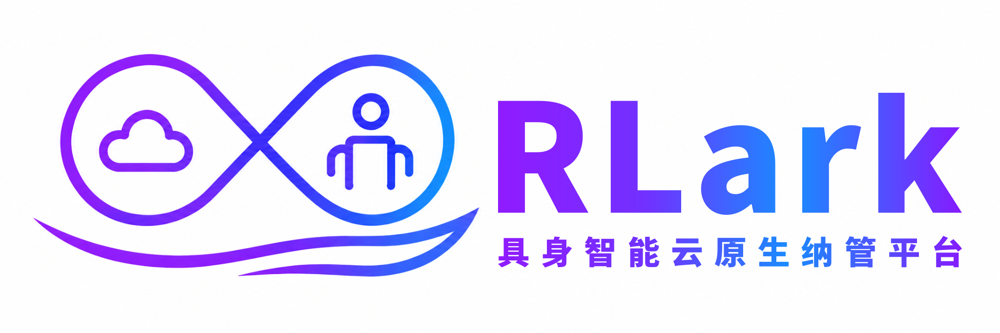

---
hide:
  - toc
---

<div align="center">
  
</div>

<div align="center" markdown>
  
  
  
</div>


<h1 align="center">
  <sub>RLark 具身智能云原生纳管平台</sub>
</h1>

以云原生方式统一纳管跨集群具身智能工作负载，覆盖云端 GPU 训练、跨集群协同与端侧设备部署，连接 GPU 集群、机械臂、传感器和摄像头等异构资源。

## 最新动态

- [2026/09] RLark 现已开源。

## 核心能力

- **具身智能工作负载编排**：从云端 GPU 训练（RL/LLM）到端侧部署（机械臂、传感器、摄像头），统一的声明式 Job/Task 抽象覆盖全链路
- **多运行时数据面**：基于 Kubernetes 统一纳管云端 GPU 集群与端侧设备，覆盖训练到具身设备部署的完整链路；面向不适合部署 Kubernetes 的轻量端侧场景，后续将扩展 Docker 和 Raw 运行时支持
- **跨集群资源抽象**：通过 Domain（虚拟网络域）和 Node（计算节点）CRD 统一管理多地 GPU 集群和端侧设备，控制面运行在 kcp 之上
- **声明式训练任务**：Job/Task 抽象，支持声明式分布式训练与 Ray 集群定义
- **跨集群 Pod 网络**：基于 TUN 设备 + gVisor 协议栈 + SSH 隧道的虚拟网络，Pod 跨集群通信无需 NAT 穿透 — 云端 GPU 与端侧机器人直接通信
- **证书体系**：X.509 + SSH 双层证书，支持 Agent 接入、Domain 范围的跨集群转发鉴权、用户 SSH 登录鉴权
- **可观测性**：Prometheus 指标暴露、Pod 日志实时查询、Web 管理界面

## Roadmap

### 已实现

- 基于 Kubernetes 统一纳管云端 GPU 集群与端侧设备
- 面向分布式训练和 Ray 工作负载的声明式 Job/Task 编排
- 通过 Domain 和 Node CRD 管理跨集群资源
- 基于 TUN 设备、gVisor 协议栈和 SSH 隧道的跨集群 Pod 网络
- 基于 X.509 和 SSH 证书的身份认证
- Prometheus 指标、Pod 实时日志和 Web 管理界面

### 未来计划

- 面向轻量数据面的 Docker 运行时支持
- 面向无容器编排环境主机和端侧设备的 Raw 运行时支持
- 更完善的账号、角色与权限管理
- 持续优化 Web UI 易用性和操作流程
- 优化跨集群网络吞吐、时延与资源效率

## 架构概览

下图是控制面和数据面主要组件的简化视图。

<div style="max-width: 85%; margin: 0 auto;">
  
</div>

## 快速开始

选择以下两种已验证流程之一：

- **一键 CLI 方式**：部署控制面和两个 kind 数据面集群，并验证 Pod 跨集群网络。
- **UI 交互方式**：在 Web 控制台创建集群和 Domain，部署两个 kind 数据面，将一个 Job 调度到两个集群并验证网络连通性。

一键 CLI 流程如下：

```bash
# 克隆仓库并进入项目目录
git clone https://github.com/RLinf/RLark.git
cd RLark

# 一键部署：控制面（Docker Compose）+ 2 个 kind 集群 + 跨集群网络验证
bash apps/rlark/docs/examples/quickstart.sh
```

!!! tip "系统要求"
    - 操作系统：Linux（推荐）或 macOS
    - CPU 架构：amd64 / arm64
    - 内存：建议 ≥ 16 GB
    - 磁盘：建议 ≥ 20 GB 可用空间
    - 依赖：Docker ≥ 24.0、kind ≥ 0.20、kubectl ≥ 1.28、jq、python3
    - 中国大陆用户：如 Docker Hub 拉取镜像失败，脚本会自动尝试国内镜像源

详见 [快速开始指南](quickstart.md) 了解完整前置依赖和分步说明。

## 技术栈

- **语言**：Go (控制面/Agent) + TypeScript (前端)
- **编排**：Kubernetes (kcp + kind)
- **网络**：TUN 设备 + gVisor netstack + SSH 隧道
- **证书**：X.509 mTLS + SSH 证书
- **数据库**：PostgreSQL (Bun ORM)
- **监控**：Prometheus
- **前端**：React + Vite + TypeScript
