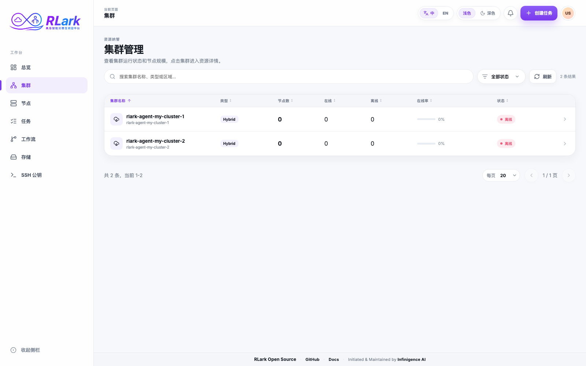
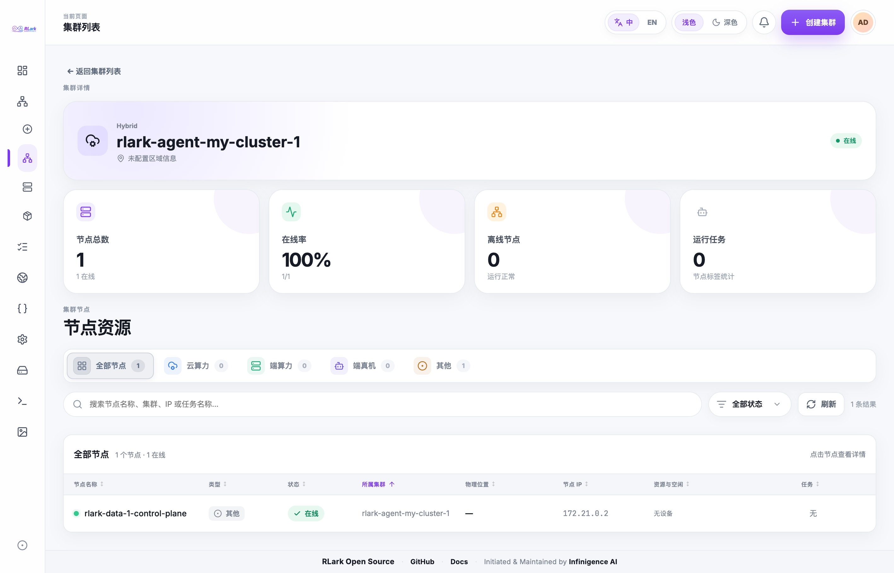
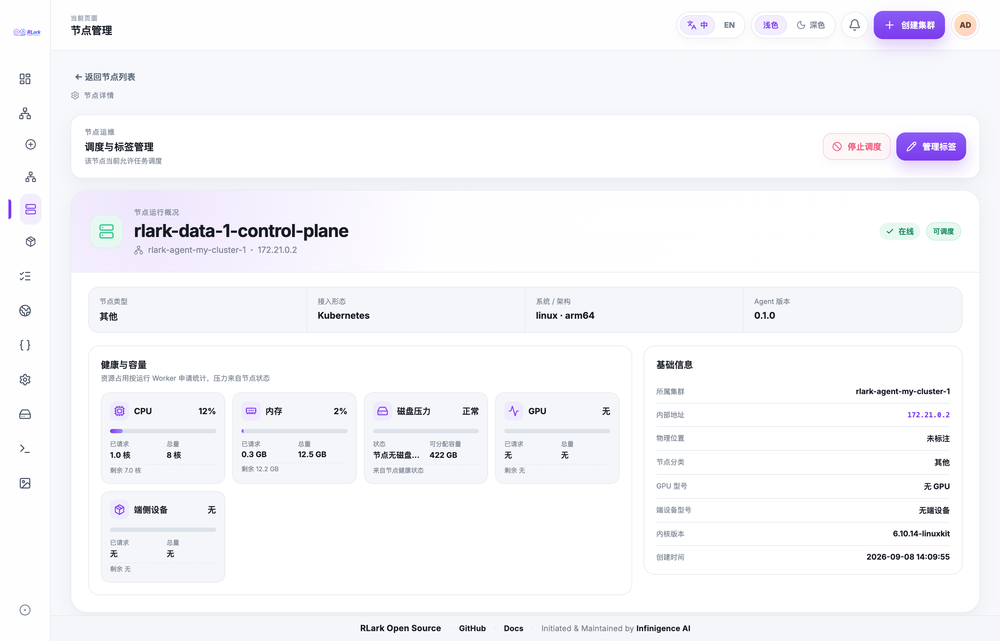

# 集群与节点

使用本指南在创建 Job 前查找数据面集群，并确认其中有合适的 Worker 资源。

## 任务一：查找可用集群

1. 在业务平台打开**集群**。
2. 按集群名称或 ID 搜索，或使用列表提供的元数据筛选。
3. 检查集群状态、在线率和 Worker 数量。
4. 打开计划使用的集群。

Cluster 是集群作用域的 RLark 资源。`spec.agentNamespace` 是其 Node CR 成员关系的权威边界：集群详情与节点数只包含该命名空间中的 Node CR。`rlark.io/cluster-id` 仅用于兼容查询，不能证明成员归属。每个已注册 Worker 都有控制面的 `node-heartbeat-<node-name>` Lease。Server 会为活跃的 node-Agent 连接续租，并在 `holderIdentity` 记录连接实例 ID。续约是幂等的 Lease 写入而非 leader election，因此重新连接的 Agent 在首次续约成功后即被视为在线，无需等待上一持有者的 Lease 时长耗尽。Node Controller 只使用控制面时间判断其续约时间。心跳仅更新 Lease，不会高频重写完整 Node Status。默认 Lease 时长为 45 秒、续约周期为 15 秒，Controller 另有 15 秒宽限窗口。Server 可通过 `--node-heartbeat-lease-duration`、`--node-heartbeat-renew-deadline`、`--node-heartbeat-retry-period` 配置；controller-manager 可通过 `--node-heartbeat-timeout`、`--node-heartbeat-grace-period` 配置。宽限窗口内保持 `AgentConnected=True`；超过窗口后，过期 Lease 只会使对应 Worker 离线。

列表的**状态**列和状态筛选使用以下集群阶段：

- **Online（在线）**：所有已注册 Worker 均已连接、就绪，且未被停用调度。
- **Offline**：没有任何已注册 Worker 已连接且就绪。若占比最高的异常 Reason 为 `LeaseExpired` 或 `HeartbeatNeverReceived`，控制台显示**已失联**；否则显示**不可用**。
- **Downgraded（服务降级）**：仍有至少一个 Worker 已连接且就绪，但一个或多个 Worker 已降级、失联或已被停用调度。
- **Cordoned（停用调度）**：持续的 Cluster 意图禁止调度；该操作不会停止已有 Task。
- **Draining（排空中）**：管理员已请求有序排空。RLark 会将已处于 Succeeded 或 Failed 终态的 Task 视为已排空，并为其余 Task 记录排空停止请求，随后等待每个 Task 针对当前 generation 上报停止状态。未声明 Runtime 的 Task 不可能承载任何工作负载，因此同样视为已排空，不会阻塞排空。拥有 Job 的 Task 由 Job 控制器下发暂停；即使排空中被停用调度的 Cluster 阻止新调度，Job 控制器仍会继续下发该暂停。独立 Task 由 Cluster 控制器直接暂停。检查会从 1 秒到 1 分钟指数退避。排空超过 30 分钟仍未完成时，会保持请求状态，并通过 `Progressing=True`、`Reason=DrainTimedOut` Condition 列出阻塞的 Task 以便恢复处理；排空完成本身不会更改持续的排空或停用调度意图，但 **Draining（排空中）** 阶段只表示排空仍在进行：一旦所有可排空的 Task 均上报停止，阶段会回落到持续的调度意图（**Cordoned（停用调度）**），控制台随即显示为停用调度，并把**驱逐任务**按钮恢复出来（不再显示**取消驱逐**），而排空请求与已停止的 Task 保持不变。排空仍在进行时，可使用**取消驱逐（Cancel Drain）**清除停止请求，并且只恢复由排空暂停的独立 Task；排空前就已暂停的 Task 保持自身的期望状态。出现当前 generation 的 `Progressing=False`、`Reason=DrainComplete` 后，可使用**恢复调度（Resume Scheduling）**取消排空意图并重新接收任务；被排空停止的 Task 不会随恢复调度自动恢复，而是保持 Stopped，直到用户启动其 Job 或取消 Task 挂起。
- **Delisted（已下架）**：管理员已将集群及其节点从用户控制台隐藏。对非管理员，节点页面和 Node 列表 API 不返回该集群的节点；重新上架后节点会再次可见。管理员仍可查看集群及其节点，以便执行运维或上架恢复。

列表显示 Worker 总数，以及已连接就绪、降级、失联和已停用调度的 Worker 数。可用率按 `已连接就绪 Worker / Worker 总数` 计算。因资源压力而降级的 Worker 会同时计入已连接就绪和降级，但不参与新任务放置。控制器会从不可用候选 Worker 的稳定 Node Condition Reason 中选择出现次数最多的值写入 `status.dominantFailureReason`；次数相同时按字典序选择。这些数量和原因用于解释观测到的阶段；调度仍会逐个检查 Node Condition 与能力。

Cluster Controller 还会通过集群心跳 Lease 单独记录 Cluster Agent 的连接状态，写入 `AgentConnected` Condition。该 Condition 不会改变集群阶段；即使已注册 Worker 仍上报就绪，集群心跳过期或缺失也能被观察到。

管理员可使用**暂停调度（Pause Schedule）**暂停新任务调度；当集群处于 Cordoned 状态或其排空已完成时，使用**恢复调度（Resume Schedule）**恢复新任务调度；使用**驱逐任务（Drain）**仅停止所选集群中的 RLark Task，使用**下架（Delist）**停止向用户展示集群，使用**删除（Delete）**永久清理集群及其数据面资源，使用**上架（Restore）**恢复可见性且不改变此前的调度意图。在管理端操作菜单中，**驱逐任务**仅在 **Cordoned** 且有运行中任务（runningJobs 不为 0）时可用；处于 Cordoned 但无运行中任务时置灰并提示**无运行中任务**；**下架**和**删除**仅在 **Cordoned** 且 runningJobs 为 0 时可用。初始未暂停调度时，驱逐任务、下架和删除均置灰。对于 **Delisted（已下架）** 集群，操作菜单仅提供**上架**和**删除**两个选项。下架与由心跳缺席导致的 **Offline（离线）**状态不同。仍处于排空状态的集群，只有当前 generation 的 Condition 为 `Progressing=False`、`Reason=DrainComplete` 后才能执行恢复调度；排空未完成时，该操作会被拒绝。对已完成排空的集群执行恢复调度时，还会清除 `spec.draining` 和保存的停用调度状态，使集群重新可被调度，而不是继续被排空意图阻塞；但恢复调度不会释放该集群驱逐停止的 Task，这些 Task 保持 Stopped，直到用户启动其 Job 或取消 Task 挂起。恢复调度不会修复 Agent 连接或节点健康状态；清除暂停调度意图后，集群状态会根据已观测的心跳和节点状态重新计算。已下架集群需先上架后才能执行恢复调度。Job 的结果仍由已观测的 Task 状态聚合得出。

创建 Job 时，控制台展示 **Online（在线）** 和 **Downgraded（服务降级）** 集群。Job 控制器在解析 Task 的节点选择器时也会在服务端强制执行该规则：仅接受在线且可调度的 Node，且其所属的唯一 Cluster 必须同时满足 `spec.cordoned`、`spec.draining`、`spec.delisted` 均为 false，并且阶段为 **Online（在线）** 或 **Downgraded（服务降级）**。Cordoned、Draining、Offline 和 Delisted 集群均不会作为候选，通过 API 创建的 Job 同样受此约束。Downgraded 集群只会将任务调度至其中在线且可调度的 Worker；离线 Worker 仍不具备调度资格。Gateway 会拒绝在 Cluster 处于 Cordoned、Draining 或 Delisted 期间向其 agent namespace 创建新的独立 Task。同时，Gateway 也会拒绝在这类集群上对已有 Task 执行取消挂起（`spec.suspended` 从 `true` 变为 `false`）的更新和 patch，因为取消挂起会让数据面重新运行负载，绕过调度意图边界。其他对已有 Task 的更新和 patch 仍被允许以进行运维恢复，包括挂起 Task（`spec.suspended` 设为 `true`）或不改变 `spec.suspended` 的更新。暂停调度不会停止已有 Task；已有 RLark Task 仍由 Drain 负责停止。Gateway 在创建即运行的 Job 以及启动 Job 时也执行同样的调度意图边界：创建 `spec.suspended: false` 的 Job、`POST /jobs/:name/start`，以及取消挂起 Job 的更新和 patch，在 Job 的 Task 模板选中的全部节点都被该规则排除（即都位于 Offline、Cordoned、Draining 或 Delisted 集群，或都不属于任何集群）时都会以 `409 Conflict` 拒绝。以 `spec.suspended: true` 创建的 Job 只是模板，允许创建。

> **截图说明：** 截图来自示例环境，资源名称和数据仅供说明，实际环境会有所不同。

## 任务二：检查集群容量

1. 在集群详情中查看 Worker 总数、离线 Worker 和运行中的 Job。
2. 对比云算力、端算力和真机资源分组。
3. 筛选或搜索 Worker 列表，查找所需硬件。

## 任务三：检查 Worker

1. 从集群详情选择 Worker，或打开**节点**后搜索。
2. 确认 Worker 在线且可调度。
3. 查看接入形态、操作系统、架构和 Agent 版本。
4. 查看 CPU、内存、GPU 的资源声明。`capacity` 是物理资源总量；`allocatable` 是扣除系统预留后的调度声明资源；`used` 是已调度且未终态 Pod 的 requests 汇总。控制台将其分别标记为**可调度量**、**调度已分配**和**调度可用**；只有 `allocatable - used` 才表示调度可用量；这些字段都不是实时硬件利用率。
5. 控制台将文件系统的**监控实际用量**作为独立的观测值展示，绝不用作调度容量。资源压力由 `ResourcePressure` Condition 表达；控制台不会通过对监控样本设置阈值来推断压力。
6. 检查已放置在该节点上的 Job 和 Worker。节点列表的任务汇总与节点详情的 Worker 列表都统计已调度到该节点且尚未进入终态（`Succeeded` 或 `Failed`）的 Pod，因此在启动或重启期间短暂处于 `Pending` 的 Worker 在两处都会显示。

使用节点页面的**刷新**按钮可原位更新当前筛选条件下的全部节点。请求处理中会保留当前行并显示半透明局部遮罩和居中的旋转加载指示，页面其余部分的位置不会变化。

!!! note "节点分类"
业务平台使用 RLark 分类标签组织云算力、端算力和真机 Worker。节点一旦被 RLark 纳管（`rlark.io/enabled=true`）即进入 Worker 视图；Kubernetes 角色不影响可见性，因此管理员纳管控制面节点后，它也会与其他 Worker 一同显示。

## 节点状态与字段所有权

Node 将持续的调度意图与观测事实分离；**Online（在线）**不再同时代表连接、健康和可调度性。

- `spec.unschedulable` 是管理端拥有的持续意图，用于阻止新任务放置；它不会停止已有工作负载。Agent 会将该意图同步到本地 Kubernetes Node：cordon 时设置 `rlark.io/unschedulable=true`，uncordon 时移除该标签。
- `spec.operations` 保存一次性的 `Drain` 或 `EnterMaintenance` 请求。每个请求必须有唯一 `id`；真正的新操作必须使用新的 ID。Drain 端点会复用未完成 Drain 的 ID，不会因重复请求而追加操作。对于 Node `Drain`，集群 Agent 读取 `status.kubernetesNodeUID` 中上报的本地 Kubernetes Node UID，列出实际调度到该 Node 的 Pod，通过 Task UID 证明根工作负载归属后，在对应 Task 上写入包含操作 ID 和 Kubernetes Node UID 的 `spec.drainRequests`；随后 Task Host 删除已证明归属的根工作负载。仅在清理完成后，Task 才会在 `status.drainRequests` 中上报 `WaitingForReschedule`。只要 Drain 操作仍保留在 `spec.operations` 中，Task 就保持停止。当所有 Task 都上报 `WaitingForReschedule` 后，Node Controller 会把已完成的 Drain 操作从 `spec.operations` 中移除，并在移除前为每个被排空的 Task 写入 `rlark.io/node-drain-stopped=<node>` 标记并置为 suspended，避免因移除操作而在仍被 cordon 的 Node 上重启工作负载。取消排空（`uncordon`、`undrain` 或 `recover`）会释放对应的 `spec.drainRequests`，但会刻意保留该标记和 suspended 状态，Task 保持停止，直到运维显式启动其 Job（或取消该 Task 的 suspend）；删除 Node 时才会一并清除标记。RLark 没有专门的重调度组件，启动后的工作负载由 Kubernetes 原生调度器放置；用户自行暂停的 Task 保持其原有期望状态。
- `spec.runtime` 是控制面拥有的运行时引用，`spec.identity` 保存持久的业务注册字段；Agent 不得写入 Node `spec`。本地 Kubernetes Node UID 由 Agent 上报到 `status.kubernetesNodeUID`。
- `status` 中的 `kubernetesReady`、`kubernetesCordoned`、心跳与状态变化时间、调度资源快照、Agent/运行时版本、能力以及有界的 `activeWorkloads` 摘要由 Agent 上报。`capacity` 是声明资源总量，`allocatable` 是调度声明资源，`used` 是已调度 Pod requests 汇总；三者均不是实时利用率。
- `status.storage` 等有界监控快照仅用于观测，不是调度输入。高频监控数据必须通过监控链路采集，不能通过频繁重写 Node Status 上报。
- 仅 Node Controller 根据意图和观测结果计算 `status.phase` 与 `status.conditions`，并通过 `ResourcePressure` 表达资源压力、通过 `Schedulable` 发布唯一的调度判定。Scheduler、Job 和控制台只能只读消费 Node 状态。

调度新工作负载时，应要求控制器写入的 `Schedulable=True` Condition，且观测能力满足需求。Node Controller 依据 `spec.unschedulable`、`AgentConnected`、`Ready` 和 `ResourcePressure` 计算 `Schedulable`；Job Scheduler 与控制台都消费该 Condition，不再各自推导调度规则。当操作员接受风险时，指定节点方式仍可显式将 Task 固定到服务降级节点。Agent 已连接或生命周期 Phase 为 `Ready` 本身不能覆盖管理员的调度意图。滚动升级期间，尚未上报能力快照的 Agent 所对应的 Node 会按旧版 Node 处理：控制器回退到 Node 声明的运行时，并在快照上报后再执行能力与设备校验。

控制台仅在控制器写入的 `Schedulable` Condition 为 `True` 时将 Node 显示为**可用**，不会根据连接、就绪或压力 Condition 自行推导可用性。可调度但存在非致命 `Degraded=True` Condition 的 Node 显示为**服务降级**以便诊断，但由于 `Degraded` 不是调度阻断项，它仍可参与放置。`Schedulable` 不为 `True` 的 Node 一律显示为**不可用**。节点列表的**说明**列会展示控制器写入的 `Schedulable` Reason（例如 `LeaseExpired`、`KubernetesNodeNotReady` 或 `ResourcePressureDetected`），可用性徽标本身不再提供提示浮层；对于服务降级但仍可调度的节点，说明中会包含 `Degraded` Condition 的原因。当节点处于 `Draining` 状态时，**说明**列显示**不可调度/驱逐任务中**，因为排空请求同时会将节点置于暂停调度，通用的 `Schedulable` 原因只会显示为已暂停调度。节点详情页头部的调度标签同样以 `Schedulable` 判定为准：可调度时显示**可调度**，排空中显示**排空中**，其余情况显示**不可调度**，并使用与**说明**列相同的文本作为悬停提示，因此离线节点会显示**不可调度**，悬停提示为例如**不可调度：心跳租约已过期**。可用性筛选仅提供**可用**与**不可用**两项。

### Node Phase 与 Condition

`status.phase` 仅用于 UI 和生命周期概览。Node Controller 按以下优先级计算：`Draining`、维护操作对应的 `Cordoned`、`Offline`、`Registering`、`spec.unschedulable` 对应的 `Cordoned`、`Degraded`、`Online`。`Draining` 仅在 Drain 操作仍未完成时生效；所有 Task 的 drain 观测完成后，由于排空会保持 `spec.unschedulable=true`，Node 会落到 `Cordoned`。在其停止的 Task 已被持久暂停后，已完成的 Drain 操作会被移出 `spec.operations`，此时 `Draining` Condition 为 `False`、Reason 为 `DrainComplete`；Node 仍保持 cordon，直到操作员执行 `uncordon`。`Cordoned` 不会改变 Agent 连接或健康 Condition。`Degraded` 表示资源压力或能力失败，并与就绪状态分离：资源压力不会使 `Ready` 失败，而 Kubernetes Node NotReady 会同时使 `Ready=False`。`ResourcePressure=True` 时 Node Controller 会写入 `Schedulable=False`，因此自动放置会排除该 Node，而已有工作负载继续运行；操作员仍可通过指定节点方式显式将 Task 固定到该节点。二者均不能单独作为调度判断依据。

### Node Condition

Node Controller 写入 Kubernetes 风格的 `status.conditions`：`AgentConnected`、`Ready`、`RuntimeReady`、`NetworkReady`、`StorageReady`、`DeviceReady`、`ResourcePressure`、`Draining`、`Degraded`、`Schedulable` 和 `KubernetesCordoned`。每项均包含 `status`（`True`、`False` 或 `Unknown`）、稳定且供机器读取的 `reason`、供人阅读的 `message` 以及 `lastTransitionTime`。`Ready` 和 `Degraded` 是两态汇总，只会取 `True` 或 `False`：Kubernetes 节点就绪状态未被观测时，`Ready=False` 且 Reason 为 `KubernetesNodeReadyUnobserved`；未知的能力观测由构成它的各个 Condition 表达。`Schedulable` 是 Job Scheduler 与控制台共同消费的唯一调度判定：仅当 `spec.unschedulable` 为 false、`AgentConnected=True`、`Ready=True`、`KubernetesCordoned` 不为 `True` 且 `ResourcePressure` 不为 `True` 时才为 `True`。`KubernetesCordoned` 反映 Agent 观测到的本地 Kubernetes Node `spec.unschedulable`，而 RLark 从不写入该字段；`KubernetesCordoned=True` 表示节点在 RLark 之外被 cordon，由于 Kubernetes 调度器会排除该节点上的所有 Pod，Node Controller 同时写入 `Schedulable=False`（原因为 `KubernetesCordoned`）。`observedGeneration` 表示控制器写入该结论时已观测到的 generation。

`AgentConnected` 仅由心跳 Lease 计算。`Ready` 要求 Agent 连接有效、Kubernetes Node 已就绪、没有排空请求，且运行时、网络和设备等关键能力没有被明确观测为失败。缺少可选能力观测时保持 `Unknown`，不会仅因此将一个已就绪节点标记为离线；但 Kubernetes 节点就绪状态未被观测时，`Ready` 会判定为 `False`。存储压力通过 `StorageReady=False`、`ResourcePressure=True` 和 `Degraded=True` 表达，不会使 `Ready` 失败：Node Controller 会写入 `Schedulable=False`，因此仅因资源压力而降级的节点可继续运行已有工作负载，但不会接收新任务。`Degraded` 本身不改变 `Schedulable`，也不能替代 `Ready`。Node Controller 会通过 `status.drainOperations` 发布每个操作的有界进度；仅当该操作下所有已登记的 Task 请求都针对当前 generation 上报 `WaitingForReschedule` 时，才将其设为 `completed=true`。缺失或过期的 Task 观测始终视为阻塞。Drain 操作会使 `Ready=False`，Node Controller 因此写入 `Schedulable=False`，调度器随之排除该 Node；但 Drain 不会写入 `spec.unschedulable`，如果操作移除后 Node 仍需保持不可调度，请显式执行 cordon。

自动化逻辑必须使用 Condition 的 type、status 和 reason，不能解析 `message`。主要 Reason 包括 `LeaseValid`、`LeaseExpired`、`HeartbeatNeverReceived`、`KubernetesNodeReady`、`KubernetesNodeNotReady`、`KubernetesNodeReadyUnobserved`、`RuntimeUnavailable`、`NetworkUnavailable`、`StorageUnavailable`、`DeviceUnavailable`、`ResourcePressureDetected`、`DrainRequested`、`DrainBlocked`、`Schedulable`、`Unschedulable`、`NotSchedulable`、`KubernetesCordoned`、`KubernetesNotCordoned` 和 `KubernetesCordonUnobserved`。控制台据此区分 Agent 已失联、节点未就绪、运行时或依赖不可用、资源压力和排空状态，而不是根据 `Offline` Phase 推测故障类型。

控制台会本地化条件类型、状态、原因，以及控制器为每种条件固定写入的说明文本。`lastTransitionTime` 以相对时间展示，悬停可查看绝对时间；机器可读的条件类型保留在悬停提示中。

## 完成结果

此时应已选定一个集群，并在需要时得到可匹配就绪、可调度且容量充足 Worker 的节点选择条件。接下来可参照[提交和管理 Job](jobs.md)。

## API 等效操作

查询 Cluster 摘要和 Node CR。字段和过滤参数参见 [API 参考](../api/reference.md)。
