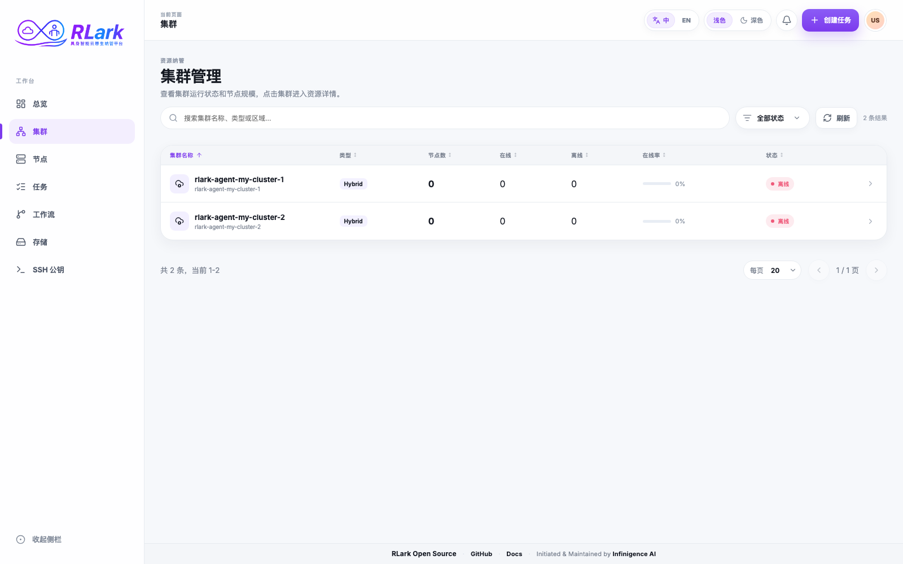
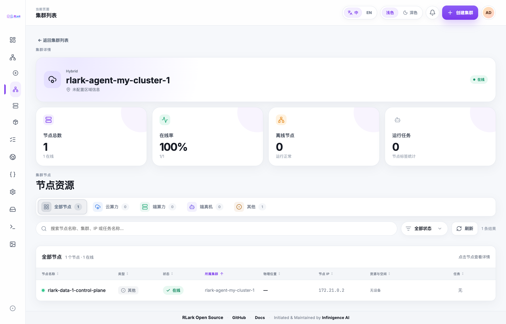
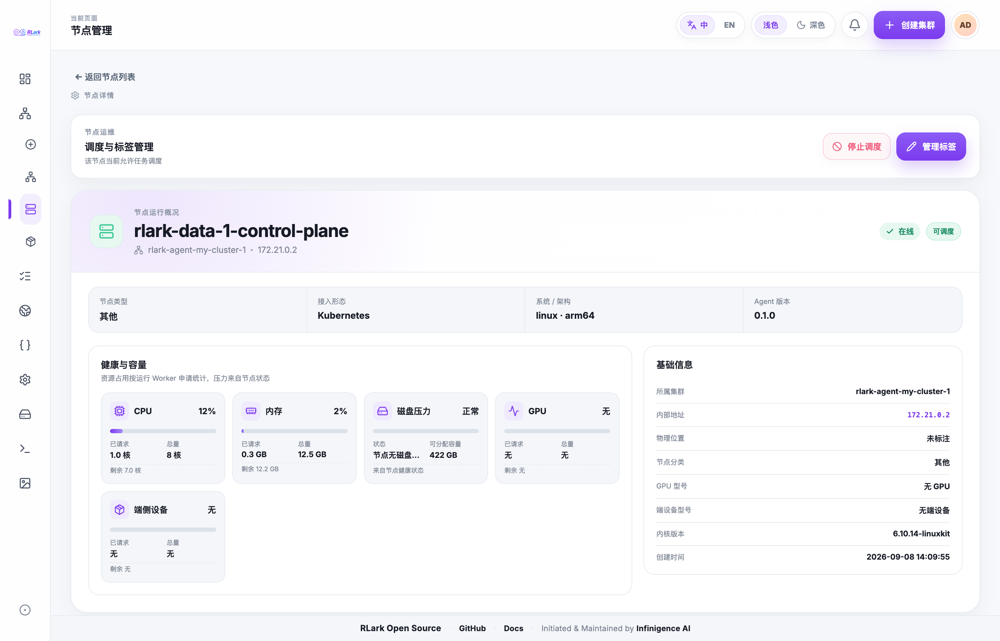

# 集群与节点

使用本指南在创建 Job 前查找数据面集群，并确认其中有合适的 Worker 资源。

## 任务一：查找可用集群

1. 在业务平台打开**集群**。
2. 按集群名称或 ID 搜索，或使用列表提供的元数据筛选。
3. 检查集群状态、在线率和 Worker 数量。
4. 打开计划使用的集群。

Cluster 是集群作用域的 RLark 资源。其 cluster Agent 每 15 秒续约一次控制面的 `heartbeat` Lease，Lease 在 45 秒后过期。每个已注册 Worker 还需要由 `rlark-agent-node` 维护自身的 `node-heartbeat-<node-name>` Lease；节点 Lease 缺失或过期时，仅该 Worker 会离线。各状态含义如下：

- **Online（在线）**：集群心跳有效，且所有已注册 Worker 在线。
- **Offline（离线）**：心跳 Lease 缺失或已过期。
- **Downgraded（降级）**：集群心跳有效，但至少一个已注册 Worker 离线。
- **Cordoned（已封锁）**：持续的 Cluster 意图禁止调度。
- **Draining（排空中）**：Cluster 处于持续的排空期望状态。

> **截图说明：** 截图来自示例环境，资源名称和数据仅供说明，实际环境会有所不同。

## 任务二：检查集群容量

1. 在集群详情中查看 Worker 总数、离线 Worker 和运行中的 Job。
2. 对比云算力、端算力和真机资源分组。
3. 筛选或搜索 Worker 列表，查找所需硬件。

## 任务三：检查 Worker

1. 从集群详情选择 Worker，或打开**节点**后搜索。
2. 确认 Worker 在线且可调度。
3. 查看接入形态、操作系统、架构和 Agent 版本。
4. 查看 CPU、内存、GPU 容量及已申请资源。页面用量来自 Kubernetes requests 汇总，不是实时硬件利用率。
5. 检查已放置在该节点上的 Job 和 Worker。

使用节点页面的**刷新**按钮可原位更新当前筛选条件下的全部节点。请求处理中会保留当前行并显示半透明局部遮罩和居中的旋转加载指示，页面其余部分的位置不会变化。

!!! note "节点分类"
业务平台使用 RLark 分类标签组织云算力、端算力和真机 Worker。旧版分类值及明确上报受支持资源的节点仍可见；Kubernetes 控制面节点不进入业务平台 Worker 视图。

## 完成结果

此时应已选定一个集群，并在需要时得到可匹配在线、可调度且容量充足 Worker 的节点选择条件。接下来可参照[提交和管理 Job](jobs.md)。

## API 等效操作

查询 Cluster 摘要和 Node CR。字段和过滤参数参见 [API 参考](../api/reference.md)。
