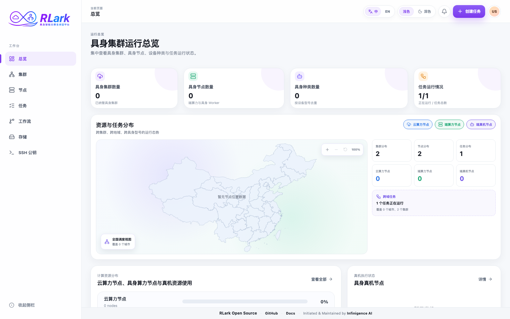

# 控制台访问与导航

## 登录

RLark 有两个登录入口：

| 入口     | 地址                       | 用途                                     |
| -------- | -------------------------- | ---------------------------------------- |
| 业务平台 | `http://<host>:5173`       | 任务管理、Worker、存储、SSH 密钥 |
| 管理后台 | `http://<host>:5173/admin` | 集群纳管、节点、证书、系统配置           |

### 登录步骤

1. 在浏览器中打开控制台地址
2. 输入用户名和密码
3. 点击登录
4. Gateway 签发 JWT access token（默认有效期 8 小时），浏览器在后续 API 请求中以 Bearer token 携带

!!! warning "角色授权仍是粗粒度的"
    Gateway 已对控制面配置和凭据管理强制要求 `admin`。`user` 可管理平台工作负载，但尚未实施逐用户资源所有权，因此已认证用户之间的 Job 或存储对象还没有相互隔离。请继续使用 TLS 和网络访问控制。

## 控制台导航

Astribot 版控制台的侧栏显示 Astribot 标识，RLark 标识位于页脚的 **RLark Open Source** 旁。

### 业务平台页面

| 页面     | 用途                                       |
| -------- | ------------------------------------------ |
| 总览     | 集群、可调度工作负载节点、机器人和运行中任务的仪表盘汇总 |
| 集群     | 浏览和检查已纳管的数据面集群               |
| 节点     | 筛选和检查节点资源、调度状态和健康状态     |
| 任务     | 创建、监控和管理训练任务                   |
| 存储     | 浏览存储类和对象存储                       |
| SSH 密钥 | 管理 Worker 访问的 SSH 公钥                |

### 管理后台页面

**镜像管理**页面用于保存私有镜像仓库凭证，并选择分发范围：仅保存、指定集群或当前及未来的所有集群。展示名称可以重复和修改，RLark 使用内部 ID 标识每条凭证。分发和删除均为异步操作；凭证最终投递到所选 Kubernetes 数据面集群的 `rlark-system` 命名空间。

> **截图说明：** 截图来自示例环境，资源名称和数据仅供说明，实际环境会有所不同。

### 快速查找页面

| 问题                           | 前往                            |
| ------------------------------ | ------------------------------- |
| 判断集群或节点是否可用于调度？ | 集群或节点页面                  |
| 如何创建训练任务？             | 任务 → 创建任务                 |
| 判断任务卡在哪个阶段？         | 任务详情 → Worker 标签          |
| 如何查找应用错误？             | 任务详情 → 日志标签             |
| 如何查看资源使用情况？         | 节点页面 → 节点详情             |
| 如何在容器中打开终端？         | 任务详情 → Worker → WebTerminal |
| 如何配置私有镜像凭证？         | 管理后台 → 镜像管理             |

### 节点删除进度

在**节点管理**里，管理员用行内的**删除**发起节点移除。居中的确认弹窗会汇总节点、集群、IP、状态和类型，列出删除步骤及最多六个受影响的任务；机器可能无法远程到达或节点身份未核实时会单独提示。确认后，控制台在控制面创建节点操作。关闭弹窗或离开页面都不会取消删除：节点行显示**删除中**和当前阶段，右下角任务卡跟随操作进展；任务卡可收起，也可展开为包含全部阶段与条件的详情抽屉。刷新页面后会从操作列表恢复进度。某个阶段失败或成员集群 API 不可达时，详情抽屉给出原因并提供**重试**。删除处于 Pending/Running 时，控制台不会为同一节点再次提交；Gateway 也会以 `409 NODE_OPERATION_IN_PROGRESS` 拒绝重复请求。控制面节点不能删除。

### 场站节点详情

**场站节点**页面使用完整内容宽度。**加入节点**位于工具栏，状态页签显示全部、在线、离线、冲突和已移除数量。工具栏支持按节点名和 UID 搜索、按成员集群筛选、刷新列表，以及查看所选集群的近期节点操作。每个含机器人的集群单独成组，标题为集群名：控制面节点是紧凑行，机器人与它同组，使用相机主导的卡片。机器人卡片显示期望与当前电源、自检、维护、一大三小相机画面和状态，并以每 5 秒一帧的慢速预览刷新。卡片的快捷操作提供符合当前状态的驱动操作（启动或关闭驱动）和上电/下电，以及初始姿势；完整详情仍有全部四个电源与驱动操作。电源或驱动命令会先显示正在下发，再显示 Gateway 是否接受；期望状态立即改变，机器人在下一次上报时跟上，未跟上时可在节点注解 `rlark.io/power` 中看到原因。卡片的当前电源状态也会显示硬件报错或读不到厂商监控，而不是留空；展开详情会显示节点 `rlark.io/power` 注解，便于追查回位为什么被禁用。初始姿势是按住回位：按钮文案会提示按住，短按会说明需要按住；不可用时显示是缺上电、驱动未运行、急停按下还是电源状态硬件报错；松开后显示已停止或被拒绝的原因。勾选机器人后出现现有的批量电源与姿势控制。其他集群按集群分组为紧凑库存卡片。所有详情默认收起，一次只开一个；展开的详情在该行卡片下方占满整行，不会把这一行的卡片拉高。手机端单列排列。

**展开详情**在卡片行下方打开整行面板，不再使用详情抽屉或卡内页签。面板并排展示身份、网络与入网、条件；机器人面板额外提供电源与驱动操作和四路实时相机。冲突记录同时显示记录绑定的 UID 与当前上报的 UID。Node UID、WireGuard 公钥、隧道地址和 SSH 主机指纹等取值可复制。重发、作废以及**删除记录**位于面板顶部，条件不满足时就地显示原因；**删除记录**只在记录符合条件时可用。点击相机可放大查看画面，关闭后焦点回到该相机按钮；按 Escape 收起面板并回到卡片的展开按钮。删除场站节点记录不会移除仍在上报同名节点，该节点会在下一次上报时重新登记。

**入网记录**区块列出通过入网码和 SSH 入网的记录，包括集群、状态、发码人、发码与过期时间、WireGuard 公钥和隧道地址。待使用的入网码可作废，记录可重发；已兑换但未完成的入网可清理后重新开始；SSH 入网记录可打开对应操作。入网码本身不会保存，也不会在签发后再次显示。

### 加入节点

打开**场站节点 → 加入节点**。页面由紧凑页头、目标集群选择和“未加入的机器 / SSH 入网 / 入网码”三种方式组成。机器工作区有 **全部 / 扫描发现 / 手动添加** 三个来源筛选。

- **扫描发现**列出站点 Hub 找到的机器，可搜索、批量勾选；点**加入所选机器**会先打开口令弹窗，而不是直接提交。弹窗按 NodeClass 分组，显示 Orin 入口口令是否已配置，并填写 x86 登录口令和可选的 sudo 口令。x86 留空表示继续使用已保存的机型凭据；填写会覆盖并保存。弹窗先写入机型凭据，再提交入网。这些口令是机型凭据，不是一次性口令；RLark 只显示是否已录入，不显示内容。
- **手动添加**列出仍在进行或已经停住的 SSH 入网记录；点**打开 SSH 记录**会切到 SSH 方式并选中该记录。**添加普通电脑/GPU**直接打开 SSH 表单，提交后机器出现在“手动添加”里。普通 x86/GPU 服务器不会由站点扫描产生，请使用 SSH 或入网码。
- 右侧入网操作栏跟踪批量、SSH 和入网码入网；离开页面后服务端继续。宽屏时操作栏在右侧，窄屏时排在下方。SSH 和入网码方式各自保留表单、流程/说明栏和最近的记录。

### 站点扫描设置

打开**管理后台 → 场站节点 → 扫描设置**（`/admin/stations/network`），也可以从**加入节点**点击**扫描设置**进入。该页面仅管理员可用：Gateway 对读取和保存都返回 `403`，控制台显示只读提示。出现 `404` 表示站点网络尚未初始化。

页头包含网络健康项（Ready、FullyConnected、DiscoveryStale、已观测/当前配置版本）以及**返回入网**和**刷新**。工作台是一个整体：

- 左侧站点栏选择站点。编辑器显示所选站点的状态、集群和扫描 Hub；**取消**和**保存设置**在编辑器页头，未修改时按钮置灰。
- 可以开启或关闭扫描，将间隔设为 10–3600 秒，并填写 1–8 条互不重复的额外 IPv4 网段，前缀长度为 `/22` 到 `/32`。管理面拨号 Hub（`from`）与负责扫描的 Hub 分开选择；扫描只由所选站点已入网的 Hub 执行。
- 右侧详情显示站点的集群和 Hub、可发现 NodeClass 的入口端口与 access/discovery 标记，以及全部出厂主机密钥指纹。窄屏时详情移到编辑器下方。
- 编辑器页头提示未保存的修改；遇到 `409` 冲突时，页面会重新加载最新配置，并提示核对后再保存。切换站点栏时，各站点未保存的修改会保留。
- **扫描范围与限制**是共用的折叠面板，五条规则保持不变：只发现匹配 `NodeClass.spec.discovery.hostKeyFingerprints` 的入口设备；Hub 也会扫描直连私网；网段重叠可能产生重复 Machine；修改约 30 秒生效；没有已入网 Hub 的站点不会扫描。

工作台下方有三张状态卡，不改变管理工作台本身：

- **最近扫描事件**列出最近发现的机器和设置保存记录。
- **站点发现负载**统计各站点本轮发现的机器；点击站点会切换上方编辑器。
- **Astribot 机器人**读取场站节点数据，显示在线机器人数、电源、相机、正在入网数量和站点在线数；**查看场站节点**打开场站节点页。

普通 x86/GPU 服务器没有 discovery 声明，不会出现在扫描列表里；它们通过 SSH 入网或入网码加入。要直接扫描它们，需要单独的 direct/entry-only 准入模式。

### 新建集群

**新建集群**页面把场地和第一台机器分成两张卡片，并在右侧常驻**将要创建**摘要。必填项有标记；输入不合法时在字段下方说明，而不是只把按钮置灰。回车即可提交。提交后进度卡显示建集群阶段和历史记录；离开页面不会取消建集群。

### 刷新控制台数据

点击**刷新**可在不离开当前页面的情况下获取最新数据。请求进行时，受影响的表格或仪表盘会变淡并暂时禁用交互，同时在区域中央显示进度指示；已有数据行会保留到新响应返回。总览、集群与节点、域、任务与 Worker、存储与文件、SSH 公钥、镜像仓库和系统配置均使用这一套一致的反馈方式。

### 界面语言

顶部的语言开关对中文和英文同时生效。除静态文案外，它还会本地化控制台从控制面状态推导出的取值：节点状态原因、Addon 阶段、CPU 核数单位、Worker 筛选中推导出的节点类型，以及列表分隔符。登录页和 WebTerminal 页同样遵循该开关。从数据面原样透传的取值——节点标签、操作系统与架构标识符等服务端提供的字符串——按上报内容展示，不做翻译。

### 节点表格中的长取值

在节点详情的 Worker 表格中，过长的实例名称会省略号截断；展开的 Pod 子表中，网络域同样会截断显示。将鼠标悬停在被截断的取值上即可在提示中查看完整内容。这样无需水平滚动也能看到状态列。

### 按标签筛选任务

任务列表的标签筛选与 Gateway 的语义一致：不同标签 key 之间为「且」，同一 key 下的多个值之间为「或」。只有同时携带所有被选中的 key，且每个 key 至少命中一个被选中的值的任务才会出现在列表中。因此，选中一组不会同时出现在同一个任务上的 key 时会得到空列表，这是筛选语义本身，而不是请求失败。弹层会在两列上方说明该规则，**全选/取消**只作用于当前聚焦 key 的值列表，不会作用于 key 列。

点击 key 所在的行即可聚焦该 key，右栏会一直展示它的值，直到点击另一个 key。悬停不会改变聚焦，因此指针移向值列表的途中不会换掉右栏内容。key 前面的勾选框是独立的控件，用于一次性选中或清空该 key 的所有值。

### 任务列表中的角色数量

**角色数量**列统计任务去重后的角色名数量，与任务详情页和任务编辑器展示的角色名一致。它不来自 `Task.spec.role`：后者只是用于分组展示的粗粒度提示（`Actor`、`Rollout`、`Env`），会把多个业务角色折叠成同一个取值。

### 复制按钮

复制按钮不会静默完成，而是就地给出结果反馈：图标切换为对勾约 1.6 秒后恢复为复制图标。任务详情页角色运行配置中的镜像复制按钮还会泛起一次绿色脉冲，并把提示文案切换为**已复制**。按钮没有变化说明复制未发生，通常是浏览器阻止了剪贴板访问。

控制台中所有复制按钮共用同一条剪贴板实现。浏览器只在安全上下文（HTTPS 或 `localhost`）下提供异步剪贴板接口，因此控制台通过普通 HTTP 访问时，复制会自动回退到兼容方式而不是直接失效。该行为覆盖 SSH 公钥、SSH 连接命令、Worker SSH 命令、API 示例、部署配置 YAML、工作流 YAML 以及任务日志的复制按钮。只有复制确实成功后才会给出成功反馈。

### 关闭表单弹层

需要填写内容的弹层——创建、复制、编辑或重启编辑任务，创建或编辑存储类，添加或编辑镜像仓库凭据，添加 SSH 公钥，创建网络域，以及编辑任务标签——在点击弹层外的变暗区域时不会关闭。由于控制台无法恢复已丢弃的输入，这些弹层只能通过右上角的关闭按钮或**取消**按钮退出；任务、存储类和镜像仓库弹层还支持 `Esc` 关闭。

不收集输入的确认弹窗（例如任务生命周期操作、删除任务、重启方式选择和集群生命周期操作）仍可通过点击弹窗外部关闭。

## API 等效操作

已支持的资源操作可通过 [Gateway API](../api/reference.md) 完成。独立 Gateway 默认使用 `http://<host>:8080`；`rlarkadm` 部署使用其配置的 Service 与 UI 代理。并非每个 UI 交互都有一一对应的公开接口，请以 API 参考为准。
