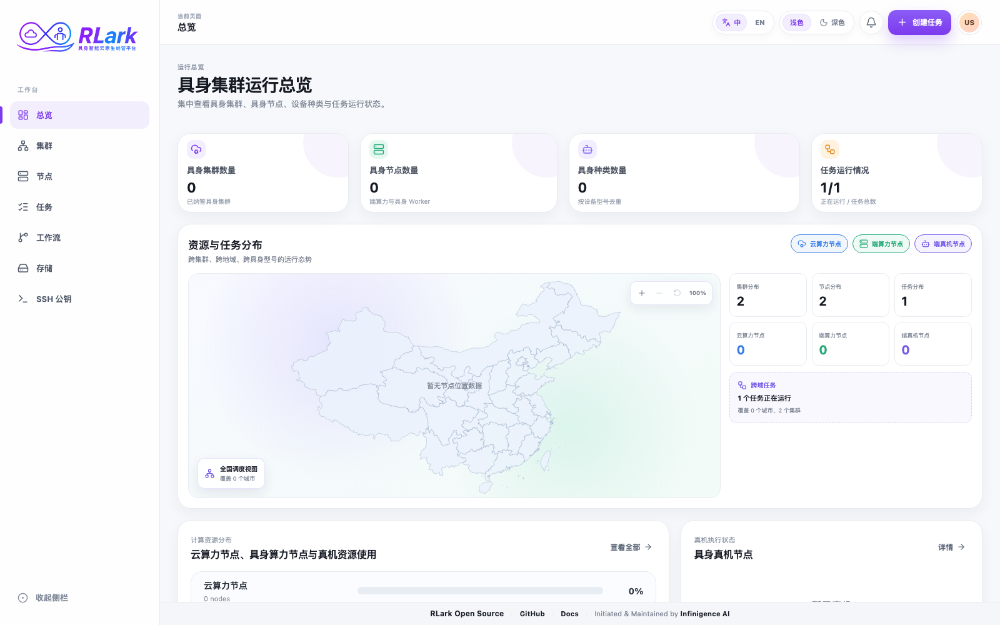

# 控制台访问与导航

## 登录

RLark 有两个登录入口：

| 入口     | 地址                       | 用途                                     |
| -------- | -------------------------- | ---------------------------------------- |
| 业务平台 | `http://<host>:5173`       | 任务管理、Worker、存储、SSH 密钥 |
| 管理后台 | `http://<host>:5173/admin` | 集群纳管、节点、证书、系统配置           |

### 登录步骤

1. 在浏览器中打开控制台地址
2. 输入用户名和密码
3. 点击登录
4. Gateway 签发 JWT access token（默认有效期 8 小时），浏览器在后续 API 请求中以 Bearer token 携带

!!! warning "角色授权仍是粗粒度的"
    Gateway 已对控制面配置和凭据管理强制要求 `admin`。`user` 可管理平台工作负载，但尚未实施逐用户资源所有权，因此已认证用户之间的 Job 或存储对象还没有相互隔离。请继续使用 TLS 和网络访问控制。

## 控制台导航

### 业务平台页面

| 页面     | 用途                                       |
| -------- | ------------------------------------------ |
| 总览     | 集群、可调度工作负载节点、机器人和运行中任务的仪表盘汇总 |
| 集群     | 浏览和检查已纳管的数据面集群               |
| 节点     | 筛选和检查节点资源、调度状态和健康状态     |
| 任务     | 创建、监控和管理训练任务                   |
| 存储     | 浏览存储类和对象存储                       |
| SSH 密钥 | 管理 Worker 访问的 SSH 公钥                |

### 管理后台页面

**镜像管理**页面用于保存私有镜像仓库凭证，并选择分发范围：仅保存、指定集群或当前及未来的所有集群。展示名称可以重复和修改，RLark 使用内部 ID 标识每条凭证。分发和删除均为异步操作；凭证最终投递到所选 Kubernetes 数据面集群的 `rlark-system` 命名空间。

> **截图说明：** 截图来自示例环境，资源名称和数据仅供说明，实际环境会有所不同。

### 快速查找页面

| 问题                           | 前往                            |
| ------------------------------ | ------------------------------- |
| 判断集群或节点是否可用于调度？ | 集群或节点页面                  |
| 如何创建训练任务？             | 任务 → 创建任务                 |
| 判断任务卡在哪个阶段？         | 任务详情 → Worker 标签          |
| 如何查找应用错误？             | 任务详情 → 日志标签             |
| 如何查看资源使用情况？         | 节点页面 → 节点详情             |
| 如何在容器中打开终端？         | 任务详情 → Worker → WebTerminal |
| 如何配置私有镜像凭证？         | 管理后台 → 镜像管理             |

### 刷新控制台数据

点击**刷新**可在不离开当前页面的情况下获取最新数据。请求进行时，受影响的表格或仪表盘会变淡并暂时禁用交互，同时在区域中央显示进度指示；已有数据行会保留到新响应返回。总览、集群与节点、域、任务与 Worker、存储与文件、SSH 公钥、镜像仓库和系统配置均使用这一套一致的反馈方式。

### 界面语言

顶部的语言开关对中文和英文同时生效。除静态文案外，它还会本地化控制台从控制面状态推导出的取值：节点状态原因、Addon 阶段、CPU 核数单位、Worker 筛选中推导出的节点类型，以及列表分隔符。登录页和 WebTerminal 页同样遵循该开关。从数据面原样透传的取值——节点标签、操作系统与架构标识符等服务端提供的字符串——按上报内容展示，不做翻译。

### 节点表格中的长取值

在节点详情的 Worker 表格中，过长的实例名称会省略号截断；展开的 Pod 子表中，网络域同样会截断显示。将鼠标悬停在被截断的取值上即可在提示中查看完整内容。这样无需水平滚动也能看到状态列。

### 按标签筛选任务

任务列表的标签筛选与 Gateway 的语义一致：不同标签 key 之间为「且」，同一 key 下的多个值之间为「或」。只有同时携带所有被选中的 key，且每个 key 至少命中一个被选中的值的任务才会出现在列表中。因此，选中一组不会同时出现在同一个任务上的 key 时会得到空列表，这是筛选语义本身，而不是请求失败。弹层会在两列上方说明该规则，**全选/取消**只作用于当前聚焦 key 的值列表，不会作用于 key 列。

点击 key 所在的行即可聚焦该 key，右栏会一直展示它的值，直到点击另一个 key。悬停不会改变聚焦，因此指针移向值列表的途中不会换掉右栏内容。key 前面的勾选框是独立的控件，用于一次性选中或清空该 key 的所有值。

### 任务列表中的角色数量

**角色数量**列统计任务去重后的角色名数量，与任务详情页和任务编辑器展示的角色名一致。它不来自 `Task.spec.role`：后者只是用于分组展示的粗粒度提示（`Actor`、`Rollout`、`Env`），会把多个业务角色折叠成同一个取值。

### 复制按钮

复制按钮不会静默完成，而是就地给出结果反馈：图标切换为对勾约 1.6 秒后恢复为复制图标。任务详情页角色运行配置中的镜像复制按钮还会泛起一次绿色脉冲，并把提示文案切换为**已复制**。按钮没有变化说明复制未发生，通常是浏览器阻止了剪贴板访问。

控制台中所有复制按钮共用同一条剪贴板实现。浏览器只在安全上下文（HTTPS 或 `localhost`）下提供异步剪贴板接口，因此控制台通过普通 HTTP 访问时，复制会自动回退到兼容方式而不是直接失效。该行为覆盖 SSH 公钥、SSH 连接命令、Worker SSH 命令、API 示例、部署配置 YAML、工作流 YAML 以及任务日志的复制按钮。只有复制确实成功后才会给出成功反馈。

### 关闭表单弹层

需要填写内容的弹层——创建、复制、编辑或重启编辑任务，创建工作流，创建或编辑存储类，添加或编辑镜像仓库凭据，添加 SSH 公钥，创建网络域，以及编辑任务标签——在点击弹层外的变暗区域时不会关闭。由于控制台无法恢复已丢弃的输入，这些弹层只能通过右上角的关闭按钮或**取消**按钮退出；任务、工作流、存储类和镜像仓库弹层还支持 `Esc` 关闭。

不收集输入的确认弹窗（例如任务生命周期操作、删除任务、重启方式选择和集群生命周期操作）仍可通过点击弹窗外部关闭。

## API 等效操作

已支持的资源操作可通过 [Gateway API](../api/reference.md) 完成。独立 Gateway 默认使用 `http://<host>:8080`；`rlarkadm` 部署使用其配置的 Service 与 UI 代理。并非每个 UI 交互都有一一对应的公开接口，请以 API 参考为准。
