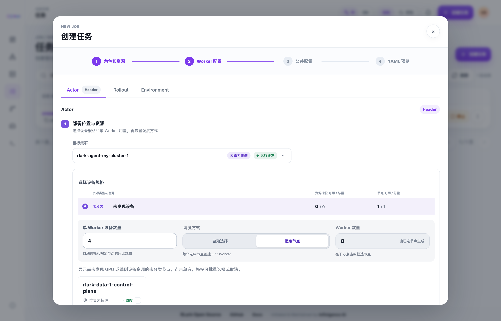
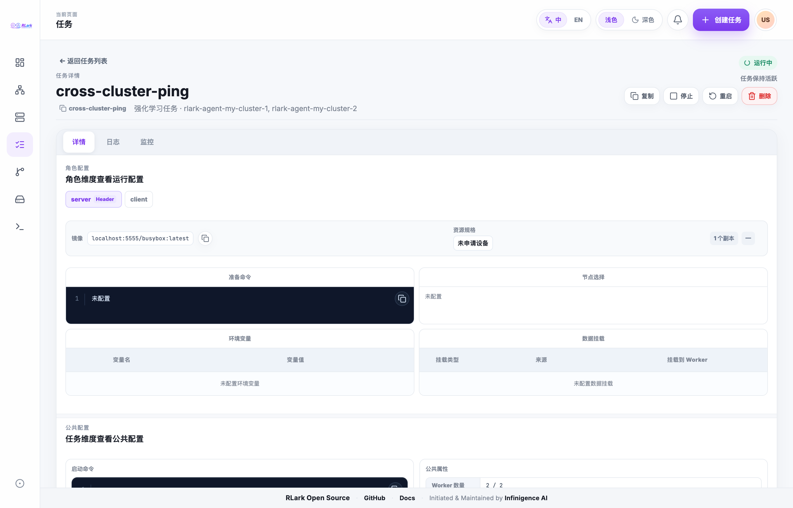
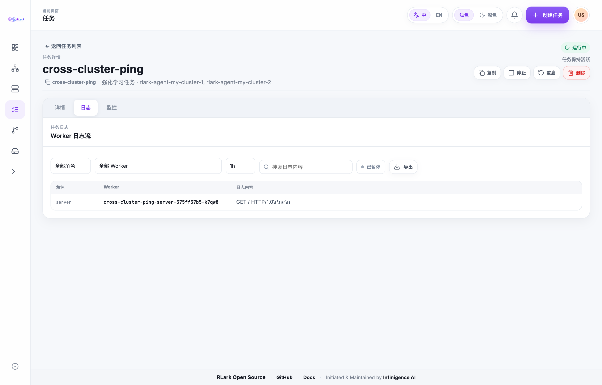

# 任务

Job 是面向用户的工作负载。创建任务时选择模板或配置 Task 角色、镜像、命令、副本数、资源申请、存储与调度要求；提交后可在任务详情中跟踪状态并查看所有 Worker。

提交前应确认平台中存在满足条件的集群和节点资源。Job、Task 与 Worker 的关系参见[核心概念](../concepts.md)。

## 通过 UI

业务平台 → 任务 → 创建任务。填写展示名称并定义 Worker 角色。任务展示名称和角色名称最长均为 50 个字符；角色名称忽略大小写后必须唯一，RLark 会将其规范化为 Kubernetes 可接受的 Task 资源名。任务展示名称可以重复，因为每个 Job 都有独立生成的资源 ID。

然后逐个配置角色：

1. 选择目标集群；每个选项会在同一行展示集群名称、类型标签和当前状态。
2. 从规格列表中单选 GPU 或具身设备型号；列表会同时展示设备和节点的可用量/总量。选定后填写两种调度方式共用的单 Worker 资源数量。调试任务可以填写 `0`，此时保留所选型号的节点范围，但不申请对应设备。
3. 选择一种调度方式：
   - **自动选择**：填写需要创建的 Worker 数量，控制台会按可用容量校验总申请量，并自动选择控制器写入的 `Schedulable=True` 的节点。
   - **指定节点**：单击符合条件的节点或拖拽框选。每张节点卡片展示与节点列表一致的可用性判断：**可用**、**不可用**或**服务降级**。**可用**和**服务降级**节点的 `Schedulable` 均为 `True`，自动选择和手动指定都可选中；**服务降级**仅用于诊断，因为 `Degraded` 不会阻断放置。只有**不可用**节点（`Schedulable` 不为 `True`）会被禁用并默认隐藏；勾选网格上方的“查看不可用节点”后，这些节点以不可选中的卡片形式展示，悬停可用性徽标或状态旁的告警图标可查看控制器写入的 `Schedulable` Reason；服务降级节点还会显示 `Degraded` 原因。每个选中节点创建一个 Worker；再次单击或框选已选节点可取消选择。之后修改单 Worker 资源数量时，空闲容量仍然满足新数量的已选节点会保留，只有不再满足的节点会被移除。
4. 检查统一的资源总结，然后配置镜像、准备脚本、环境变量和存储挂载。

复制任务时会保留原任务的调度方式。未指定具体节点的角色仍使用自动选择，不会被转换为指定节点。

最后一步会展示即将提交的 Job 的 YAML 预览。预览按 Kubernetes 工具链使用的 YAML 1.1 序列化，解析回来的取值与表单中填写的一致，可以直接复制出来原样使用。准备脚本、运行命令等多行取值以字面量块标量呈现；当取值需要显式的缩进或截断指示符才能无损还原时，会带上相应的指示符（`|2-`、`|`、`|+`）。本身是字符串、但 YAML 1.1 会解析成其他类型的取值（例如 `true`、`1.0`、`1_000`、`2026-11-23`、`1:2:3`）会加引号。

提交任务后，在任务详情页确认状态进入运行中并查看 Worker。

选择角色后，资源规格会直接展示实际节点上配置的 GPU 或具身设备型号与申请数量，例如 `NVIDIA RTX 4090 · 1 GPU`。Worker 尚未上报实际运行节点时，控制台会根据该角色选择的候选节点解析型号。

Worker 处于等待中时，可悬停或聚焦其状态旁的信息图标。RLark 会查询该 Worker 对应的数据面 Pod、Task 或节点事件，并按当前界面语言将已识别的 Kubernetes 事件归类为用户可读的等待原因。映射覆盖常见的调度、节点压力与可用性、镜像拉取、存储卷、运行环境、容器创建及健康检查问题；未识别事件显示通用等待提示，不直接展示底层原始消息。镜像拉取进度仍会单独展示，且只有运行时实际上报字节进度时才显示百分比；展示范围仅限该任务声明的镜像，不会混入同节点其他任务的历史拉取进度。单击信息图标可固定提示框：固定后鼠标移入提示框仍会保留内容，便于阅读和复制；再次单击图标、点击提示框外区域或按 `Esc` 即可关闭。

提示框展示的是当前的阻塞原因，而不是原始事件流水：

- `Pulling` 与 `Pulled` 是**按容器、按镜像**上报的时点事件，Worker Pod 还会拉取平台注入的 sidecar/init 镜像。这些平台镜像的拉取进展会被直接过滤，不会出现在提示框中；任务自身镜像的拉取进展中只保留最新的一条，更早的归入 **历史事件**；一旦镜像拉取失败，或存在不早于该进展的 Warning 事件，则所有拉取进展都会归入历史事件，避免镜像拉取成功的"镜像已拉取"与 Worker 失败提示并列出现。
- kubelet 对镜像拉取失败和容器启动失败都上报 `Failed`。RLark 会按事件消息进一步收敛，使镜像不可用时显示"镜像地址无效"或"镜像拉取失败"，而不是"Worker 启动失败"。
- 同一原因的重复事件会按原因合并，保留最近一次上报的时间，并整体按时间倒序排列。**历史事件** 分区以灰色删除线保留被取代的条目，便于排查。


## 任务类型

RLark 支持以下任务类型，每种类型预配置了适合该工作负载的默认角色：

- **强化学习** — 面向分布式 RL 训练工作流。默认角色包括 Actor、Rollout、Environment 和 Learner。
- **数据采集** — 优化从具身 Agent 或传感器采集训练数据。默认角色包括 Collector 和 Storage。
- **评测** — 基于已训练模型运行评测和基准测试。默认角色包括 Evaluator 和 Monitor。
- **自定义任务** — 完全灵活定义自己的角色和拓扑结构。不预配置默认角色。

每种任务类型预配置了一组默认角色。你可以添加、删除或自定义角色以适应你的训练流水线。角色定义了训练过程中协作的 Worker 组，每个角色可以有自己的容器镜像、资源需求和命令。

所选的任务类型会以标签 `rlark.io/job-type` 记录在 Job 对象上，取值为 `RL`、`DataCollection`、`Evaluation` 或 `Custom` 之一，UI 读取该标签来展示任务类型。该标签出现之前创建的任务不带此标签，UI 会退回到依据 `spec.tasks[].role` 推断一个近似类型，这种推断可能把自定义任务误报为强化学习任务。该标签仅供控制台展示使用，控制面与 Agent 都不消费它。

对于内置任务类型，控制台会把角色名归一为 `spec.tasks[].role` 的粗粒度分类（`Actor`、`Rollout` 或 `Env`）。对于自定义任务，你填写的角色名会原样写入 `spec.tasks[].role`，因为 `TaskRole` 并不限制在一个封闭取值集合内。无论哪种任务类型，原始角色名都可以从容器环境变量 `RLARK_TASK_ROLE` 中获取。

## Worker 配置

为每个 Worker 角色配置以下内容：

- **集群和节点** — 选择目标集群，可选指定具体节点。Worker Pod 模板会添加必需节点亲和性，排除带有 `rlark.io/unschedulable=true` 标签的节点。使用**节点选择器**按属性筛选节点，如：
  - 节点类型：cloud、edge 或 robot
  - GPU 型号（如 A100、H100、RTX 4090）
  - 物理位置或区域

- **容器镜像** — 为该角色指定容器镜像。可从最近使用的 10 个镜像中选择，并查看最后使用时间和 Job 使用次数；也可输入镜像标签（如 `myimage:latest`）或 digest（如 `myimage@sha256:...`）。推荐使用 digest 以确保可复现性和可审计性。私有镜像应先在**管理后台 → 镜像管理**中配置凭证并分发到目标集群。RLark 会按仓库前缀匹配普通容器和 init container 镜像，并将所有匹配的已投递 Secret 追加到 `imagePullSecrets`；同一仓库允许配置多条凭证。当前凭证仅用于 `rlark-system` 中的工作负载，Task 也不会等待异步投递完成。

- **资源申请** — 设置每个 Worker 所需的 CPU、内存和 GPU 资源：
  - CPU：以核心数指定（如 `4`）
  - 内存：以 GiB 指定（如 `16Gi`）
  - GPU：GPU 数量（如 `1`、`2`、`8`）

- **准备脚本** — 在主入口命令之前运行的命令。用于环境设置、依赖安装或数据准备。

- **存储挂载** — 向 Worker 容器挂载存储。任务编辑器可创建两种类型：
  - **hostPath**：挂载宿主机节点上的目录，任务生命周期操作不会删除其中的数据。
  - **PVC**（PersistentVolumeClaim）：使用所选存储类挂载 Kubernetes 存储。当前 Web UI 写入 `ephemeral.volumeClaimTemplate`，因此这些 PVC 属于 Pod 级资源，会随 Pod 删除并重新创建。导入或较早创建、使用 `persistentVolumeClaim` 和已废弃 PVC map 的 Task 则遵循保留型兼容生命周期。

  通过 API 提交的任务还可能使用其他 Kubernetes 原生卷类型，例如 `emptyDir`、`configMap`、`secret`。任务编辑器无法创建或修改这类卷，但会在角色的挂载列表和任务详情页以只读方式展示，并在编辑或复制任务时原样保留其原始定义；编辑器对这类挂载唯一支持的改动是删除。

- **高级配置** — 为角色启用可选的运行时能力。当前支持：
  - **共享内存 (shm)** — 将 memory-backed `emptyDir` 挂载为所有 regular 容器的 `/dev/shm`。需指定大小上限（如 `512Mi`、`1Gi`）以限制共享内存文件系统的容量。Kubernetes 默认的 `/dev/shm` 仅 64Mi，无法满足多进程数据加载（如 PyTorch `DataLoader` 的 `num_workers > 0`）、共享内存对象存储（如 Ray Object Store）或高吞吐 IPC 等场景的需求。

    **资源语义**：`sizeLimit` 是文件系统容量上限，不是内存预留。同一 Pod 内的所有 regular 容器共享一个卷和容量上限；不同 Pod 之间不共享。实际使用计入容器内存消耗，可能触发 OOM。请为容器配置合理的 memory `requests`/`limits`。当前仅 Kubernetes runtime 支持此能力；其他 runtime（如 Docker）为计划中功能，尚未实现。

    **冲突处理**：如果 `/dev/shm` 已被非等价挂载占用（如 `readOnly: true` 或 `subPath`），handler 会返回冲突错误而不是覆盖。等价挂载需满足：相同卷名、相同挂载路径、可写、无子路径。

> **截图说明：** 截图来自示例环境，资源名称和数据仅供说明，实际环境会有所不同。



## 公共配置

配置适用于任务中所有 Worker 的设置：

- **Header 角色** — 选择一个角色作为 Header。Ray 任务中的 Header 角色必须恰好配置 1 个 Worker；它负责协调分布式训练，其 IP 地址会通知所有其他 Worker。副本数大于 1 的角色在该选择器中不可选；若之后把已选 Header 角色的副本数改大，控制台会回退到第一个单 Worker 角色，保证向导仍可修正。

- **跨集群网络域** — 如果后台配置了网络域，控制台会按名称选择第一个网络域，并为所有任务自动启用，不受 Worker 是否跨集群影响；未配置时不会写入网络域。

- **SSH 公钥** — 选择写入 Job workload SSH 配置的公钥。内置 Ray-on-Kubernetes workload 会通过 Task-owned Secret 交付，挂载到每个 Worker main container 的 `/var/run/rlark/ssh/authorized_key`，并启动 optional `rlark-tools sshd` 服务。SSH 故障不会使 Task 失败；其他 workload implementation 不会仅因设置此字段而自动获得 SSH 能力。

- **运行命令** — 主训练脚本或入口命令。在所有准备脚本完成后执行。Header 节点执行完运行命令后不会退出，而是继续阻塞保持 Ray 集群运行，直到任务被手动停止或删除。

- **TensorBoard** — 为任务启用 TensorBoard 监控。配置日志目录路径和 TensorBoard 服务端口。

## 查看 Worker 与 Pod

### 任务概览

从任务列表打开任务详情页，查看概况：

- **名称** — 面向用户的展示名，可以重复；RLark 会另外分配 `jo-<16 位十六进制字符>` 系统资源 ID。
- **类型** — 任务类型（强化学习、数据采集、评测、自定义）
- **状态** — 当前状态：Pending、Running、Stopping、Stopped、Succeeded 或 Failed。`Stopping` 是 RLark 等待 Job 及其所有子 Task 和 Worker 停止时的过渡状态。
- **Worker 数量** — 所有角色的 Worker 总数
- **创建时间** — 任务提交时间
- **Header 角色** — 被指定为协调者的角色

### Worker 列表

概览下方显示每个 Worker 实例的信息：

- **实例名称** — 自动生成的名称（如 `myjob-actor-0`）
- **角色** — 该 Worker 所属角色
- **节点** — 承载该 Worker 的物理节点
- **集群** — Worker 所属的数据面集群；节点名称可点击并跳转到对应节点详情页
- **IP** — Pod IP 地址
- **状态** — 每个 Worker 的状态（Pending、ContainerCreating、Running、Terminated）

使用列表表头的**刷新**按钮更新 Task、Pod、调度节点、IP 与状态信息，无需重载整个页面。

任务列表和 Worker 列表的**刷新**都只更新对应的数据区域。请求处理中会保留当前行并显示半透明局部遮罩和居中的旋转加载指示，同时暂时禁用该区域内的操作；页面其余部分仍可使用。

点击任意 Worker 查看运行时详情，包括容器状态、资源使用情况和事件。

### 按角色查看配置

展开角色区域查看适用于该角色所有 Worker 的配置：镜像、资源申请、准备脚本和存储挂载。



## 查看与导出日志

**日志**标签汇总了任务中所有 Worker 的 main 容器日志。

### 日志功能

- **默认选择与刷新** — 默认选择第一个角色；日志仅在点击**刷新**后更新。
- **聚合视图** — 所选角色或 Worker 的日志合并到一个流中，每行标记 Worker 和角色。Pod 终止后，历史 Worker 仍可选择。
- **时间范围** — 可选择 15 分钟、1 小时、6 小时、24 小时、7 天或自定义时间段。
- **排序** — 可按时间升序或降序排列日志。
- **搜索** — 支持完整单词或词组搜索，不进行单词片段匹配。
- **日志后端分页** — 配置日志后端时，每页最多返回 99 条，并通过游标继续加载。
- **Pod 回退** — 未配置日志后端时，RLark 回退到 Pod 日志，每个 Pod 最多获取 1000 行。

### 导出日志

点击**导出**将当前日志视图下载为 CSV 文件。CSV 包含三列：

- `worker` — Worker 实例名称
- `role` — Worker 角色
- `message` — 日志消息内容



## WebTerminal 终端访问

你可以在任意运行中的 Worker 主容器中打开交互式终端，无需 SSH 即可调试和检查。

### 打开终端

在 Worker 列表中点击任意运行中 Worker 的**终端**操作，默认会在其主容器中打开 `/bin/bash`。浏览器通过 WebSocket 连接 Gateway，再由 Gateway 经 Server 代理到 Agent，最终 exec 进入容器；用户无需进行 SSH 登录。

### 诊断命令

进入终端后可运行诊断命令检查容器环境：

```sh
pwd                     # 检查当前工作目录
id                      # 验证用户身份
ls -la                  # 列出工作目录文件
df -h                   # 检查磁盘使用情况和挂载点
cat /proc/mounts        # 检查所有挂载的文件系统
env                     # 查看环境变量
nvidia-smi              # 检查 GPU 状态（如有 GPU 分配）
```

### 文件传输

Worker 列表中的钥匙按钮用于复制 SSH 连接命令。该功能依赖管理员配置 SSH 跳板地址；未配置时按钮会禁用并提示原因，避免复制空内容。复制命令统一通过节点 sshd 的 2222 端口转发到目标 Pod。在非 HTTPS 环境下，复制功能自动降级使用兼容方案，不受浏览器 Clipboard API 限制。

WebTerminal 支持文件上传和下载：

- **上传** — 从本地机器上传文件到容器默认工作目录。文件名需匹配 `[A-Za-z0-9._-]+` 模式。
- **下载** — 输入文件在容器内的路径，再将其下载到本地机器。

所有文件传输通过终端使用的同一 WebSocket 连接进行，确保安全性和简洁性。

## 管理任务

### 生命周期操作

详情页右上角同时提供完整的任务生命周期操作：

- **停止任务**：运行中的 Job 先进入 `Stopping`，RLark 会删除其子 Task CR，并等待对应 Worker 清理完成。任务配置会保留；引用的外部 PVC 不由 RLark 管理；Pod 级临时 PVC 随 Pod 删除。
- **启动任务**：使用相同配置启动 `Stopped` Job。显式引用同一个已有 PVC 时可继续访问其数据；Pod 级临时卷会获得新 PVC。
- **重启任务**：选择使用当前配置一键重启，或先编辑任务配置并在保存后自动重启。Job controller 会删除每个旧 Task，等待 Agent 完成 Runtime cleanup 并释放 cleanup finalizer，并且只有在旧 Task 对象已经消失后，才按当前模板创建同名、具有新 UID 的 Task。重复调谐或 controller 重启会从观测到的 Task 删除状态继续，而不会创建相互重叠的运行。因此 `Succeeded` 和 `Failed` Job 都会重新创建 Task 和 Worker，不影响引用的外部 PVC，并替换 Pod 级临时 PVC。
- **删除任务**：在危险操作弹窗中核对任务名称与不可恢复提示后，永久删除任务。

执行生命周期操作前需要确认。请求处理中会禁用其他操作按钮，失败信息会显示在操作区；操作成功后页面会返回任务列表并显示完成提示。

控制台以同步流程执行删除：先停止任务，等待所有子 Task 和 Worker 进入终态，再删除 Job，并继续等待 Job 与子 Task 均被清理后才更新列表。

任务列表的每一行直接提供复制、重启和启动/停止文字按钮，删除操作收纳在相邻的更多操作菜单中；重启与详情页一样支持“一键重启”或“编辑后重启”。Worker 展开详情聚焦集群、角色、节点和 GPU 信息，不展示 CPU 与内存申请卡片。

### 停止运行中的任务

停止任务后，页面会先显示 `Stopping`。RLark 删除全部子 Task CR，并等待对应 Worker Pod 清理完成；任务配置、日志、元数据、hostPath 数据会保留，引用的外部 PVC 仍不由 RLark 管理。Pod 级临时 PVC 随 Pod 删除。

手动停止的任务进入 `Stopped` 状态时会记录停止时间，并显示在任务列表中。

当 Node 或 Cluster Drain 停止运行中 Job 的全部 Worker 时，Job 会自动进入 `Stopped`，并写入 `Evicted` Condition：`Reason=Evicted`，`Message` 为「所有 Worker 已被驱逐 / All workers were evicted」。被驱逐的 Worker 重新调度后，Job 回到 `Pending`。

### 恢复已停止的任务

启动已停止的任务会按相同配置重新创建 Task 和 Worker Pod。显式引用同一个已有 PVC 时，新 Task 可继续访问其数据；RLark 不负责创建该 claim；Pod 级临时卷会获得新 PVC。hostPath 数据仍然可用。

### 删除任务

删除 Job 会清理活动工作负载资源，但存储存在以下保留规则：

- Worker Pod 被终止
- 引用的外部 PVC 不由 RLark 创建或删除
- Pod 级临时 PVC 随 Worker Pod 删除
- 任务元数据和日志可在配置的保留期内保留

> **注意：** hostPath 挂载上的数据在任务删除时不会自动删除。如需清理，请手动删除 hostPath 目录。

> **已有 PVC：** RLark 不拥有通过 `persistentVolumeClaim.claimName` 引用的 PVC。删除前应确认没有 workload 引用它，并考虑绑定 PV 的 reclaim policy。

### 编辑或克隆任务

- **编辑** — 修改已停止任务的配置（角色、资源、命令）并重新提交。
- **克隆** — 复制现有任务配置，作为新任务的模板。

两种操作都会用源任务预填编辑器，并保留源任务的角色，包括不属于所选任务类型默认角色的自定义角色。每个角色会恢复容器镜像、运行命令、准备脚本、环境变量、副本数、CPU、内存和设备申请、调度方式以及存储挂载；编辑器无法编辑的卷类型按原始定义保留。预填后切换任务类型只会更新任务类型标签，不会改动角色列表：角色是用户已经确认过的配置，需要新类型的默认角色时请手动添加。

Job 本身不保存源集群信息，编辑器会根据各角色的节点选择器反查集群。如果该集群已不存在或已停止调度，编辑器会忽略其残留节点，并将该角色切换到可调度的集群。已经不可调度（离线、停用调度、已下架）或不再属于所选集群的节点会被取消选中并从草稿中移除，因此提交内容和 YAML 预览都不会保留无法承载 Worker 的节点。指定节点模式下 Worker 数量会随剩余节点同步。如果移除后该角色没有任何已选节点，编辑器会阻止进入下一步，并要求重新选择节点。

## 提交前检查清单

提交任务前请确认：

| 检查项         | 说明                                                                      |
| -------------- | ------------------------------------------------------------------------- |
| 集群资源       | 目标集群有足够的 CPU、内存和 GPU 容量满足所有 Worker 需求                 |
| 节点兼容性     | 匹配选择器的节点（类型、GPU 型号、位置）可用且可调度                      |
| GPU / 具身设备 | 如果申请 GPU 或具身设备（机器人、相机），确认所需型号在选定节点上存在     |
| 容器镜像       | 指定镜像可从目标集群访问。如果使用私有 Registry，确保配置了镜像拉取凭据   |
| 存储路径       | hostPath 目录在目标节点上存在且具有正确的读写权限。PVC 存储类在集群中可用 |
| 跨集群网络     | 如果任务跨多个集群，网络域已配置且 DomainPeer 关系已建立                  |
| SSH 密钥       | SSH 公钥有效且格式正确                                                    |

## API 等效操作

所有任务管理操作可通过 REST API 编程执行：

```
POST /api/v1/rlinf.io/v1alpha1/jobs
```

该端点接受请求体中的 `Job` CRD 对象。完整请求示例和状态查询模式参见 [API 示例](../api/examples.md)。
