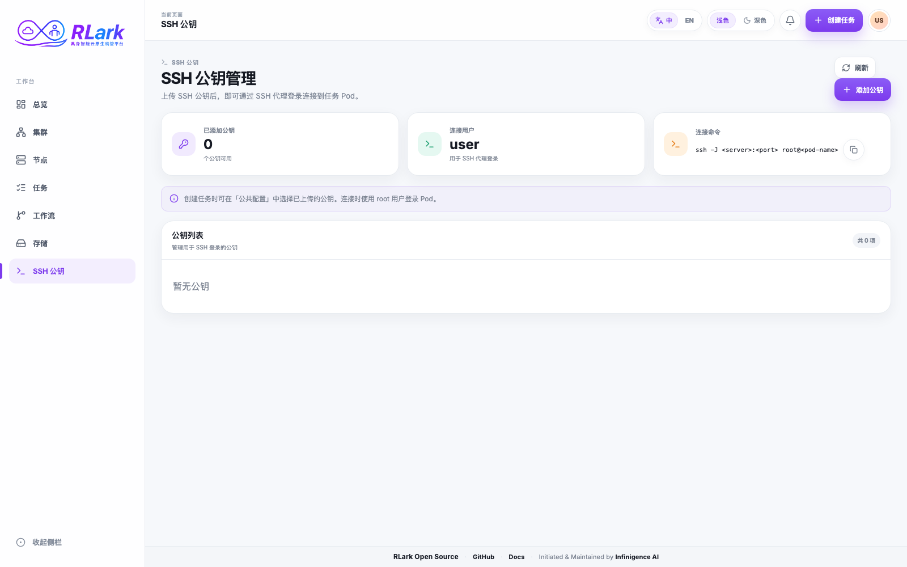

# SSH 密钥

使用本指南登记用于 RLark SSH 堡垒机认证的公钥，并可选择在创建 Job 时将其写入任务配置。

> **截图说明：** 截图来自示例环境，资源名称和数据仅供说明，实际环境会有所不同。



## 任务一：添加公钥

1. 为 RLark 生成专用密钥对，切勿上传私钥。
2. 在业务平台打开 **SSH 公钥**，选择**添加公钥**。
3. 输入 SSH 用户名。该名称必须与 SSH 命令使用的用户名一致。
4. 粘贴一条 OpenSSH 公钥，例如 `ssh-ed25519` 或 `ssh-rsa`。
5. 选择**确认添加**，并确认密钥出现在列表中。

RLark 会校验公钥格式，并要求 SSH 用户名和公钥内容在全局范围内均不可重复。任一内容已存在时，表单会在上传前显示行内错误提示。当 Server SSH 地址可用时，页面还会显示配置好的跳板连接命令。

## 任务二：为 Job 选择密钥

1. 打开**任务**并开始创建 Job。
2. 在**公共配置**的 **SSH 公钥注入**中选择已上传的密钥。
3. 检查 YAML 预览，确认每个适用 Task 模板包含以下 Environment 声明：

   ```yaml
   environments:
     - type: rlinf.io/ssh
       version: v1
       parameters:
         authorizedKeys:
           - ssh-ed25519 AAAA...
   ```
4. 提交 Job。

每条选中的公钥会写入适用 Task 模板的 `rlinf.io/ssh/v1` Environment，供 workload 交付。只在 SSH 公钥页面登记或修改记录不会改变已有 Job 或 Task。Job 详情中的多条已配置公钥会通过可滚动列表展示。

对于内置 Ray-on-Kubernetes workload，Agent 会把 Task 选中的公钥存入归当前 Task incarnation 所有的 Secret，将其 `authorized_key` item 以只读方式挂载到每个 main container 的 `/var/run/rlark/ssh/authorized_key`，并将 `rlark-tools sshd` 作为 optional supervised service 启动。该 mount 不使用 `subPath`，`sshd` 每次认证都会重新打开该文件。空文件表示关闭 workload key 认证。SSH 服务故障可能导致 Pod 无法通过 SSH 访问，但不会停止 Task。Docker、Raw 或任意自定义 workload implementation 不具备这一自动服务生命周期。

## 任务三：通过堡垒机连接

管理员配置 Server SSH 入口后，使用控制台显示的命令，或从 Job/节点详情复制指定 Worker 的命令。典型命令如下：

```bash
ssh -J <registered-user>@<bastion-host>:<port> root@<worker-name>
```

外层 SSH 用户名必须与公钥登记的用户名一致。目标容器必须提供 SSH 服务，并接受所选公钥。

SSH 公钥列表中的“公钥名称”对应登记的 SSH 用户名，不一定是控制台登录账号。Gateway 与 Server 使用同一管理 namespace 下的 `rlark-ssh-keys` Secret 保存和验证公钥；启用 PostgreSQL 不会改变此行为，无需向数据库手动添加公钥。

!!! warning "没有 Pod 级授权"
    当前 SSH Server 会认证用户名和已登记公钥，但尚未实现把该用户限制到特定 Pod 的授权检查。应将堡垒机访问视为受信任用户访问，不要把密钥登记描述为仅授予所选 Pod 的访问权限。

## 任务四：删除或轮换密钥

1. 添加替换公钥，并在 Job 配置中选择它。
2. 使用替换后的私钥验证访问。
3. 从 **SSH 公钥**中删除旧密钥。
4. 确认已有 Job/Task 已更新或替换，其 workload SSH 配置不再包含旧密钥。

删除登记密钥会阻止该用户名/密钥组合后续通过堡垒机认证，但不会修改 SSH Environment 中已经包含旧密钥的 Job 或 Task。轮换 workload 访问时，应替换或清空 `parameters.authorizedKeys`。投影文件的更新受 kubelet 传播的最终一致性影响，不保证瞬时撤销。

## 安全注意事项

- 密钥记录按输入的 SSH 用户名存储，不按当前控制台会话隔离。
- 任何持有对应私钥的人都能以该 SSH 用户名认证。
- 切勿把私钥上传或写入 Job YAML、脚本及环境变量。
- 不要把 `/var/run/rlark/ssh/authorized_key` 复制到持久文件，也不要让 SSH 服务缓存其解析后路径或长期持有打开的文件描述符，否则轮换和撤销无法生效。
- 首次使用前核对堡垒机主机密钥指纹，并定期轮换密钥。

!!! warning "当前安全边界"
    RLark 当前未明确记录持久化 SSH 认证/连接审计日志的位置，请勿将平台作为 SSH 审计的唯一记录系统；应在堡垒机外部接入集中日志与留存机制。平台尚未内置 SSO/OIDC 集成，生产环境应通过外部支持 SSO/OIDC 的访问代理或堡垒机实施身份与访问策略。SSH 密钥记录和堡垒机授权不按租户或 Pod 隔离；互不信任的租户应使用独立部署或分别管控的堡垒机。

## API 等效操作

使用 `GET`、`POST /api/v1/ssh-user-keys` 和 `DELETE /api/v1/ssh-user-keys/{index}?user={user}`。`index` 是该用户名下已登记密钥的零基索引。详见 [API 参考](../api/reference.md)。
