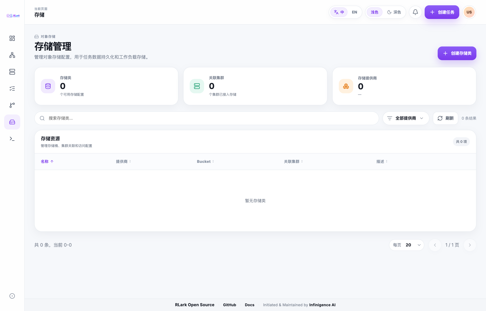

# 存储

## 存储类型

Job 编辑器提供两种存储选择：主机目录和 PVC 存储挂载。其生命周期由 Kubernetes 原生 PodTemplate volume 形态决定：

| 类型 | 适用场景 | 生命周期 |
|------|----------|----------|
| 主机目录 | 数据已在节点上，高 I/O | 任务生命周期操作不删除数据 |
| 对象存储（Pod 级临时 PVC） | 当前 Web UI 为 PVC 挂载写入的形态 | Kubernetes 随 Pod 创建和删除 PVC |
| 已有持久 PVC 引用 | Task volume 使用 `persistentVolumeClaim.claimName` | RLark 不创建或删除该 PVC；生命周期由管理员管理 |

## 主机目录

- 管理员需确认目标节点上路径存在且权限正确
- 填写源路径（节点文件系统）和挂载路径（容器文件系统）
- 任务删除后数据保留在节点上

## 对象存储

- 使用 Kubernetes 通用临时卷和 RLark 管理的 StorageClass
- 当前 Web UI 将 PVC 挂载写为 `ephemeral.volumeClaimTemplate`，因此新建或编辑的 Job 使用 Pod 级临时 PVC
- 每个 PVC 挂载默认申请 10Gi，可配置范围为 1–200Gi
- 先选择集群；下拉框会列出已配置为该集群目标的 StorageClass 声明
- 每个 Worker Pod 使用独立的 PVC

## 管理存储类

进入 **存储** 页面可查看对象存储配置、目标集群、提供商和存储桶。创建或更新存储类会在控制面保存其声明，随后将生成的 rclone CSI StorageClass 和 Secret 异步分发到目标集群。为 Worker 配置 PVC 挂载前，需要先创建对应的存储类并等待下发完成。

使用存储类前，请确认目标集群已安装 rclone CSI 驱动，且可以访问对象存储服务。若 PVC 一直处于 `Pending`，请检查资源分发状态、驱动、凭据和网络连通性。

> **截图说明：** 截图来自示例环境，资源名称和数据仅供说明，实际环境会有所不同。

## 在训练任务中使用存储

创建任务时，在 Worker 配置步骤中：
1. 选择存储类型（hostPath 或 PVC）
2. 输入源路径（hostPath）或选择 StorageClass（PVC）
3. 输入容器挂载路径
4. 训练代码读写挂载路径

## 检查读写

验证存储链路：
1. 源位置可访问
2. 容器挂载正确
3. 应用可读取输入数据
4. 应用可写入输出数据
5. 对当前 Web UI 创建的 Job，应将 PVC 视为 Pod 级临时存储，并在停止或重启前复制需要保留的输出。请检查 `spec.workload.template.spec.volumes`：`ephemeral.volumeClaimTemplate` 是 Pod 级临时卷，`persistentVolumeClaim.claimName` 引用已有且由外部管理的 PVC

## 生命周期

- 已有 `persistentVolumeClaim`：RLark 不创建、收养、修改或删除引用的 PVC；其生命周期和数据保留不属于 Task 管理范围
- Pod 级 `ephemeral.volumeClaimTemplate`：删除 Worker Pod 时删除对应临时 PVC，新 Pod 获得新 PVC
- hostPath：生命周期操作不删除节点数据

已有 PVC 引用必须填写 `claimName`，且该 claim 必须已存在于 workload namespace。挂载或绑定失败由 Kubernetes 通过 workload 和 Pod 状态报告。删除被引用的 PVC 属于外部管理操作；删除前应确认没有 workload 使用它，并考虑绑定 PV 的 reclaim policy。

`pvcStorageMap` 和 `pvcSizeGbMap` 不属于 canonical Task Schema。当前 Web UI 和 Kubernetes 原生示例写入 `ephemeral.volumeClaimTemplate`；破坏性升级时必须替换依赖已移除字段的旧资源。

## API 等效操作

使用 StorageClass、provider 和对象文件接口，详见 [Storage API](../storage-api.md)。
