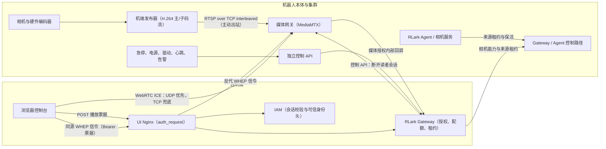

# RFC：方案 2 相机 H.264 / WebRTC 媒体流

- 状态：首期架构已定稿，组件版本与性能门槛待实测确认
- 范围：Astribot S1U 与 RLark 控制台的相机只读媒体路径
- 首期选型：MediaMTX、机器人主动出站 RTSP over TCP（interleaved）、同源 WHEP/WebRTC
- 架构约束：媒体面与控制面、本体控制面严格隔离

本文定义拟议目标架构和验收条件，不表示仓库现已具备 H.264、WebRTC、WHEP、媒体票据、租约或服务端强制撤销运行时能力。所有端口、时限、并发、性能和资源数字均为目标门槛（待实测），不能作为已测结果或正式 SLA。当前工作仅为 RFC，不新增生产部署配置。

## 1. 背景与范围

当前 S1U 相机服务由 `s1u-robot` Addon 在机器人集群的 `rlark-system` 命名空间提供，Gateway 通过集群 API Server Pod proxy 转发单帧 JPEG 和 MJPEG。控制台的 `cameraMediaScheduler` 管理本地流优先级与并发。连续媒体经过 Gateway 和 Kubernetes API Server 会占用代理连接、缓冲、协程与带宽，并可能与管理 API 争用资源。

首期方案将连续视频从 Gateway 媒体代理路径移出。Gateway 负责授权、配额、租约和控制面元数据，媒体服务负责只读媒体接入与扇出，机器人只在获准观看时编码和主动推流。现有 `cameraFramePath` 快照仍是第一降级路径，既有 MJPEG 仅作为有严格预算的连续流降级选项。

## 2. 不可跨越的边界与目标架构

### 2.1 控制面隔离

急停、电源、驱动、心跳、告警、控制指令、认领/释放和入网均绝不进入 MediaMTX、媒体票据或 WebRTC DataChannel。媒体服务不反控机器人本体。控制操作继续由既有 Gateway/IAM 控制路径处理，媒体服务故障不能阻断控制面。

首期 WebRTC DataChannel 不承载任何控制或状态协议。单机遥操作如需低延迟输入，须另立方案，定义独立鉴权、权限、序列号、过期、审计和急停语义。

### 2.2 目标架构

媒体传输的目标为 UDP 优先，默认候选 `8189/UDP`，受控 TCP ICE 兜底候选 `8189/TCP`。WHEP 信令经 UI Nginx 同源路径 `/media/whep/<opaque-path>` 反代。机端主动向中心 MediaMTX 推送 RTSP over TCP interleaved。跨不可信二层或跨站点的机端发布预留 RTSPS（TLS），具体证书、端口和网络拓扑待实测锁定。

MediaMTX 的管理 API 和鉴权回调仅在内网开放。媒体服务独立容器部署并设置独立资源限额，初始压测预算目标为 `4 vCPU / 4–8 GiB`（待实测校准）。本 RFC 不修改 Compose、Nginx 或其他生产部署文件。

### 2.3 首期路径与备选边界

首期采用 MediaMTX + RTSP/TCP 主动出站 + WHEP/WebRTC。若实测发现目标浏览器无法兼容 WHEP，或受限网络同时阻断 UDP 与 TCP ICE，再评估二期 `go2rtc` / MSE 的鉴权、规模、运维与安全边界。

### 2.4 回退顺序

WHEP 信令因媒体服务不可用而失败、ICE 进入 failed，或首帧超过 `5s` 首帧超时目标门槛（待实测确认）时，先回退至低频单帧快照，例如沿用 `cameraFramePath` 按 `1 fps` 轮询（均为目标门槛，待实测）。仅在确需连续画面且配额允许时才降级为现有 MJPEG。降级路径继续执行会话及目标相机授权，收到授权拒绝时停止播放与自动降级。降级场景的单用户 MJPEG 并发上限目标为 `≤ 4` 路（待实测），避免 ICE 故障同时触发大量 MJPEG 请求并压垮控制面。

## 3. 身份、授权与播放票据

### 3.1 票据签发闭环

1. 浏览器以 JSON `POST /api/v1/station/media-tokens` 请求票据，不使用携带长凭证的 GET URL。请求只表达目标 `cluster`、`node`、`view` 和播放档位，不接受客户端指定媒体 URL。
2. 请求经 UI Nginx `auth_request` 到 IAM。IAM 校验会话未过期且账号未禁用，并强制覆写可信 `X-IAM-User` 与 `X-IAM-Role`，不得透传或信任客户端同名头。
3. Gateway 是票据签发与授权决策责任方。Gateway 复用现有租户 Node 授权，校验唯一 `cluster -> agentNamespace` 归属（namespace 冲突即拒绝）、相机 capability 视图、服务端并发配额和有效读者租约，再签发只读短时票据。
4. 票据建议 TTL `30–60s`（目标门槛，待实测），绑定 `jti`、`sub`、`role`、`cluster`、`node`、`view`、`tier`、`action=read` 和 `exp`。票据不含控制权限、机器人凭据或长效 service-account 凭据。
5. MediaMTX `authHTTPAddress` 调用 Gateway 的内部鉴权端点。该端点只允许内网访问，读操作校验签名、有效期、精确媒体 path 绑定、会话租约和配额。发布动作使用完全独立的机端发布凭据与来源网段 ACL，浏览器 `read` 票据绝不能用于 `publish`。
6. WHEP 优先使用 `Authorization: Bearer <ticket>`。若锁定版本或客户端限制迫使票据走 query，则 `jti` 必须单次消费，Nginx 对媒体路径关闭 query 访问日志或确保日志脱敏。任何日志、指标和错误响应均不得记录票据原文。

IAM 负责用户会话真实性和可信身份头，Gateway 负责租户资源授权、归属、能力、配额、租约及票据签发，MediaMTX 仅按 Gateway 内部回调结果执行媒体读写许可。三者职责不可互相替代。

### 3.2 服务端强制撤销 SLA

短时票据过期只阻止建立新连接，不会自动断开已建立的 WebRTC PeerConnection。撤销 SLA 只有在服务端对活跃读者租约到期或撤销并执行强制断流时才成立，绝不能依赖前端关闭 PeerConnection。

首期必须实现服务端强制执行机制并通过集成测试。读者租约到期、用户会话注销或禁用、租户授权撤回、角色权限收回时，Gateway 须原子禁止相关会话继续续期或使用其票据建连，再调用仅内网开放的 MediaMTX 控制 API 断开对应会话。会话在确认断开前继续计入硬配额，断流失败时保留待回收状态并重试或对账。撤销 SLA 窗口数值须在实测后锁定。

必测用例包括模拟拒不关闭连接的客户端及冻结标签页。服务端必须在约定撤销 SLA 窗口内终止媒体流并释放配额。仅验证浏览器收到过期状态、仅验证新建连接被拒绝，均不满足验收。

## 4. 双层租约与重启恢复

### 4.1 每读者会话租约（Per-Reader Session Lease）

每个观看会话单独建租约，绑定 `reader_session_id`、`sub`、`role`、`cluster`、`node`、`view`、`tier`、`expires_at`。签发票据时先创建计入配额的短期预留，WHEP 建连时由服务端绑定对应的 MediaMTX 会话 ID，每份预留最多绑定一个读者。未建连的预留到期时释放。租约 ID 与媒体会话 ID 的关联须可在 Gateway 重启后恢复或对账。

`cameraMediaScheduler` 负责前端 UX 优先级裁剪，顺序为 `dialog > pinned > card`。Gateway 持有权威硬配额并对获取、续期、释放、过期回收执行原子操作，防止多标签页并发竞态超发。单用户 `4–6` 路、全局 `20–32` 路为可配置目标门槛（待实测），不是已实现默认值或 SLA。周期续期须重新校验 IAM 会话和租户授权。

到期或撤销时服务端强制断流并回收配额。MediaMTX 重启导致活跃读会话全部断开时，旧读者租约依靠短 TTL 自动过期回收并释放配额，客户端退避后重建。Gateway 重启时须从共享/持久化租约状态恢复，并查询 MediaMTX 活跃会话进行对账；无主或超期孤儿 WebRTC 会话在宽限期后由服务端强制断流，防止配额泄漏或越权残留。共享状态、对账窗口和失败恢复需在实现设计中明确并测试。

### 4.2 来源级按需租约（Source-Level On-Demand Lease）

来源租约按 `(cluster, node, view, tier)` 聚合对应的有效读者预留与已建连租约。首份预留即由 Gateway 经 Agent/相机服务下发机端推流租约，以便在 WHEP 建连前启动硬件编码并向媒体网关 RTSP/TCP 推流。此控制指令只管理媒体采集状态，媒体网关绝不反控机器人本体。

活跃读者从 `1 → 0` 后进入宽限期，`15–30s` 为目标门槛（待实测），到期回收来源租约并让机端停编停推，实现无读者时零编码、零媒体上行。机端须维护本地租约 TTL 看门狗，Gateway 重启或控制面失联而未续租时，TTL 到期自动停编停推，避免僵尸推流。

MediaMTX 重启后，仍持有有效来源租约的机端以指数退避重连推流；没有有效来源租约的机端保持静默。Gateway 与 Agent 重试、幂等更新和租约状态对账以当前权威状态为准，不能依赖单次事件成功送达。

## 5. 编码档位与浏览器网络

### 5.1 H.264 编码约束

浏览器 WebRTC 默认档为 **Constrained Baseline Profile**。Main Profile 仅在目标浏览器矩阵实测通过后作为可选优化。强制 `bframes=0`，每个 IDR 携带 SPS/PPS。GOP 以秒定义为 `1–2s`，关键帧间隔按 `keyint = ceil(gop_seconds × fps)` 计算：

| 帧率 | 1 秒 GOP | 2 秒 GOP |
| --- | ---: | ---: |
| 5 fps | 5 帧 | 10 帧 |
| 10 fps | 10 帧 | 20 帧 |
| 15 fps | 15 帧 | 30 帧 |
| 20 fps | 20 帧 | 40 帧 |

以下均为目标门槛（待实测），需按设备 capability 验证，不得视为已具备能力：子码流 `480p @ 5–10 fps, 400–800 kbps`；主码流 `720p @ 15–20 fps, 1.5–2.5 Mbps`；硬件编码新增 CPU `≤ 15%`；软编兜底单路 CPU `≤ 25%`。未声明能力的相机不得由 UI 假定支持档位。

### 5.2 WHEP 与 ICE

播放信令经同源 `/media/whep/<opaque-path>`，浏览器通过 WHEP 建立 WebRTC 接收会话。媒体 UDP 优先，默认候选 `8189/UDP`；受控 TCP ICE 兜底候选 `8189/TCP`，须在网络策略中显式启用并限制来源。Nginx 反代 WHEP 信令不等于转发 ICE 媒体流，浏览器网段仍须能到达媒体 ICE 地址。

跨不可信站点不得假设无公网 STUN/TURN 时 ICE 可达。需验证 VPN/路由、受控 TURN 或 RTSPS 源接入等拓扑。跨不可信二层或跨站点的机器人发布链路预留 RTSPS（TLS）。裸 IP HTTP、企业浏览器策略和嵌入式 WebView 均需在目标矩阵实测，不视作通用保证。

## 6. 目标门槛与验收

本节所有数值均明确为目标门槛（Target / To-Be-Measured），不是测量结果或正式 SLA。测试须分别报告配置、环境、样本数、分位数、失败数和复测结果。

| 验收项 | 目标门槛（待实测） |
| --- | --- |
| 首帧时间 | 已有媒体源 P95 `≤ 1.5s`；来源冷启动 P95 `≤ 3.5s`；`5s` 首帧超时后按快照优先顺序降级 |
| 端到端延迟 | UDP G2G P95 `≤ 500ms`；TCP ICE G2G P95 `≤ 1.0s` |
| 并发与扇出 | 20 路播放分别测试 `5×4`（5 个源各 4 读者）与 `20×1`（20 个独立源）两种模型 |
| 注册规模 | 100+ 台在线注册；另验证 500 台注册时无人观看的控制连接与资源占用 |
| 媒体网关 | 初始预算 `4 vCPU / 4–8 GiB`；CPU P95 `≤ 60%` |
| 控制面隔离 | 压测期间控制面 P99 退化 `≤ 10%`、控制 API 错误率 `0` |
| 媒体代理收益 | 切换后 Gateway MJPEG 代理流量下降 `≥ 90%` |
| 撤销 | 服务端强制断流在撤销 SLA 窗口内完成，冻结/拒不关闭客户端仍可终止并释放配额；窗口待实测锁定 |
| 稳定性 | 切换 50 次无会话或配额泄漏 |
| 回滚 | 一键切回既有 Scheme B 链路 `≤ 1 分钟`，停媒体容器对控制面零影响 |
| 编码档位 | 子码流 `480p @ 5–10 fps, 400–800 kbps`；主码流 `720p @ 15–20 fps, 1.5–2.5 Mbps` |
| 机端开销 | 硬编新增 CPU `≤ 15%`；软编兜底单路 `≤ 25%` |

压测与隔离验证必须在 **隔离 Mock 环境（Isolated Mock）** 中执行。急停及电源控制面隔离验证严禁对真实物理机器人或现网环境执行急停/电源故障注入或压测。隔离 Mock 应模拟控制 API、身份与租户授权、媒体会话、冻结客户端和 Agent 租约行为，不得连接真实执行器或现网机器人。

首期集成测试至少覆盖票据伪造/过期/path 不匹配、publish/read 凭据隔离、租户和 namespace 冲突拒绝、原子配额并发竞争、续期授权撤回、强制 kick、冻结客户端配额释放、Gateway/MediaMTX 重启对账、机端 TTL 停推、退避重连、无人观看停编停推、UDP/TCP ICE、快照优先回退和受限 MJPEG 配额。

## 7. 灰度与回滚

保持 Scheme B 控制面独立。按站点和相机 capability 提供可审计灰度开关，未启用或未具备 capability 的节点继续使用已有相机路径。先在隔离 Mock 和可控试点环境完成认证、租约、撤销、恢复、网络与资源验收，再分站点放量并观测媒体指标和控制面指标。

发生媒体服务、鉴权、ICE、机端资源或控制面隔离验收失败时，关闭媒体灰度开关，将观看退回快照；只有需要连续视频且预算允许时才使用受限 MJPEG。可停止媒体容器并一键无损回到既有 Scheme B 链路，控制 API、认领/释放和机器人控制通道不依赖媒体服务。回滚开关与回滚步骤须经实施阶段验证，目标耗时 `≤ 1 分钟`（待实测）。

## 8. 仍待实测与锁定项

1. 目标相机和浏览器/WebView 矩阵、Constrained Baseline 实际编码能力、双码流参数、设备驱动和持续运行开销。
2. 锁定 MediaMTX 镜像版本及 WHEP、`authHTTPAddress`、活跃读者查询、控制 API kick、RTSP/TCP 发布和重启恢复语义。
3. UDP/TCP ICE 端口可达性、跨站点路由、RTSPS 证书模型及是否确需 TURN。
4. IAM 身份头契约、Gateway 内部票据签发/校验端点、签名密钥轮换、单次 `jti` 语义、撤销 SLA 窗口和审计字段。
5. 共享/持久化租约存储、配额原子性、Gateway 重启对账宽限期、来源租约 TTL 与零读者宽限期。
6. 上表全部目标门槛在隔离 Mock 与受控测试环境的测量结果、容量边界、告警阈值和灰度/回滚演练记录。

## 附录：参考资料

- [MediaMTX WebRTC connectivity](https://mediamtx.org/docs/usage/webrtc-specific-features)
- [MediaMTX configuration reference](https://mediamtx.org/docs/references/configuration-file)
- [go2rtc 官方仓库](https://github.com/AlexxIT/go2rtc)
- [MDN `getUserMedia`](https://developer.mozilla.org/en-US/docs/Web/API/MediaDevices/getUserMedia)
