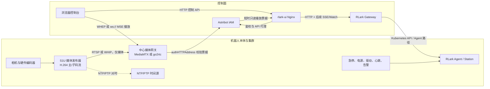

# RFC：面向 100+ 机器人相机的 H.264 媒体流架构

- 状态：提案，待机器人本体、中间件、后端、前端和运维评审
- 范围：以 Astribot S1U 和 RLark 控制台为首个落地对象，目标规模 100–500 台机器人
- 方案：H.264 + 独立媒体网关（MediaMTX / go2rtc）+ WebRTC 或 MSE
- 核心约束：媒体面与控制面、本体控制面严格解耦

本文描述目标架构，不表示仓库当前已经支持 H.264、WebRTC、WHEP、MSE 或播放票据。下文端口、配置名和资源数字是提案值，实施前须以选定组件版本、浏览器矩阵和压测结果定稿。

## 1. 背景与问题量化

### 1.1 当前实现

当前发布的 S1U 相机服务来自 `s1u-robot` Addon，在机器人所在集群的 `rlark-system` 命名空间中运行，服务端口为 `18891`。Gateway 注册只读路由 `GET /api/v1/rlinf.io/v1alpha1/nodes/{name}/cameras`、`.../cameras/{view}.jpg` 和 `.../cameras/{camera}/stream`，根据 Node 所属集群查找该 Node 上运行的 `s1u-robot` Pod，再通过 Kubernetes API Server 的 Pod proxy 转发到相机服务。现有响应是 JPEG/MJPEG，控制台会拉取状态、单帧 JPEG 或 multipart 流，并通过 `cameraMediaScheduler` 限制本地活动流数。Gateway 默认并发流上限为全局 64、单用户 12。

控制台部署在裸 IP HTTP 地址（例如 `http://10.11.14.128`），没有域名或 TLS 终止。UI Nginx 对 `/api/` 使用 IAM `auth_request`，鉴权成功后注入对应角色的 Gateway service-account Bearer token，并透传流式响应所需的 HTTP/1.1 Upgrade 与长超时设置。机器人局域网地址不应被浏览器直接访问，也不应将 Kubernetes API Server 当作媒体中继。

### 1.2 规模瓶颈

以下估算用于说明量级。MJPEG 单帧大小受分辨率、画面内容和质量设置影响，实施前应从实际机器人采样；此处用 720p JPEG 每帧 100–250 KB、每路 5–10 fps 估算。

| 瓶颈 | 假设和估算 | 影响 |
| --- | --- | --- |
| 浏览器 HTTP/1.1 连接 | 同源 HTTP/1.1 常见每浏览器约 6 条并发连接。若相机墙一屏 4 路、每路分别请求状态、快照或长连接，多个视图和后台请求会争抢连接槽位。HTTP/2 可缓解连接数，但不会降低媒体字节量或 Gateway 的逐帧处理。 | 100 个操作者各看 4 路会形成约 400 路观看订阅；同源长连接可让 API 请求排队，连接槽位也限制同一用户打开多机器人、多视图。 |
| MJPEG 带宽 | 100–250 KB/帧 × 5–10 fps = 每路约 4–20 Mbps。100 台同时推送约 0.4–2 Gbps，500 台约 2–10 Gbps，尚未计 TCP/IP、TLS 和重传开销。典型 H.264 子码流 0.3–1 Mbps，较 MJPEG 通常可降低约 10–20 倍，具体取决于场景、编码参数和画质。 | 若每路都持续采集/推送，即使无人观看也消耗机器人 CPU、USB/编码器和上行带宽。MJPEG 每帧独立 JPEG，缺少帧间预测压缩。 |
| Gateway / Kubernetes API Proxy | 当前每条流都经 Gateway -> 成员集群 Kubernetes API Server Pod proxy -> `s1u-robot:18891`，Gateway 按 64 KiB 缓冲并逐块 Flush。每名观看者都会占用一路端到端连接和 Gateway 代理协程/文件描述符。100 台各自 4 名观看者意味着 400 路重复中转，若单路 2 Mbps 即约 800 Mbps 中心出入流量；机器人源端也可能被重复拉取。 | API Server 与 Gateway 同时承担管理 API 和长时媒体字节转发，扩大故障面、连接数、带宽和反向代理压力。Gateway 当前限制只能拒绝超额请求，不能完成媒体扇出。 |

HTTP/1.1 的约 6 连接是常见浏览器行为而非所有浏览器的硬性标准。MSE/WebRTC 应改为媒体网关连接或有界订阅，并让调度器为多宫格分配低码率子码流。

## 2. 核心原则：媒体面与控制/本体面严格解耦

### 2.1 不可跨越的边界

本体信息和本体操作包括急停、电源、驱动、心跳、告警、控制指令、认领/释放以及入网。这些内容**绝不**进入 MediaMTX/go2rtc 的媒体协议、媒体 Token 或 DataChannel。它们继续通过 Gateway 控制面走 HTTP，后续需要事件推送时使用受控的 SSE/Watch 通道；在 Gateway/IAM 侧执行授权、审计、冲突处理和可靠状态读写。媒体网关不可代理或执行机器人控制指令，也不能成为控制器的依赖。

该边界保证视频网关故障、网络抖动或媒体订阅过载不会阻断急停和管理 API；控制面仍有审计主体、动作结果与授权链，媒体服务只承载授权后的只读图像流。播放票据签发只证明“此用户可在短时间内观看某视图”，不代表用户可以操作机器人。

### 2.2 目标架构

媒体源按需发布到中心网关，网关负责单源多人 Fan-out。控制台仍从 Gateway 获取相机能力、在线状态、故障诊断和采集时间等元数据，再向媒体网关建立独立播放会话。

### 2.3 唯一衔接点与 DataChannel 边界

媒体面与控制面只通过两个明确定义的衔接点相遇：

1. Astribot IAM 根据用户会话和 `admin` / `operator` / `viewer` 角色签发短时、只读播放票据。票据绑定 `cluster`、`node`、`view`、过期时间 `exp` 和签发者，媒体网关在建连时通过 `authHTTPAddress` 回调校验。票据不得复用 Gateway 的长效上游 service-account Token。
2. 视频采集时间戳与 Gateway 状态时间需要关联时，机器人与服务端使用 NTP/PTP 对时；流帧携带采集时间，前端在统一时间基准下显示状态与画面延迟。时钟偏差要可观测，不能仅依赖浏览器到达时间推断采集时间。

WebRTC DataChannel 只在单台机器人遥操作需要 50–100 Hz 低延迟输入时另行评估，且须复用独立的控制协议鉴权、序列号、过期、审计、急停语义和权限边界。百台机群看板只需要视频播放和低频状态 API，不使用 DataChannel 承载控制。

## 3. 端到端技术选型与对比

### 3.1 机器人端：S1U x86 / 边缘本体

- **编码**：优先使用硬件 H.264 编码。S1U x86 可评估 Intel VAAPI / QuickSync，具备 NVIDIA GPU 的边缘机评估 NVENC；必须确认设备驱动、容器设备映射、编码实例数、温度与持续运行能力。CPU 软件编码仅作为低路数兼容路径，并设定 CPU 上限。
- **双码流**：主码流 720p/1080p，仅在用户放大弹窗或单路查看时拉起；子码流 360p/480p、5–10 fps 用于监控墙。不同相机型号可声明真实支持的档位，不能只在 UI 假定存在。
- **传输**：初始候选为机器人向中心媒体网关推 RTSP（实现简单、TCP/UDP 选择灵活），或以 WHIP 发布 WebRTC（NAT/实时性更好，但需要确认目标网关版本、鉴权和重连语义）。如果由媒体网关按需反向拉 RTSP，需网络允许中心到机器人入站，且不符合默认的机器人主动出站网络模型。应优先机器人出站推流，并让媒体网关通过按需发布/发布许可策略控制会话。
- **On-Demand**：没有有效观看者时停止编码器和视频发布，做到零推流、零编码开销；首次观看时启动，最后一个观看者离开后经短暂宽限期停止，避免 UI 切换造成启停抖动。源端需处理媒体网关重启、断网重连和观看者竞态。
- **能力协商**：由 Gateway 可读的节点注解或能力资源声明编码格式、路径、主/子流、分辨率与播放模式。建议以明确字段表达，避免把动态 Secret 或媒体 URL 写入公开注解。

### 3.2 中心媒体网关：MediaMTX 与 go2rtc

| 比较项 | MediaMTX | go2rtc |
| --- | --- | --- |
| 单源多人扇出 | 面向多协议实时媒体服务器，RTSP、WebRTC/WHEP 等协议和按路径发布/读取适合独立媒体层。需验证选定版本的按需源与 reader 生命周期。 | 面向摄像头/流桥接，配置源和浏览器输出较轻便，具备 WebRTC 与 MSE 接入。需验证规模化 Fan-out、源拉起/停止条件与管理 API 暴露面。 |
| 源接入 | 机器人 RTSP 发布较自然；也可按版本能力评估 WHIP。可配置路径级发布权限与读取授权。 | RTSP、WebRTC 等源适配灵活；机器人发布协议、授权方式及连接重试须基于目标版本确认。 |
| 按需拉源 | 支持路径/源按读者需求连接的能力需结合版本和配置实测；避免对所有 100–500 台常驻拉源。 | 常用于按请求拉取/代理源，适合节省无人观看时资源；需验证读者断开后上游源是否按预期关闭。 |
| WHEP / MSE | 提供 WebRTC 浏览器播放入口；本次核对的官方文档未确认原生 MSE/fMP4 WebSocket 播放入口，不应假定 MediaMTX 自带该路径。若需要 MSE，应由 go2rtc 或专门的 fMP4/MSE 服务提供。 | 提供 WebRTC 与 MSE 浏览器播放，MSE 使用其 HTTP/API 服务的 WebSocket 接口；WHEP 兼容和实际协议能力应对照锁定版本，不能仅凭产品名称假定。 |
| 资源与运维 | 单一媒体服务职责明确，适合集中 Fan-out 与统一鉴权；部署规模、内存和 TURN 需求通过压测确定。 | 部署较轻、摄像头接入能力丰富；集中管理能力、API 安全和高并发上限须专门验证。 |

建议先以 MediaMTX 作为规模化媒体面候选，并用 go2rtc 做兼容性/资源对照试验后定案。任何选型都必须证明共享上游源的扇出，而不是让每个浏览器各自重新拉机器人源；验证掉线恢复、单节点重启、权限拒绝及 20 路并发观看。

### 3.3 裸 IP HTTP 下的浏览器播放与网络

现有控制台使用 `http://<IP>/`。浏览器以 HTTP 页面访问同源 WHEP 信令（普通 HTTP 请求）或 `ws://` MSE WebSocket，不会触发 HTTPS 页面连接不安全媒体端点的 mixed-content 阻断；`getUserMedia` 摄像头/麦克风采集要求安全上下文，本方案不需要浏览器采集。WebRTC 接收播放使用 `RTCPeerConnection` 和 ICE，不调用 `getUserMedia`，常见桌面浏览器可在 HTTP 页面完成接收播放。由于该项目的浏览器版本尚未在仓库中锁定，裸 IP、不同浏览器版本、企业策略和目标 WHEP 客户端必须做实际验收，不能把这一点当成所有嵌入式 WebView 的保证。

优先将播放入口通过现有 UI Nginx 暴露为同源路径，例如 `/media/whep/<opaque-path>` 与 `/media/mse/<opaque-path>`，再反代到内网媒体网关。若直接暴露媒体网关，则 WHEP HTTP 和 WebSocket 都需匹配页面的协议、主机与端口策略，并配置 CORS、Origin 校验和鉴权，不能让 `http` 页面连接不受信任的公网端点。`ws://` 应限于受控内网；跨网部署推荐 TLS 域名和 `wss://`。

在无公网 STUN/TURN 的同一可路由内网，ICE host candidate 通常可直连。MediaMTX 默认 WebRTC HTTP/WHEP listener 为 TCP 8889，默认 ICE UDP listener 为 8189；TCP ICE listener 可配置为 8189，但默认关闭，且拥塞时 TCP 的实时性通常较差。配置 `webrtcAdditionalHosts` 或相应接口地址，让客户端拿到可路由的内网地址，并按部署拓扑开放 UDP 8189。企业网络阻断 UDP 时，显式启用 TCP ICE listener 并开放其端口，或回退同源 `ws://` MSE。go2rtc 默认 HTTP/API（同时承载 WebSocket/MSE）为 TCP 1984，RTSP 为 TCP 8554，WebRTC 使用 TCP/UDP 8555。Nginx 同源反代可隐藏 HTTP/WebSocket 上游端口，但不能替代 WebRTC ICE 媒体端口的网络可达性。未配置公网 STUN 时不要假设跨 NAT/跨站点一定可达；跨站点需路由/VPN 或受控 TURN 中继。

前端适配以 `cameraMediaScheduler` 的现有授予/撤销和优先级机制为入口：调度器获准后申请票据并建立 WebRTC/MSE 播放器，撤销时关闭 PeerConnection/WebSocket、释放票据相关资源；弹窗 `dialog` 优先于 `pinned`，再优先于 `card`。调度器当前默认最多 3 路活动流，应由配置和服务端策略共同约束，快照回退仍使用 `cameraFramePath`。播放器适配层需统一暴露 `start`、`stop`、首帧、采集时间、重连和错误事件，使 UI 状态沿用现有 `cameras.ts` 的视图/能力模型。

### 3.4 安全与鉴权：衔接 Scheme B

现有入口链路是 `rlark-ui` Nginx -> Astribot IAM `/_iam_api` 内部授权 -> Gateway；IAM `/internal/authorize` 根据会话与 `admin` / `operator` / `viewer` 判断方法和路径，再返回对应角色上游 Token。Gateway 相机 GET 路由为已登录用户开放只读读取，读取 Node 时仍执行租户对象授权。IAM 现有接口没有媒体票据或媒体网关 `authHTTPAddress` 回调处理。

建议的 Scheme B 流程如下：

1. 浏览器调用新增的 Gateway 播放票据签发 API，并携带现有 IAM 会话。请求包括 `cluster`、`node`、`view` 和期望播放协议，不接受客户端指定媒体 URL。
2. IAM 验证会话未过期、账号未禁用、角色为允许观看的 `admin` / `operator` / `viewer`，并由 Gateway 校验该用户对目标 Node 的租户可见性、Node 所属 `cluster` 及能力声明中的视图。租户边界不能由前端过滤替代。
3. IAM 或 Gateway 生成不可伪造、短时（建议 30–120 秒）且只读的票据，至少绑定 `cluster`、`node`、`view`、`exp`、签发者和随机唯一标识。不得含有机器人控制权限或长效上游凭证。URL/query 中出现的票据需采用单次/短时策略，并避免写入访问日志、Referer 和浏览器持久存储。
4. 浏览器通过媒体 URL 建立 WebRTC/MSE 会话。媒体网关以 `authHTTPAddress` 回调 IAM 专用内部端点，提交票据、媒体路径、协议和动作（publish/read）。IAM 验签/查验有效期与资源绑定，并只允许 read；发布端身份由单独的机器人凭据或网络 ACL 校验，不能使用浏览器播放票据发布。
5. Nginx 对新增票据 API 按 `/api/` 现有 `auth_request` 链路授权；媒体回调仅在内部网络可达，不公开绕过 Nginx 的 IAM 管理接口。媒体网关应拒绝无票据、过期、路径不匹配、角色不允许及发布动作，审计失败原因但不记录票据原文。

播放票据有效期需覆盖连接建立。长时间播放的续期由前端在到期前重新申请并无缝切换，或由网关验证后授权现有会话续期。撤销用户会话与立即断开已建立媒体会话的语义需要评审拍板，不能假设短时票据自动提供即时撤销。

## 4. 部署与网络变更清单

以下是面向 `astribot/release/control-plane/rlark.compose.yaml` 和 `astribot/release/rlark-ui.nginx.conf` 的拟议变更，文件本身在本 RFC 中不修改。

- 在 Compose 增加独立媒体服务容器，镜像版本固定并纳入发布物校验；挂载只读配置和 TLS/签名信任材料，配置健康检查、重启策略、日志轮转、CPU/内存限制及优雅退出。媒体服务与 Gateway 共用内网网络，但分别设置访问控制。
- 为 Nginx 配置媒体 HTTP/WHEP 与 WebSocket MSE 反代位置，设置 Upgrade、长读超时、关闭响应缓冲、正确传递 Host/Origin 和播放票据。外部页面仍可保持裸 IP HTTP 部署，但这是受限内网场景；公网或跨不可信网络应启用 TLS。
- 以 MediaMTX 方案初估：默认 WHEP/HTTP 8889/TCP、ICE UDP 8189；ICE TCP 可配置在 8189，但默认关闭。MediaMTX 方案暂按 WebRTC 播放设计，不把 MSE 当作其内建能力。若选择 go2rtc 提供 MSE，其默认 HTTP/API 与 MSE WebSocket 为 1984/TCP、WebRTC 为 8555/TCP+UDP、RTSP 为 8554/TCP。最终映射仍以锁定镜像版本和实测配置为准。MSE 若经 Nginx 同源 WebSocket，可不另开放浏览器可见的媒体 HTTP 端口；WebRTC ICE 媒体端口仍须从浏览器网段可达。机器人 RTSP/WHIP 发布端口只对机器人网段与媒体网关开放。
- 禁止将媒体网关管理 API、源发布端口和无鉴权播放端点暴露到用户网段或公网。Gateway 19000:8080 和 UI 80:80 是当前 Compose 映射，媒体端口应按网络部署模型单独评审。

### 4.1 资源预算初值

规划基线为 100 台机器人在线，20 路并发观看，观看流以 480p 子码流 0.3–0.8 Mbps 为主，每个操作者的媒体订阅由前端调度器限流。网关需将每个机器人源拉取/接收一次并 Fan-out，不能每个观看者重建一个机器人上游连接。

| 项目 | 估算区间 | 说明 |
| --- | --- | --- |
| 观看下行带宽 | 6–16 Mbps 媒体有效载荷，建议预留 10–25 Mbps | 20 × 0.3–0.8 Mbps，含协议开销与短时码率峰值余量。 |
| 机器人上行媒体 | 约 30–80 Mbps，若 100 路子码流均持续发布 | On-Demand 应使未观看源不发送数据；实际值由同时观看的机器人数量决定。 |
| 媒体网关 CPU | 初始压测机型 4 vCPU，按 20 路 WebRTC 转发验证 | 若只做转发，主要成本是协议、加密和连接数；转码会显著改变预算，首期避免服务端转码。 |
| 媒体网关内存 | 初始 4–8 GiB 预算 | 取决于活跃源数、观看者数、缓冲和 WebRTC 会话数量。 |
| Gateway / Kubernetes API Proxy | 预期媒体字节从其路径移除 | Gateway 仍处理能力/状态查询、Node 授权与票据签发，不再代理连续视频帧。 |

这些数值不是 SLA。验收测试至少覆盖 20 路并发、100 路源注册、扇出倍率、首帧时延、弱网重连、CPU/内存、NIC 吞吐、UDP 丢包、TCP fallback、票据拒绝和媒体服务重启恢复。另以 500 台注册规模验证连接/配置和无人观看时的资源占用。

## 5. 渐进迁移与回滚

1. **能力声明与观测**：机器人按 capability/annotation 声明 `h264`、主/子流和传输能力。先以只读探测和小规模试点采集硬编成功率、源在线率、首帧时间、码率和网关负载，不改变现有 MJPEG 默认路径。
2. **双轨灰度**：前端检测节点能力后优先尝试 WebRTC/MSE；票据拒绝、ICE 失败、编解码不兼容或首帧超时后自动回退现有 MJPEG，并保留现有 JPEG 抽帧/快照状态路径。未声明 H.264 的旧机器人继续走旧路径。
3. **逐步扩面**：按机器人 capability、站点或百分比放量，设置服务端并发、用户配额和可观测指标。确认 Gateway/Kubernetes API Proxy 的 MJPEG 流量下降、媒体网关 Fan-out 正常，再提高 H.264 比例。
4. **回滚**：前端可通过发布配置关闭 H.264 优先逻辑，立即全部回到 MJPEG；机器人端停止发布/编码并回退旧相机容器版本；媒体容器可独立停止或回滚，不触碰 Gateway 控制 API 和机器人控制通道。回滚前维持兼容旧机器人与 MJPEG 路由，直到全量稳定并完成退役评审。

回滚开关必须是可审计的发布配置或功能开关，默认关闭/开启策略由灰度阶段确定；不要以长期双写把控制面重新变成媒体代理。

## 6. Review Checklist

### 本体 / 嵌入式组

- S1U x86 实际 CPU、GPU、驱动和容器权限下，VAAPI/QuickSync/NVENC 各自能否持续运行几路 H.264 编码？功耗、温度和 CPU 预算是什么？
- 主码流与 360p/480p 子码流的分辨率、帧率、码率、GOP/关键帧间隔及相机视图映射应如何定为 capability 契约？
- On-Demand 编码启停由谁触发与仲裁，采用机器人出站 RTSP/WHIP 哪条路径，断网或网关重启后如何重连并保证无人观看时停流？

### 后端 / 基础设施组

- 播放票据由 IAM 直接签发还是由 Gateway 发起授权后签发？如何绑定 `cluster/node/view/exp`、支持撤销和续期，并避免票据进入日志？
- MediaMTX 与 go2rtc 的最终选择是什么？选定版本的 `authHTTPAddress` 请求格式、WHEP/MSE 支持、Fan-out、按需源和 HA 行为如何通过集成测试证明？
- 当前租户 Node 授权逻辑如何复用到票据签发，媒体网关回调如何获得权威的 Node/cluster 状态，避免仅依赖客户端路径或可伪造标签？

### 前端组

- `cameraMediaScheduler` 的全局默认并发 3 路是否适用于媒体服务，调度单位按机器人还是视图，主/子码流和弹窗优先级如何选择？
- WebRTC/WHEP 与 `ws://` MSE 的首选顺序、浏览器兼容矩阵、超时与自动回退阈值如何定义？裸 IP 部署是否覆盖目标 Chromium/Firefox 版本？
- 首帧、采集时间戳、重连、权限过期和错误状态如何接入现有 `cameras.ts` 状态模型，并确保关闭视图释放 PeerConnection/WebSocket？

### 运维 / 网络组

- 控制面宿主机和站点网络能否为 WebRTC UDP 8189 配置允许的入站/出站规则？是否需要 TCP fallback、VPN 路由或 TURN，以及各自成本？
- 播放路径是否统一经 Nginx 同源反代？裸 IP HTTP 与跨站点访问的边界、TLS 终止、Origin/CORS、管理端口隔离如何落地？
- 100 台在线、20 路并发和 500 台注册的压测环境、带宽/CPU/内存告警阈值、媒体服务故障演练与发布回滚责任人是谁？

### 核对来源

- [MediaMTX WebRTC connectivity 配置说明](https://mediamtx.org/docs/usage/webrtc-specific-features)：内网额外公布地址、UDP 8189、TCP ICE listener 配置与 STUN/TURN 行为。
- [MediaMTX 当前配置参考](https://mediamtx.org/docs/references/configuration-file)：当前文档版本列出 WebRTC HTTP 地址 `:8889`、UDP 地址 `:8189`，TCP listener 默认空值关闭。
- [go2rtc 官方仓库 README](https://github.com/AlexxIT/go2rtc)：默认 API 1984/TCP、RTSP 8554/TCP、WebRTC 8555/TCP+UDP。
- [MDN getUserMedia](https://developer.mozilla.org/en-US/docs/Web/API/MediaDevices/getUserMedia)：浏览器本地摄像头/麦克风采集需要安全上下文；该限制与远端视频接收播放不同。
